## Scientific scope and levels of evidence {#scope .layout-statement}

::: {.slide-eyebrow}
01  /  Context
:::

::: {.statement-grid}

::: {.statement-metric}

04

independent exposure studies

:::

::: {.statement-copy}
- **Question:** which regional expression patterns accompany the original mouse exposure experiments?
- **Reproduction:** recover deposited author results using the same source animals.
- **Project extensions:** new primary contrasts, enrichment, interactions and spatial-reference models.
- **Spatial interpretation:** measured unexposed cells, fitted reference estimates and an illustrative PM₂.₅ scenario remain separately identified.
:::

:::

::: {.source}
Scientific references[Rajagopalan et al., JCI 2020](https://doi.org/10.1172/JCI137315) · [Zhang et al., Science 2025](https://doi.org/10.1126/science.adu4132) · [Nakamya et al., IJMS 2025](https://doi.org/10.3390/ijms26062407)
:::

::: {.notes}
This is a defense-style presentation of completed computational work, not a claim of a new animal experiment or independent biological replication. “New” means added by this project, not proven biological novelty. The analyses and reference outputs were completed on 18–20 October 2026; this presentation was prepared on 28 October 2026. The data do not contain matched pollutant-exposed spatial or single-cell brains. No NO₂ expression matrix enters the four analyzed studies. Use the Notes button for the complete methodological discussion, arrow keys to navigate, Esc for overview and S for the optional speaker window. The two languages share explicit slide identifiers.
:::

## Brain regions and exposure designs define the question {#intro}

::: {.slide-eyebrow}
01  /  Context
:::

Regional RNA measurements can identify expression associations under a particular route, dose, genotype and age.

The project addresses three linked questions:

1. Can the deposited author analyses be reconstructed?
2. What do explicitly specified reanalyses and response-interaction tests show?
3. Where are prioritized transcripts detected in an independent measured brain reference?

::: {.source}
Scientific references[Rajagopalan et al., JCI 2020](https://doi.org/10.1172/JCI137315) · [Zhang et al., Science 2025](https://doi.org/10.1126/science.adu4132) · [Nakamya et al., IJMS 2025](https://doi.org/10.3390/ijms26062407)
:::

::: {.notes}
The background is deliberately brief. The four primary papers motivate hypothalamic, cortical and hippocampal questions involving particulate matter and ozone, but their routes and units are not interchangeable. An exposure association in bulk tissue may reflect regulation, tissue composition, source-quality variation or combinations of these. Spatial reference anatomy helps locate baseline detection, but cannot identify which individual cells responded in the original experiment. This presentation prioritizes the computational evidence and the limits needed to defend each inference.
:::

## Two PM₂.₅ RNA-seq studies {#studies-rna .layout-study}

::: {.slide-eyebrow}
01  /  Context
:::

| Feature | Hypothalamus | Anterior cingulate cortex |
|---|---|---|
| Deposit | GSE145840 | GSE297423 |
| Primary animals | 4 FA + 3 PM | 4 PBS + 4 PM |
| Model / context | Male C57BL/6J, chow-fed | Humanized hWT α-synuclein, sex unreported |
| Exposure route | Concentrated ambient aerosol inhalation | Repeated intranasal PM suspension |
| Starting material | Seven deposited gene-count files | Eight selected libraries from a 20-library matrix |
| Primary inference | PyDESeq2, PM versus FA | PyDESeq2, PM versus PBS |

::: {.source}
Scientific references[Rajagopalan et al., JCI 2020](https://doi.org/10.1172/JCI137315) · [Zhang et al., Science 2025](https://doi.org/10.1126/science.adu4132)
:::

::: {.notes}
FA means filtered air, whereas PBS is the cortex vehicle control. The four HFD hypothalamus libraries are not additional FA controls. The cortex RNA-seq arm begins at two months in humanized hWT α-synuclein mice; it must not be conflated with the paper's distinct older conventional-mouse arm. Both primary reanalyses start from deposited counts, so read alignment and read-level QC were not independently reconstructed. Detailed exposure protocols and platform information appear in the appendix.
:::

## Hippocampal miRNA and ozone studies {#studies-hippocampus .layout-study}

::: {.slide-eyebrow}
01  /  Context
:::

| Feature | PM₂.₅ miRNA | Ozone RNA-seq |
|---|---|---|
| Deposit | GSE93967 | E-MTAB-14917 |
| Sequenced / assayed animals | 9 arrays, 3 per group | 24 animals, 3 in each of 8 strata |
| Design | Saline, 1 or 5 mg/kg PM | 2 ages × 2 APOE genotypes × 2 exposures |
| Assay | Agilent miRNA V19 microarray | Paired-end left-hippocampus RNA-seq |
| Input | Deposited quantile-normalized signal | Original FASTQ pairs |
| Scale | Original signal units | Estimated gene fragments + length offsets |

::: {.source}
Scientific references[Ku et al., Part. Fibre Toxicol. 2017](https://doi.org/10.1186/s12989-017-0215-3) · [Nakamya et al., IJMS 2025](https://doi.org/10.3390/ijms26062407)
:::

::: {.notes}
The miRNA experiment uses oropharyngeal aspiration, not an ambient airborne dose. The ozone ages 3 and 17 months describe exposure onset. Its paper-wide animal numbers are not the transcriptomic sample size: only three sequenced mice per age/genotype/exposure stratum enter this analysis. APOE3/APOE4 are human targeted-replacement genotypes. Mouse-reference quantification does not establish allele-specific human APOE expression. The miRNA scale has signed values and an uncertain log2 preprocessing history, so no second log transform or count likelihood was imposed.
:::

## Experimental units and analytical populations {#units .layout-statement}

::: {.slide-eyebrow}
01  /  Context
:::

::: {.statement-grid}

::: {.statement-metric}

01

unexposed spatial donor

:::

::: {.statement-copy}
- **Bulk and arrays:** the sequenced or assayed animal is the biological replicate.
- **Author reproduction:** the same deposited animals supply computational agreement.
- **Spatial reference:** 52,393 ACA/HY cells come from one unexposed donor.
- **Spatial validation:** reserving sections measures within-donor prediction.

No pooled pollutant dose, cross-study effect or independent-cell exposure test is estimated.
:::

:::

::: {.source}
Scientific references[Rajagopalan et al., JCI 2020](https://doi.org/10.1172/JCI137315) · [Zhang et al., Science 2025](https://doi.org/10.1126/science.adu4132) · [Nakamya et al., IJMS 2025](https://doi.org/10.3390/ijms26062407)
:::

::: {.notes}
This slide prevents pseudoreplication. Thousands of cells do not replace independent exposed and control animals. The spatial folds are useful for checking prediction at unsampled reference sections, but they cannot validate across donors or exposures. A repeated gene–cell evaluation in a ten-gene pooled score is not ten new cells. Similarly, fitting another software implementation to the same seven animals does not create a new experiment.
:::

## Bulk contrasts and spatial cells answer different questions {#explain-bulk-spatial .explanation-slide}

::: {.slide-eyebrow}
01  /  Context
:::

**Exposure comparison.** Bulk RNA-seq combines RNA from many cells in each sampled region. The animal supplies the independent replicate. A regional difference can reflect expression within cells, changes in cellular composition, or both.

**Spatial reference.** MERFISH counts a targeted gene panel at measured cell positions in one unexposed donor. It shows where a transcript is detected in that reference.

**Connection.** We map regional candidates onto the measured panel. The atlas supplies anatomical context, while the separate exposure experiment supplies the regional contrast.

::: {.source}
Scientific references[Rajagopalan et al., JCI 2020](https://doi.org/10.1172/JCI137315) · [Zhang et al., Science 2025](https://doi.org/10.1126/science.adu4132) · [Zhang et al., Nature 2023](https://doi.org/10.1038/s41586-023-06808-9)
:::

::: {.notes}
The atlas and exposure studies have different animals, assays and estimands. Spatial cells cannot be assigned the pollution label of an animal from another experiment. Increasing the number of reference cells improves description within the donor but does not increase the number of exposed biological replicates. The measured panel also limits which regional candidates can appear on a spatial map. Missing panel genes remain missing rather than receiving invented coordinates or expression.
:::

## Project workflow and provenance {#workflow .figure-slide .figure-interpretation}

::: {.slide-eyebrow}
01  /  Context
:::

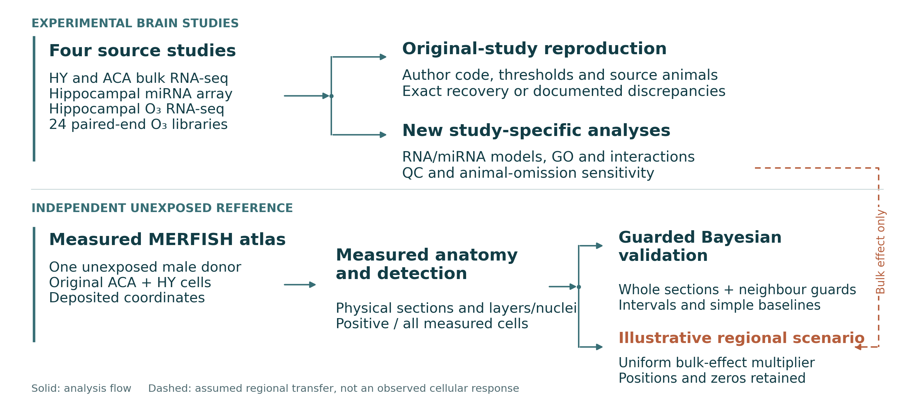{fig-alt="Follow the upper branch from exposure data to author reproduction and new study-specific analyses. The lower branch starts with an independent, unexposed MERFISH donor. Its measured anatomy supports reference modeling. The dashed regional bulk-effect transfer enters only the illustrative scenario, so the diagram does not imply measured cellular exposure responses." width=100%}

::: {.figure-caption}
Follow the upper branch from exposure data to author reproduction and new study-specific analyses. The lower branch starts with an independent, unexposed MERFISH donor. Its measured anatomy supports reference modeling. The dashed regional bulk-effect transfer enters only the illustrative scenario, so the diagram does not imply measured cellular exposure responses.
:::

::: {.viewer-links}
[Interactive hypothalamus slide](#hy-3d){.inline-slide-link data-map-slide="hy-3d" target="_self"} · [Interactive cortex slide](#aca-3d){.inline-slide-link data-map-slide="aca-3d" target="_self"}
:::

::: {.source}
Analysis: this project[Rajagopalan et al., JCI 2020](https://doi.org/10.1172/JCI137315) · [Zhang et al., Science 2025](https://doi.org/10.1126/science.adu4132) · [Nakamya et al., IJMS 2025](https://doi.org/10.3390/ijms26062407)
:::

::: {.notes}
Inputs, sample mappings, models and results have retained identifiers, hashes and downloadable tables. The ozone branch begins with original reads; PM bulk starts with supplied counts and miRNA with deposited normalized arrays. Author reproduction and primary reanalysis remain distinct. Gene prioritization connects regional results to measured panel coverage, and the atlas supports observed sections, illustrative scaling and baseline models. The arrows describe processing order, not a biological causal diagram.
:::

## Fosb across the experimental and spatial analyses {#explain-gene-trace .explanation-slide}

::: {.slide-eyebrow}
01  /  Context
:::

**Regional evidence.** The eight-animal ACA comparison estimates higher Fosb RNA after PM exposure. Its shrunken log₂ fold change is +0.99711, corresponding to a 1.996-fold multiplier.

**Measured reference.** The separate atlas detects Fosb in 1,418 of 14,582 ACA cells. Original coordinates place these detections within the registered anatomy.

**Illustrative display.** Multiplying every reference value by 1.996 changes the color and magnitude while preserving positions and measured zeros. This assumption illustrates the regional estimate without identifying the cells that actually respond to PM.

::: {.source}
Scientific references[Zhang et al., Science 2025](https://doi.org/10.1126/science.adu4132) · [Zhang et al., Nature 2023](https://doi.org/10.1038/s41586-023-06808-9) · [Love et al., Genome Biol. 2014](https://doi.org/10.1186/s13059-014-0550-8)
:::

::: {.notes}
Fosb is a concrete example linking the project's primary count analysis, measured panel and viewer. The primary model uses four PBS and four PM animals. The atlas denominator is all measured ACA cells, including measured zeros, and comes from one unexposed donor. A positive bulk coefficient does not imply activation in every Fosb-positive cell. Protein abundance, AP-1 activity, isoform-specific FosB versus ΔFosB effects and causal mechanisms are outside what the gene-level RNA measurement establishes.
:::

## Methods {#methods .section-slide data-background-color="#103d49"}

::: {.slide-eyebrow}
02  /  Methods
:::

Original-study reconstruction, new statistical analyses and measured spatial reference

::: {.notes}
The next block defines what each model estimates before showing results. Detailed assumptions and source links remain available in notes and the appendix.
:::

## Criteria for computational reproduction {#reproduction-criteria}

::: {.slide-eyebrow}
02  /  Methods
:::

| Layer | Comparison | Interpretation |
|---|---|---|
| Inputs | Identifiers, counts, samples and source hashes | Verify the same analytical starting point |
| Model | Design, normalization, filter and multiplicity family | Reconstruct the stated procedure |
| Outputs | Feature identities, effects, p values and selected sets | Counts alone are insufficient |
| Missing specification | Unrecovered parameters and altered quantification | Report sensitivity or concordance explicitly |

::: {.source}
Scientific references[Rajagopalan et al., JCI 2020](https://doi.org/10.1172/JCI137315) · [Zhang et al., Science 2025](https://doi.org/10.1126/science.adu4132) · [Nakamya et al., IJMS 2025](https://doi.org/10.3390/ijms26062407)
:::

::: {.notes}
The analysis distinguishes exact output reconstruction from a transparent substitute workflow. Exact recovery applies only to the output layer actually checked. It does not imply recovery of raw-read alignment, histology, protein experiments or every figure. Missing parameters are not selected after inspecting which setting maximizes agreement. This project preserves disagreements and source-quality questions alongside successful numerical reconstruction.
:::

## Numerical recovery and independent biological validation {#explain-reproduction .explanation-slide}

::: {.slide-eyebrow}
02  /  Methods
:::

**Numerical recovery** asks whether the same deposited inputs and analysis rules recover the authors' effects, probabilities and selected genes. Cortex recovers all four tested significant-gene sets exactly.

**Methodological sensitivity** asks what changes when a model, filter or analytical population changes. Hypothalamic reconstruction remains incomplete because key RUVg specifications are unavailable.

**Independent biological validation** would require additional animals or experiments. Reanalyzing the source animals, even with another software package, checks computation and assumptions while leaving the biological sample size unchanged.

::: {.source}
Scientific references[Zhang et al., Science 2025](https://doi.org/10.1126/science.adu4132) · [Rajagopalan et al., JCI 2020](https://doi.org/10.1172/JCI137315)
:::

::: {.notes}
Identical gene counts alone are a weak reproduction criterion because different sets can have the same size. The cortex comparison also checks identities, effect estimates, p values and selected-set Jaccard. This is strong evidence for recovery of the checked count-level output, not validation of every experiment in the source article. Source metadata concerns remain relevant even when calculations match. Transparent nonagreement and explicit missing specifications are scientific results of a reproduction audit rather than reasons to tune an analysis until it matches.
:::

## Cortex author-aligned count analysis {#cortex-author-method .small}

::: {.slide-eyebrow}
02  /  Methods
:::

1. Match the original Zenodo count matrix to the GEO deposit.
2. Retain all **20 libraries in five treatment groups**.
3. Keep genes with ≥10 counts in ≥4 libraries: **21,388 genes**.
4. Reconstruct R DESeq2 with design <code>~group</code>.
5. Preserve default independent-filtering α = 0.1, then select **BH q < 0.05**.
6. Reconstruct the code-defined PCA using TMM log₂CPM, top 500 variable genes and variance scaling.

::: {.source}
Scientific references[Zhang et al., Science 2025](https://doi.org/10.1126/science.adu4132)
:::

::: {.notes}
The five arms are PBS, nasal PM, PFF inoculation, PM-PFF inoculation and PM-PFF plus nasal PM. They do not constitute a standard complete PM×PFF factorial because the inoculated materials differ. The repository reimplements the relevant code rather than running an arbitrary downloaded script wholesale. The source prose mentions filterByExpr but the deposited executable workflow uses an explicit count filter; this discrepancy is documented. R DESeq2 alpha controls independent-filter threshold selection; the final gene-set gate remains q<.05. Do not replace this 20-animal reconstruction with the eight-animal project primary result.
:::

## Hypothalamic RUVg specification remains incomplete {#hypothalamus-author-method}

::: {.slide-eyebrow}
02  /  Methods
:::

The paper describes lane normalization, empirical controls and RUVg before downstream testing.

- The exact **5,000 negative-control genes** and unwanted-factor count **k** are unavailable.
- A declared sensitivity uses all 11 FA/PM/HFD libraries with TMM/voom and limma, **without invented RUVg factors**.
- Shared source universe: 50,417 features. Exclude 91 HFD-only rows rather than invent zeros.
- GENCODE M13 coding filter + CPM filter yields 13,398 tested genes.

::: {.source}
Scientific references[Rajagopalan et al., JCI 2020](https://doi.org/10.1172/JCI137315)
:::

::: {.notes}
The sensitivity keeps CPM>2 in at least three libraries, then requires BH<.05, absolute log2FC>.8 and AveExpr>1. The paper's main and supplementary abundance wording differ, and the original negative-control selection is ambiguous. No substitute can uniquely recover the unavailable RUVg model. Therefore the sensitivity is a methodological comparison, not a failed exact reconstruction and not proof that the biology is absent. The separate seven-animal primary PyDESeq2 analysis does not include HFD.
:::

## miRNA target reconstruction and testing gates {#mirna-author-method}

::: {.slide-eyebrow}
02  /  Methods
:::

- Recover the prespecified Figure 6 target **mmu-miR-574-5p**.
- Preserve all nine arrays and the original normalized signal.
- Reconstruct ANOVA and pooled-MSE LSD pairwise comparisons.
- Distinguish an **unprotected pairwise test** from a **protected LSD procedure requiring omnibus significance**.
- Compare the target with the new moderated limma analysis and its array-wide BH family.

::: {.source}
Scientific references[Ku et al., Part. Fibre Toxicol. 2017](https://doi.org/10.1186/s12989-017-0215-3) · [Ritchie et al., NAR 2015](https://doi.org/10.1093/nar/gkv007)
:::

::: {.notes}
The paper gives general ANOVA/LSD language but not the complete GeneSpring array-specific gates or original heatmap feature selection. Consequently alternative readings of the testing sequence are shown. “Pairwise” refers to comparing independent groups, not paired animals. The original heatmap cannot be exactly reconstructed from an unknown row-selection rule. The arrays do not independently reproduce qPCR, ChIP, rescue, protein, BACE1 or behavior experiments.
:::

## Ozone table reconstruction and cross-pipeline comparison {#ozone-author-method}

::: {.slide-eyebrow}
02  /  Methods
:::

**Exact selection reconstruction**

The deposited E4/E3 table contains genotype effects. Apply its nominal p < 0.05 and |log₂FC| > 0.3 rule.

**Conditional effect concordance**

Compare exact-symbol finite effects from the new Salmon/tximport counts with published results. Reestimate candidate-model dispersions under their declared designs.

The original HISAT2/featureCounts pipeline, historical annotation and complete testing specification are not fully reconstructed.

::: {.source}
Scientific references[Nakamya et al., IJMS 2025](https://doi.org/10.3390/ijms26062407)
:::

::: {.notes}
The original genotype CSV is not an exposure count matrix. Other original comparisons use an absolute effect threshold .1, so thresholds are matched to each actual contrast. Two candidate genotype models are reported rather than selecting the one with the closest paper count. The 17-month ozone E4/E3 S3 comparison is conditional on the published selected genes and the same source animals. Neither a high correlation on that list nor an UpSet overlap supplies independent replication or an interaction test.
:::

## Negative-binomial model for RNA counts {#count-model .formula-slide .layout-equation}

::: {.slide-eyebrow}
02  /  Methods
:::

::: {.equation-grid}

::: {.equation-core}
$$K_{gi}\sim\mathrm{NB}(\mu_{gi},\alpha_g),\qquad
\operatorname{Var}(K_{gi})=\mu_{gi}+\alpha_g\mu_{gi}^{2}$$

$$\log\mu_{gi}=\log o_{gi}+\mathbf x_i^\top\boldsymbol\beta_g$$
:::

::: {.equation-detail}
- $K_{gi}$: assigned counts or rounded estimated fragments.
- $\alpha_g$: gene-specific dispersion, estimated with shrinkage.
- $o_{gi}$: normalization factor. Ozone additionally carries effective-length information.
- The design matrix defines the comparison before the test.
:::

:::

::: {.source}
Scientific references[Love et al., Genome Biol. 2014](https://doi.org/10.1186/s13059-014-0550-8) · [Muzellec et al. 2023](https://doi.org/10.1093/bioinformatics/btad547)
:::

::: {.notes}
This slide uses the usual natural-log GLM notation. Reported DESeq2 coefficients and effects are converted to log2 units. For the two simple PM contrasts, o_gi reduces to a sample size factor estimated from the retained counts. For ozone, DESeqDataSetFromTximport constructs gene/sample normalization from effective lengths plus depth, so treating every offset as only library size would misdescribe the implemented model. The likelihood accommodates overdispersion but does not automatically control unmeasured confounding or infer cell composition.
:::

## Normalization and dispersion in the count model {#explain-count-model .explanation-slide}

::: {.slide-eyebrow}
02  /  Methods
:::

**Normalization** accounts for technical differences in the amount of RNA sequenced. Otherwise, a deeply sequenced library could appear higher for many genes even without a biological change. Ozone also uses effective-length information from transcript quantification.

**Dispersion** describes variation among animals beyond ordinary count noise. A variable gene needs a larger, more consistent group difference to supply strong evidence.

**The coefficient** estimates the chosen regional comparison after these adjustments. Neither normalization nor dispersion estimation creates biological replicates or removes an unmeasured source of confounding.

::: {.source}
Scientific references[Love et al., Genome Biol. 2014](https://doi.org/10.1186/s13059-014-0550-8) · [Muzellec et al. 2023](https://doi.org/10.1093/bioinformatics/btad547) · [Soneson et al. 2015](https://doi.org/10.12688/f1000research.7563.2)
:::

::: {.notes}
DESeq2 and PyDESeq2 use negative-binomial count models with gene-specific dispersion estimation and information sharing. For the simple PM comparisons the normalization factor reduces to sample-specific size factors. The tximport ozone workflow adds gene/sample normalization from effective lengths, so a single library-size description would be incomplete. These count procedures do not apply to the signed, deposited miRNA continuous signals, which use limma. Low counts generally limit precision, and a retained zero remains an observation rather than a missing value filled by normalization.
:::

## Count filtering and normalization populations {#filters}

::: {.slide-eyebrow}
02  /  Methods
:::

| Analysis | Count filter | Retained genes | Fitted samples |
|---|---|---|---|
| HY primary | ≥10 in ≥3 | 19,611 | 7 |
| ACA primary | ≥10 in ≥4 | 19,235 | 8 |
| ACA author reconstruction | ≥10 in ≥4 | 21,388 | 20 |
| O₃ primary | ≥10 in ≥3 | 18,537 | 24 |
PM primary analyses use median-of-ratios size factors. Different fitted sample populations change the filter and dispersion estimates.

::: {.source}
Scientific references[Rajagopalan et al., JCI 2020](https://doi.org/10.1172/JCI137315) · [Zhang et al., Science 2025](https://doi.org/10.1126/science.adu4132) · [Nakamya et al., IJMS 2025](https://doi.org/10.3390/ijms26062407)
:::

::: {.notes}
These filters are applied to their specified analytical sample sets. The same numerical count threshold can retain different gene universes. Hypothalamus input has 50,417 symbols, cortex 56,748 Ensembl IDs, and ozone 54,347 gene summaries. Exact source identifiers remain intact. Retention does not guarantee a valid p value: Cook filtering, independent filtering or numerical validity may still withhold inference. Never equate the retained-gene denominator with the finite BH-tested family without checking the specific table.
:::

## Wald evidence, shrinkage and multiple testing {#testing .formula-slide .layout-equation .wide-equation}

::: {.slide-eyebrow}
02  /  Methods
:::

::: {.equation-core}
$$z_g=\frac{\widehat\beta_g}{\operatorname{SE}(\widehat\beta_g)},
\qquad \mathrm{CI}_{95\%}=\widehat\beta_g\pm1.959964\,\operatorname{SE}(\widehat\beta_g)$$

$$q_{(i)}=\min\!\left(1,\min_{j\ge i}\frac{m\,p_{(j)}}{j}\right)$$
:::

::: {.equation-detail}
- Original MLEs, SEs and p values define the Wald/BH evidence.
- apeglm-style shrunken effects support visualization and ranking stability.
- Pointwise intervals are not simultaneous or selection-adjusted.
- Each declared test family has its own multiplicity correction.
:::

::: {.source}
Scientific references[Love et al., Genome Biol. 2014](https://doi.org/10.1186/s13059-014-0550-8) · [Zhu et al. 2019](https://doi.org/10.1093/bioinformatics/bty895) · [Rajagopalan et al., JCI 2020](https://doi.org/10.1172/JCI137315)
:::

::: {.notes}
The BH expression describes the monotone adjusted p value among the finite valid tests in that family. A shrunken mode is not substituted into the original Wald statistic. Primary PM PyDESeq2 uses its documented apeGLM-style adaptive prior, whereas ozone and author-aligned R workflows use apeglm in R. These implementations are described separately rather than claimed identical. A nominal interval excluding zero can coexist with BH q>.05. Increasing or changing the family can change the correction in nontrivial ways; the across-family outputs remain separate analyses.
:::

## Effect size, uncertainty and the discovery threshold {#explain-testing .explanation-slide}

::: {.slide-eyebrow}
02  /  Methods
:::

**Effect size** describes direction and magnitude. A log₂ fold change of +1 corresponds to twice the regional RNA level, while −1 corresponds to half, under the fitted contrast.

**The standard error and Wald test** compare the estimated effect with its sampling uncertainty. A large fold change from inconsistent animals may have weak evidence.

**BH adjustment** evaluates many genes as a declared testing family. A nominal p < 0.05 can become q ≥ 0.05. Shrinkage stabilizes displayed effect estimates, while the stated inferential model determines the reported tests.

::: {.source}
Scientific references[Love et al., Genome Biol. 2014](https://doi.org/10.1186/s13059-014-0550-8) · [Zhu et al. 2019](https://doi.org/10.1093/bioinformatics/bty895)
:::

::: {.notes}
BH q values should not be described as the posterior probability that an individual gene is false. Under its assumptions, the procedure controls the expected false-discovery proportion among rejections at the chosen level. A pointwise 95% Wald interval is an approximate interval for one model coefficient, not a simultaneous interval for all genes or a per-cell interval. Different filtering populations and multiplicity families can change the discovery list even when underlying effects are similar. The MLE and shrunken effects are retained separately throughout the project.
:::

## Quality control and animal sensitivity {#qc}

::: {.slide-eyebrow}
02  /  Methods
:::

- For RNA-count inputs, verify nonnegative integers, exact IDs and sample assignments.
- Inspect library size, normalization, PCA and sample correlations.
- Preserve Cook-filtered inference and convergence flags.
- Retain all originally selected animals. PCA separation alone does not justify exclusion.
- Refit the HY primary model leaving one animal out at a time.
- Compare the fixed HY hypothesis across Python and R implementations.

::: {.source}
Scientific references[Rajagopalan et al., JCI 2020](https://doi.org/10.1172/JCI137315) · [Zhang et al., Science 2025](https://doi.org/10.1126/science.adu4132) · [Love et al., Genome Biol. 2014](https://doi.org/10.1186/s13059-014-0550-8)
:::

::: {.notes}
QC plots diagnose rather than certify absence of batch or identity problems. HY uses design-aware VST whereas ACA uses blind VST; both PCAs use 500 variable genes with mean centering and no variance scaling. These differ from the original cortex code's TMM logCPM PCA with scaling. The HY Cook status withholds 159 gene tests, not 159 animals. Count replacement requires at least seven replicates in an eligible group and is unavailable in the small primary PM groups. Leave-one-out variation is reported without choosing an omission that improves significance.
:::

## Linear modeling of deposited miRNA signals {#mirna-model .formula-slide .small .layout-equation .wide-equation}

::: {.slide-eyebrow}
02  /  Methods
:::

::: {.equation-core}
$$y_{fi}=\mathbf x_i^\top\boldsymbol\beta_f+\epsilon_{fi},
\qquad \Delta_f=\beta_{f,\mathrm{PM}}-\beta_{f,\mathrm{Control}}$$
:::

::: {.equation-detail}
- 1,268 input rows → 21 controls/unannotated + 2 unusable rows excluded → **1,245 tested features**.
- limma design <code>~0+condition</code>, two pairwise contrasts and a separate omnibus moderated F test.
- Empirical Bayes: trend = TRUE, robust = FALSE.
- Keep 823 low-detection flags and negative signal values.
- Effects remain **mean differences in deposited signal units**.
:::

::: {.source}
Scientific references[Ku et al., Part. Fibre Toxicol. 2017](https://doi.org/10.1186/s12989-017-0215-3) · [Ritchie et al., NAR 2015](https://doi.org/10.1093/nar/gkv007)
:::

::: {.notes}
The deposited GeneSpring signal is quantile-normalized but its log2 preprocessing is not explicitly established. Negative values are retained because they are part of that supplied scale. A second transformation or a negative-binomial count model would invent a measurement model. Feature-level moderated SEs and t intervals use limma posterior residual variance and total degrees of freedom. BH runs separately across all retained features for each contrast and separately for the omnibus test. Detection flags provide context and do not remove features from the test family.
:::

## Ozone processing begins with all original reads {#ozone-raw-qc}

::: {.slide-eyebrow}
02  /  Methods
:::

1. Match 24 biological SourceNames to paired FASTQ runs and eight strata.
2. Inspect the first 200,000 read pairs per library with fastp.
3. Apply consistent adapter trimming to full libraries.
4. Retain full before/after QC. Disable quality, length, poly-G and duplicate filtering.
5. Process **532,781,354 paired fragments** across all 24 libraries.

Sampled Q30: 92.37–96.49%. All sequenced animals remain in the analysis.

::: {.source}
Scientific references[Nakamya et al., IJMS 2025](https://doi.org/10.3390/ijms26062407)
:::

::: {.notes}
The SDRF has two rows per animal because of paired files; biological counts deduplicate SourceName, not FASTQ rows. The mapping is independently checked against deposited metadata. A strain-string exception occurs for Sample1/ERR14708304 and is retained as a source-quality flag, not represented as a complete genotype confound. Initial QC is a prefix inspection rather than a random sample. Its adapter findings motivate full-library trimming. The fastp adapter-dimer behavior is documented even though other filtering is disabled.
:::

## Selective alignment and effective-length offsets {#ozone-quant}

::: {.slide-eyebrow}
02  /  Methods
:::

**Salmon 2.5.1**

GENCODE M25 transcriptome + whole GRCm38 primary-genome decoys. Automatic library type, sequence and GC bias models.

**tximport**

Estimated fragments and sample-specific abundance-weighted effective gene lengths. <code>countsFromAbundance = "no"</code>.

**DESeqDataSetFromTximport**

Gene/sample length normalization offsets enter inference. Mapping ranges from **72.31% to 88.33%**.

::: {.source}
Scientific references[Patro et al. 2017](https://doi.org/10.1038/nmeth.4197) · [Soneson et al. 2015](https://doi.org/10.12688/f1000research.7563.2) · [Nakamya et al., IJMS 2025](https://doi.org/10.3390/ijms26062407)
:::

::: {.notes}
This workflow differs deliberately from the original HISAT2/featureCounts pipeline. Selective alignment with genomic decoys reduces spurious transcript assignments but is not full reproduction of historical gene counts. TPM values are not used as a substitute for negative-binomial input counts. Effective gene lengths vary with transcript usage and enter the offsets. Mouse-reference counts cannot resolve human APOE allele-specific expression. Versions, reference hashes and all quantification checkpoints are preserved in the repository.
:::

## Eight-parameter ozone factorial model {#ozone-factorial .formula-slide .layout-equation .wide-equation}

::: {.slide-eyebrow}
02  /  Methods
:::

::: {.equation-core}
$$\log\mu=\log o+\beta_0+\beta_A A+\beta_G G+\beta_E E
+\beta_{AG}AG+\beta_{AE}AE+\beta_{GE}GE+\beta_{AGE}AGE$$
:::

::: {.equation-detail}
Define $A=1$ for 17-month onset, $G=1$ for APOE4 and $E=1$ for O₃.

- Full design: age × genotype × exposure.
- 24 animals, 3 in each of 8 strata. Design rank = 8.
- 18,537 retained genes.
- Fixed prefilter, Cook checks and validity masks. Adaptive independent filtering is disabled.
:::

::: {.source}
Scientific references[Nakamya et al., IJMS 2025](https://doi.org/10.3390/ijms26062407) · [Love et al., Genome Biol. 2014](https://doi.org/10.1186/s13059-014-0550-8)
:::

::: {.notes}
The model has residual information from 24 animals rather than eight group means. The mathematical GLM uses natural-log coefficients; reported DESeq2 response contrasts are in log2 units. Genes all-zero within a required stratum have the corresponding effect and p value withheld before BH, even if a numerical coefficient exists. No batch or RIN covariates were invented because deposited annotations do not supply them. The factorial analysis is a project reanalysis, not an exact reconstruction of the original authors' model.
:::

## Stratum effects and covariance-aware differences {#ozone-contrasts .formula-slide .layout-equation .wide-equation}

::: {.slide-eyebrow}
02  /  Methods
:::

::: {.equation-core}
$$\widehat\Delta=\mathbf c^\top\widehat{\boldsymbol\beta},
\qquad \operatorname{SE}(\widehat\Delta)
=\sqrt{\mathbf c^\top\widehat V\mathbf c}$$
:::

::: {.equation-detail}
| O₃ versus FA effect | Linear combination |
|---|---|
| 3M / E3 | $\beta_E$ |
| 3M / E4 | $\beta_E+\beta_{GE}$ |
| 17M / E3 | $\beta_E+\beta_{AE}$ |
| 17M / E4 | $\beta_E+\beta_{AE}+\beta_{GE}+\beta_{AGE}$ |

A difference between response effects requires its own contrast.
:::

::: {.source}
Scientific references[Nakamya et al., IJMS 2025](https://doi.org/10.3390/ijms26062407) · [Love et al., Genome Biol. 2014](https://doi.org/10.1186/s13059-014-0550-8)
:::

::: {.notes}
The covariance term matters: subtracting two estimated effects and treating their SEs as independent would be incorrect because both derive from the same fitted model. An equivalent eight-group parameterization supplies the single within-stratum coefficients used for apeglm display. New secondary response-difference tests preserve the original fitted dispersions and effective-length offsets. Their pointwise Wald intervals are not simultaneous and are not intervals for atlas cells.
:::

## Global exposure and response-heterogeneity tests {#ozone-lrt .formula-slide .layout-equation .wide-equation}

::: {.slide-eyebrow}
02  /  Methods
:::

::: {.equation-core}
$$D=2(\ell_{\mathrm{full}}-\ell_{\mathrm{reduced}})
\ \overset{H_0}{\approx}\ \chi^2_{\Delta df}$$
:::

::: {.equation-detail}
| Test | Removed terms under the null | df |
|---|---|---|
| Any exposure effect | E, AE, GE, AGE | 4 |
| Genotype-dependent exposure | GE, AGE | 2 |
| Age-dependent exposure | AE, AGE | 2 |
| Three-way interaction | AGE | 1 |

Separate BH families are reported, plus supplementary pooled-family corrections.
:::

::: {.source}
Scientific references[Nakamya et al., IJMS 2025](https://doi.org/10.3390/ijms26062407) · [Love et al., Genome Biol. 2014](https://doi.org/10.1186/s13059-014-0550-8)
:::

::: {.notes}
The global ozone LRT asks whether any exposure-associated coefficient is needed. The three secondary LRTs ask narrower response-heterogeneity questions. Their hypotheses, degrees of freedom and multiplicity families differ. A significant response in one stratum and a nonsignificant response in another do not demonstrate interaction. The signed single-contrast Wald tests answer different alternatives from multi-parameter LRTs and therefore need not yield nested discovery sets.
:::

## Interaction tests compare exposure effects directly {#explain-interaction .explanation-slide}

::: {.slide-eyebrow}
02  /  Methods
:::

**Within a stratum**, the model compares ozone with filtered air at one starting age and APOE genotype. Each stratum has only three animals per exposure group.

**An interaction** asks whether the ozone effect itself differs between ages or genotypes, using coefficient differences and their covariance. One significant stratum and one nonsignificant stratum do not answer that question.

**Here**, the joint age-dependent exposure LRT identifies eight genes under its own BH family, and one under BH pooled across the three joint heterogeneity tests. The conclusion depends on the stated test and family.

::: {.source}
Scientific references[Nakamya et al., IJMS 2025](https://doi.org/10.3390/ijms26062407) · [Love et al., Genome Biol. 2014](https://doi.org/10.1186/s13059-014-0550-8)
:::

::: {.notes}
The 24 RNA-seq samples form the eight age×genotype×exposure combinations with three animals each. The full factorial design has eight parameters and estimates all groups jointly. The four-degree-of-freedom exposure LRT and the two-degree-of-freedom age-dependent exposure LRT test different null hypotheses. Signed individual interaction contrasts also differ from the joint LRTs. Starting ages of three and seventeen months are source design labels at exposure onset. These labels should not be relabeled as terminal sampling ages.
:::

## GO over-representation uses a testable universe {#ora .formula-slide .layout-equation}

::: {.slide-eyebrow}
02  /  Methods
:::

::: {.equation-grid}

::: {.equation-core}
$$P(X\ge k)=\sum_{x=k}^{\min(K,n)}
\frac{\binom Kx\binom{N-K}{n-x}}{\binom Nn}$$
:::

::: {.equation-detail}
- $N$: unique mapped genes with finite adjusted DE p values.
- $n$: BH-significant foreground, up/down separately by MLE sign.
- $K$: GO-BP term members in that universe; $k$: overlap.
- Test 15–500-member terms. Keep zero-overlap terms at p = 1.
- BH across all eligible terms within each contrast/direction family.
:::

:::

::: {.source}
Scientific references[Subramanian et al., PNAS 2005](https://doi.org/10.1073/pnas.0506580102) · [Gene Ontology Consortium](https://geneontology.org/docs/go-enrichment-analysis/)
:::

::: {.notes}
Official frozen mouse GO Biological Process annotations use taxon10090, exclude NOT and propagate only is_a and part_of. Exact symbols or unique aliases map to canonical genes. Duplicate features choose the highest baseMean representative before looking at significance. The universe includes testable mapped genes without specific BP annotation, rather than restricting to well-annotated genes. These choices do not remove all detectability or gene-length bias. No miRNA target enrichment is claimed without an independently supported target map.
:::

## Ranked enrichment preserves weak coordinated signals {#gsea .formula-slide .layout-equation}

::: {.slide-eyebrow}
02  /  Methods
:::

::: {.equation-grid}

::: {.equation-core}
$$RS(t)=
\frac{\sum_{j\le t,\ j\in S}|r_j|}{\sum_{j\in S}|r_j|}
-\frac{\#\{j\le t:j\notin S\}}{N-|S|}$$
:::

::: {.equation-detail}
- Rank $r_j$: unshrunken Wald statistic with finite original p value.
- No gene-level BH or effect-size preselection.
- GSEApy prerank, weight 1, 1,000 gene-set permutations, fixed seed.
- NES and **algorithmic GSEA FDR** differ from ORA/BH.
- Shared genes and GO ancestry make enriched terms correlated.
:::

:::

::: {.source}
Scientific references[Subramanian et al., PNAS 2005](https://doi.org/10.1073/pnas.0506580102) · [Gene Ontology Consortium](https://geneontology.org/docs/go-enrichment-analysis/)
:::

::: {.notes}
The displayed formula gives the weight1 running enrichment score before sign-dependent extremum selection and normalization. Original p values must be finite even when a Wald statistic remains finite, to exclude Cook-filtered unreliable tests. Genes with a finite original p but missing adjusted p from independent filtering can remain in the rank. These are gene-set/label permutations, not phenotype permutations, and do not propagate full sample-level uncertainty or preserve gene–gene correlation. Permutation q=0 is a finite-simulation estimate, not a zero probability of error. Enrichment supports exploratory ranked associations, not demonstrated pathway activation or suppression.
:::

## ORA and GSEA use different evidence from the same contrast {#explain-enrichment .explanation-slide}

::: {.slide-eyebrow}
02  /  Methods
:::

**ORA** starts with genes passing a declared discovery gate and asks whether an annotation contains more selected genes than expected from the tested background. Its answer depends on the foreground and universe.

**GSEA** uses the signed gene ranking and can detect coordinated shifts even when few individual genes pass BH. The analysis uses the frozen ranked-test procedure and algorithmic FDR.

**Interpretation** concerns enrichment of annotated genes. A positive score follows the positive rank direction, while shared genes make related GO terms correlated. RNA enrichment alone does not measure pathway activity.

::: {.source}
Scientific references[Gene Ontology Consortium](https://geneontology.org/docs/go-enrichment-analysis/) · [Subramanian et al., PNAS 2005](https://doi.org/10.1073/pnas.0506580102)
:::

::: {.notes}
The project's ORA universe consists of mapped genes with finite adjusted p values and retains genes lacking a propagated biological-process annotation in the background. GSEA retains finite original p values and signed Wald statistics, including finite-p genes excluded by independent filtering from adjusted-p reporting. These universes and null procedures differ. Algorithmic preranked GSEA FDR is neither BH q nor a phenotype-permutation result. No enrichment result here establishes causal regulation, protein activity, spatial connectivity or an independent mechanism for each correlated GO term.
:::

## A measured spatial reference from one donor {#atlas}

::: {.slide-eyebrow}
02  /  Methods
:::

| Reference feature | ACA | HY |
|---|---|---|
| Measured cells | 14,582 | 37,811 |
| Physical sections | 18 | 20 |
| Cell classes | 16 | 26 |
| Anatomical subdivisions | 10 | 49 |
| Occupied 100 µm bins | 1,656 | 3,772 |
Zhuang-ABCA-2: one unexposed adult male, one registered hemisphere, **1,122 measured MERFISH genes**.

::: {.source}
Scientific references[Zhang et al., Nature 2023](https://doi.org/10.1038/s41586-023-06808-9)
:::

::: {.notes}
The reference is selected from a larger atlas, but the project uses this specific donor to preserve cell identity, imaging counts and coordinates. All 52,393 ACA/HY cells are retained without subsampling. ACA includes ACAd and ACAv, each with layers1,2/3,5,6a,6b. HY has 49 nuclei/subregion labels, including HY-unassigned and ZI-unassigned, so it is incorrect to call all49 named nuclei. The atlas annotations originate from the source workflow; reference expression and metadata are not matched controls for the source pollution animals.
:::

## Deposited section coordinates and registered anatomy {#coordinates}

::: {.slide-eyebrow}
02  /  Methods
:::

**Within-section maps**

Deposited experimental x/y after source tissue rotation/alignment. Experimental z estimates acquisition AP.

**3D anatomy and Gaussian basis**

Registered CCF AP/DV/ML in millimeters. The 3D display uses ML, AP and −DV.

Nominal coronal spacing is about 200 µm. Surface mesh steps of 50–150 µm describe rendering, not expression acquisition.

::: {.source}
Scientific references[Zhang et al., Nature 2023](https://doi.org/10.1038/s41586-023-06808-9)
:::

::: {.notes}
Experimental x/y are not interchangeable with CCF ML/DV. The 3D mesh derives from the Allen CCF25µm annotation via marching cubes, with rendering steps wholebrain.15mm,HY.075mm,ACA.05mm. Increasing mesh density does not add measured RNA resolution. Cell coordinates do not use the centered RAS NIfTI affine when computing source CCF distances. Coordinate-parcellation agreement is94.05% in10,000 HY diagnostic cells and93.54% acrossACA; this is a consistency diagnostic, not ground-truth registration accuracy. No missing hemisphere is mirrored.
:::

## The measured regions in the 3D brain reference {#anatomy-3d .figure-slide .figure-interpretation .map3d-slide}

::: {.slide-eyebrow}
02  /  Methods
:::

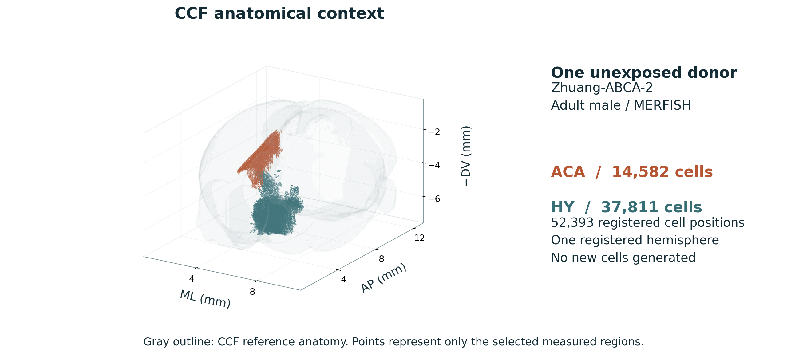{fig-alt="The gray whole-brain surface supplies anatomical context. Rust marks 14,582 ACA cells and teal marks 37,811 HY cells at their registered CCF positions. These 52,393 cells come from one unexposed donor and one registered hemisphere. The reference locates measured cells without filling unsampled regions or mirroring cells into the opposite hemisphere." width=100%}

::: {.figure-caption}
The gray whole-brain surface supplies anatomical context. Rust marks 14,582 ACA cells and teal marks 37,811 HY cells at their registered CCF positions. These 52,393 cells come from one unexposed donor and one registered hemisphere. The reference locates measured cells without filling unsampled regions or mirroring cells into the opposite hemisphere.
:::

::: {.viewer-links}
[Interactive hypothalamus slide](#hy-3d){.inline-slide-link data-map-slide="hy-3d" target="_self"} · [Interactive cortex slide](#aca-3d){.inline-slide-link data-map-slide="aca-3d" target="_self"}
:::

::: {.source}
Analysis: this project[Zhang et al., Nature 2023](https://doi.org/10.1038/s41586-023-06808-9) · [Allen CCF, 2020 annotation](https://alleninstitute.github.io/abc_atlas_access/descriptions/Allen-CCF-2020.html)
:::

::: {.notes}
Registered positions of all 14,582 ACA and 37,811 HY cells from the same Zhuang-ABCA-2 donor. CCF coordinates come from registered sections rather than direct isotropic 3D acquisition. Gray is the previously exported whole-brain anatomical mesh from the CCF annotation, with 0.15-mm surface step. That surface does not represent expression coverage. Colored points are actually measured cells from the registered hemisphere. Gaps are not filled, cells are not reflected to the opposite hemisphere, and no expression values or donors are added. Colors identify regions only and do not encode a PM₂.₅ response. The two text links jump to the interactive hypothalamus and cortex slides inside this presentation. The static anatomy preview remains available offline. The gray full-brain mesh supplies anatomical context, while measured cells occupy the source's registered hemisphere only. No reference cells are mirrored into the other hemisphere.
:::

## Gene priorities and measured-panel coverage {#gene-selection}

::: {.slide-eyebrow}
02  /  Methods
:::

1. Preserve the original primary regional BH q and effect estimates.
2. Rank candidates by q, then source symbol or exact ID.
3. Map HY by exact source symbol and ACA by exact Ensembl ID.
4. Annotate products and functions with frozen official NCBI/UniProt records.

**Panel coverage:** 1 of 11 HY primary hits and 76 of 1,167 ACA primary hits are physically measured.

The HY displayed top ten include nine exploratory candidates. All ten ACA candidates satisfy primary BH q < 0.05.

::: {.source}
Scientific references[Zhang et al., Nature 2023](https://doi.org/10.1038/s41586-023-06808-9) · [Rajagopalan et al., JCI 2020](https://doi.org/10.1172/JCI137315) · [Zhang et al., Science 2025](https://doi.org/10.1126/science.adu4132)
:::

::: {.notes}
This is transparent evidence ranking, not a causal-importance score. No current alias is silently substituted for the original mapping. Current annotation is shown alongside source identity. HY lacks original Ensembl IDs, which limits cross-resource identity resolution. Six HY measured candidates show strong shrinkage. The gene-product table includes noncoding features and pseudogenes explicitly; absent atlas genes are not imputed. Forty-six distinct genes produce51 selection rows because genes can enter more than one regional/selection group.
:::

## Detection fractions retain measured zeros {#detection-method .formula-slide .layout-equation}

::: {.slide-eyebrow}
02  /  Methods
:::

::: {.equation-grid}

::: {.equation-core}
$$d_{ig}=\mathbf1(c_{ig}>0),\qquad
\widehat f_{gA}=\frac{\sum_{i\in A}d_{ig}}{n_A}$$

$$b_x=\lfloor x/0.1\rfloor,\qquad b_y=\lfloor y/0.1\rfloor$$
:::

::: {.equation-detail}
- $A$: selected physical section, anatomy, cell class or occupied bin.
- The denominator includes every selected measured cell, including zeros.
- Bins are 0.1 × 0.1 mm and remain separate by physical section.
- Empty bins are unobserved. No spatial interpolation or density claim is added.
:::

:::

::: {.source}
Scientific references[Zhang et al., Nature 2023](https://doi.org/10.1038/s41586-023-06808-9)
:::

::: {.notes}
A raw imaging zero means no detected count in this assay, not proven biological absence. Bins use half-open intervals at global experimental-coordinate multiples. A one-cell edge section remains visible with its denominator. An empty filter combination has unavailable detection, not zero detection. Static section figures and3D use log2(1+count), whereas the interactive count map and Gaussian working response use natural ln(1+count). Every transform is explicitly labeled. Descriptive detection summaries do not receive an independent-cell exposure p value.
:::

## Uniform regional PM₂.₅ scenario {#scenario-method .formula-slide .layout-equation .wide-equation}

::: {.slide-eyebrow}
02  /  Methods
:::

::: {.equation-core}
$$E_{\mathrm{scenario}}(c,g)
=E_{\mathrm{reference}}(c,g)\,
2^{\widehat\beta^{\,\mathrm{shrunk}}_g}$$
:::

::: {.equation-detail}
| Example | Regional shrunken log₂FC | Multiplier |
|---|---:|---:|
| HY / Tll1 | −1.22405 | 0.42808 |
| ACA / Fosb | +0.99711 | 1.99600 |

Cell positions and numbers remain fixed. Shared per-gene color limits support comparison.

This is an illustrative propagation of a regional effect into an unexposed reference.
:::

::: {.source}
Scientific references[Zhang et al., Nature 2023](https://doi.org/10.1038/s41586-023-06808-9)
:::

::: {.notes}
Uniform scaling is underidentified biologically: the same bulk effect could arise from cell-specific regulation or composition. This display does not estimate which cells respond, cell loss, migration or a causal mechanism. Wald MLE±1.96SE provides alternative group-level scenarios, separate from the shrunken default, not per-cell confidence intervals. A shared optional99th-percentile color cap affects the display only; numeric values are retained. An arbitrary smoother or mirrored hemisphere would add assumptions, not observations. The atlas donor is not a matched experimental control.
:::

## The assumption behind the reference–PM comparison {#explain-scenario .explanation-slide}

::: {.slide-eyebrow}
02  /  Methods
:::

**Measured input.** Each cell has its original coordinate and reference expression value. These measurements come from an unexposed animal.

**Scenario rule.** Apply one gene-specific regional multiplier to all reference values. Fosb receives approximately ×2 in ACA. Tll1 receives ×0.428 in HY. Measured zeros stay zero and no cells move, appear or disappear.

**Scientific meaning.** This makes a regional estimate visible in anatomical space. Many cellular response patterns could produce the same bulk effect, so the rule cannot recover cell-specific pollution responses or add spatial resolution.

::: {.source}
Scientific references[Zhang et al., Science 2025](https://doi.org/10.1126/science.adu4132) · [Rajagopalan et al., JCI 2020](https://doi.org/10.1172/JCI137315) · [Zhang et al., Nature 2023](https://doi.org/10.1038/s41586-023-06808-9)
:::

::: {.notes}
The scenario uses the shrunken bulk coefficient as its default multiplier. Alternative group-level scenarios can use the pointwise MLE Wald coefficient limits, but those are not confidence intervals for each atlas cell. Uniform scaling preserves the reference's detection pattern exactly, so it cannot predict newly expressing or silenced cells. The atlas donor is not an experimental control matched to the pollution animals. Shared per-gene color scales and camera settings are necessary for comparison, and the captions identify the second view as a modeled illustration.
:::

## Gaussian baseline with fixed spatial basis functions {#gaussian-features .formula-slide .layout-equation .wide-equation}

::: {.slide-eyebrow}
02  /  Methods
:::

::: {.equation-core}
$$y_{ig}=\ln(1+c_{ig})
=\mathbf x_i^\top\boldsymbol\beta_g+\epsilon_{ig}$$

$$\phi_j(\mathbf r)=
\exp\!\left[-\frac12\sum_k\frac{(r_k-m_{jk})^2}{\ell_k^2}\right],
\qquad\boldsymbol\ell=(0.60,0.45,0.45)\ \mathrm{mm}$$
:::

::: {.equation-detail}
Features: intercept, anatomical indicators, three standardized CCF coordinates, 36 anisotropic RBFs and section nuisance intercepts.

No expression-derived cell-class predictors enter the fit.
:::

::: {.source}
Scientific references[Zhang et al., Nature 2023](https://doi.org/10.1038/s41586-023-06808-9) · [Murphy, 2007, Gaussian conjugacy](https://www.cs.ubc.ca/~murphyk/Papers/bayesGauss.pdf) · [Rasmussen & Williams, 2006, ch. 2](https://gaussianprocess.org/gpml/chapters/RW2.pdf)
:::

::: {.notes}
RBF means radial basis function. The36centers form4×3×3 training-coordinate quantiles: AP.05/.35/.65/.95 andDV/ML.1/.5/.9. Lengths correspond to AP,DV,ML and remain fixed before held-out evaluation. Standardization, RBF centering and anatomy vocabularies use training data only. Section effects absorb nuisance variation but cannot distinguish every technical source from biology. Excluding expression-derived cell labels reduces one route for target-transcript leakage. This model is finite-basis Bayesian regression, not a fitted full Gaussian process or an implementation of Tangram, BayesSpace or cell2location.
:::

## Proper priors and analytical posterior {#gaussian-priors .formula-slide .layout-equation .wide-equation}

::: {.slide-eyebrow}
02  /  Methods
:::

::: {.equation-core}
$$\boldsymbol\beta\mid\sigma^2\sim
\mathcal N(0,\sigma^2V_0),\qquad \sigma^2\sim IG(3,1)$$

$$V_n=(X^\top X+V_0^{-1})^{-1},\quad
m_n=V_nX^\top y,\quad a_n=3+n/2$$

$$b_n=1+\frac12\left(y^\top y-m_n^\top V_n^{-1}m_n\right)$$
:::

::: {.equation-detail}
Prior variance multipliers: intercept 25, anatomy 1, linear coordinates 0.25, each RBF 1/36, each section 0.25.

Cholesky computation checks the normal equations and posterior scale.
:::

::: {.source}
Scientific references[Zhang et al., Nature 2023](https://doi.org/10.1038/s41586-023-06808-9) · [Murphy, 2007, Gaussian conjugacy](https://www.cs.ubc.ca/~murphyk/Papers/bayesGauss.pdf) · [Rasmussen & Williams, 2006, ch. 2](https://gaussianprocess.org/gpml/chapters/RW2.pdf)
:::

::: {.notes}
The inverse-Gamma convention uses shape a and scale b in a density proportional to (sigma²)^(-a-1)exp(-b/sigma²). Section random effects are represented as proper Gaussian-prior coefficients with variance .25sigma². All priors are modeling assumptions, not empirically validated neural priors. The implementation checks the residual-plus-prior quadratic representation of b_n to reduce numerical cancellation concerns. It also checks covariance symmetry/inversion. Posterior integration is analytic conditional on this model, not proof that the Gaussian likelihood fits sparse nonnegative counts.
:::

## How the prior and reference measurements form a posterior {#explain-bayes .explanation-slide}

::: {.slide-eyebrow}
02  /  Methods
:::

**Before the observations**, a proper prior constrains coefficient magnitudes and unexplained variation. It regularizes sparse anatomical groups and spatial basis functions without supplying new measurements.

**The likelihood** describes how measured reference expression would vary for a given coefficient set. Combining it with the prior gives a posterior distribution of plausible reference parameters.

**Prediction** then propagates that distribution to a defined target. A smooth posterior mean is only a conditional estimate. Its scientific usefulness still requires held-out comparisons, interval checks and sensitivity to the stated assumptions.

::: {.source}
Scientific references[Murphy, 2007, Gaussian conjugacy](https://www.cs.ubc.ca/~murphyk/Papers/bayesGauss.pdf) · [Rasmussen & Williams, 2006, ch. 2](https://gaussianprocess.org/gpml/chapters/RW2.pdf) · [SciPy, beta-binomial distribution](https://docs.scipy.org/doc/scipy/reference/generated/scipy.stats.betabinom.html)
:::

::: {.notes}
The Gaussian implementation is finite-basis regression with fixed length scales and a conjugate normal–inverse-gamma prior. It is not a fitted full Gaussian process. Prior settings were fixed before held-out evaluation, and numerical sensitivity analyses do not select a setting to maximize test performance. Where anatomy is absent from training, the model must fall back to its stated prior handling. The separate beta-binomial model changes both the observation target and distribution: it models positive/all-cell detection probabilities rather than RNA magnitude.
:::

## Credible and new-section predictive intervals {#gaussian-intervals .formula-slide .layout-equation .wide-equation}

::: {.slide-eyebrow}
02  /  Methods
:::

::: {.equation-core}
**Section-adjusted latent mean**

$$f_*\mid y\sim t_{2a_n}\left(x_*^\top m_n,\
\sqrt{\frac{b_n}{a_n}x_*^\top V_nx_*}\right)$$

**New cell in a new physical section**

$$y_*\mid y\sim t_{2a_n}\left(x_*^\top m_n,\
\sqrt{\frac{b_n}{a_n}\left(1.25+x_*^\top V_nx_*\right)}\right)$$
:::

::: {.equation-detail}
The second arguments are **Student-t scales**, not variances.

Maps show the full-reference fit at measured locations. Held-out prediction is evaluated separately.
:::

::: {.source}
Scientific references[Zhang et al., Nature 2023](https://doi.org/10.1038/s41586-023-06808-9) · [Murphy, 2007, Gaussian conjugacy](https://www.cs.ubc.ca/~murphyk/Papers/bayesGauss.pdf) · [Rasmussen & Williams, 2006, ch. 2](https://gaussianprocess.org/gpml/chapters/RW2.pdf)
:::

::: {.notes}
Latent maps average the nuisance section offset to zero rather than reporting each fitted section shift. The predictive1.25 combines residual variance1 and independent new-section variance.25. An unseen test anatomy adds prior variance1 and mean0, explicitly rather than silently substituting a known anatomy. Negative means, bounds and predictive support are retained as diagnostics of the Gaussian working approximation. Estimates are not exponentiated into expected molecule counts. Uncertainty is conditional on the basis, priors, anatomy and registration and omits unmodeled donor and registration uncertainty.
:::

## Whole-section validation with neighboring guards {#guarded-cv .figure-slide .figure-interpretation}

::: {.slide-eyebrow}
02  /  Methods
:::

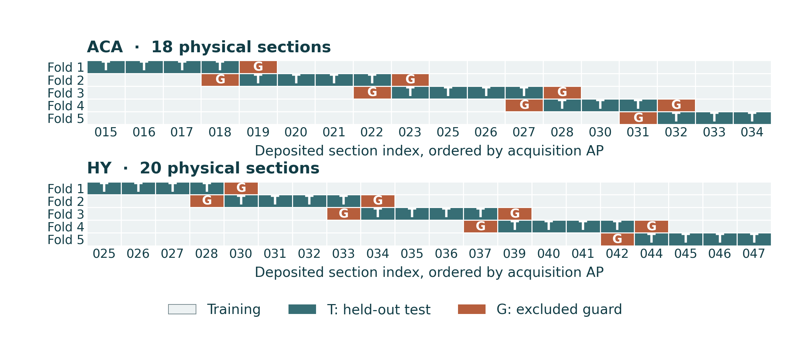{fig-alt="Each row marks one validation fold along the ordered physical sections. Teal sections supply the held-out test, rust sections are excluded neighbors, and pale sections train the model. Every measured cell is tested once. Reserving whole sections reduces local leakage, while all folds still describe the same donor." width=100%}

::: {.figure-caption}
Each row marks one validation fold along the ordered physical sections. Teal sections supply the held-out test, rust sections are excluded neighbors, and pale sections train the model. Every measured cell is tested once. Reserving whole sections reduces local leakage, while all folds still describe the same donor.
:::

::: {.source}
Analysis: this project[Zhang et al., Nature 2023](https://doi.org/10.1038/s41586-023-06808-9)
:::

::: {.notes}
Sections are ordered by experimental acquisition AP, while the Gaussian predictors use registered CCF coordinates. The nearest represented section on each side of a test block is removed from training. If the region is absent from intervening acquisition cuts, this guard can span more than one physical acquisition step. Anatomy vocabulary, scales and basis centers are learned only from remaining training cells. Fixed priors and basis lengths are not selected from test performance. Both Bayesian models use these identical folds. This is within-donor reference prediction, not exposure or cross-donor validation.
:::

## Why validation reserves sections and their neighbors {#explain-validation .explanation-slide}

::: {.slide-eyebrow}
02  /  Methods
:::

**The prediction question** is how the model performs at a physical section it has not seen. Randomly splitting nearby cells could leave very similar local information in training and testing.

**The guard** removes the represented sections adjacent to the test block from training. Feature standardization, anatomical vocabularies and spatial basis preparation use the remaining training data only.

**The comparison** uses identical folds for spatial and simpler baseline models. Better fit to the complete atlas cannot replace better held-out prediction. These folds assess transfer within one donor, while cross-donor and exposure transfer remain untested.

::: {.source}
Scientific references[Zhang et al., Nature 2023](https://doi.org/10.1038/s41586-023-06808-9) · [Murphy, 2007, Gaussian conjugacy](https://www.cs.ubc.ca/~murphyk/Papers/bayesGauss.pdf) · [SciPy, beta-binomial distribution](https://docs.scipy.org/doc/scipy/reference/generated/scipy.stats.betabinom.html)
:::

::: {.notes}
The five test blocks contain contiguous whole physical sections ordered by acquisition position. Adjacent represented sections are guards, which does not imply filling an unobserved intermediate section. Every measured cell appears in a test fold once. Unknown test anatomy remains visible in scoring, with the specified prior-only handling rather than post hoc exclusion. Multiple genes evaluated in the same cell are correlated evaluations. Cross-validation protects against selected routes of leakage but cannot create independent donors or validate the uniform pollutant scenario.
:::

## Hierarchical model of bounded detection probability {#beta-model .formula-slide .layout-equation}

::: {.slide-eyebrow}
02  /  Methods
:::

::: {.equation-grid}

::: {.equation-core}
$$Y_{sag}\mid p_{sag}\sim
\operatorname{Binomial}(n_{sa},p_{sag})$$

$$p_{sag}\mid\mu_{ag},\kappa_{ag}\sim
\operatorname{Beta}(\mu_{ag}\kappa_{ag},(1-\mu_{ag})\kappa_{ag})$$

$$\mu_{ag}\sim\operatorname{Beta}(0.5,0.5),\qquad
\ln\kappa_{ag}\sim\mathcal N(\ln20,1.5^2)$$
:::

::: {.equation-detail}
Genes/anatomies have separate fits. Section propensities are exchangeable within each fit. Probabilities stay between 0 and 1.
:::

:::

::: {.source}
Scientific references[Zhang et al., Nature 2023](https://doi.org/10.1038/s41586-023-06808-9) · [SciPy, beta-binomial distribution](https://docs.scipy.org/doc/scipy/reference/generated/scipy.stats.betabinom.html)
:::

::: {.notes}
Y is positive measured cells and n includes all measured zeros in a section×anatomy group. Mu is the mean of exchangeable section propensities, not a pooled-cell weighted detection fraction. Kappa controls section heterogeneity; the beta-binomial intraclass correlation is1/(kappa+1) conditional on the hyperparameters. Priors are proper and fixed before held-out outcomes. The model does not include an AP trend, local spatial process, class-specific response, or exposure effect. Exchangeability does not separate biological AP variation from technical section variation. Conditional binomial assumptions can miss residual cellular dependence.
:::

## Finite-grid integration and uncertainty computation {#beta-integration}

::: {.slide-eyebrow}
02  /  Methods
:::

- Main grid: **64 μ × 48 κ prior quantiles**, equal prior-quantile weights.
- Normalize log beta-binomial likelihood weights with log-sum-exp.
- Hypermean μ intervals: weighted discrete-grid quantiles.
- Known-section p and held-out positive-count intervals: **8,192 seeded mixture draws**.
- Full-reference new-section p intervals: numerical inversion of the weighted Beta-mixture CDF.
- Check 32 × 24 and 96 × 64 grids without selecting a model from test results.

::: {.source}
Scientific references[Zhang et al., Nature 2023](https://doi.org/10.1038/s41586-023-06808-9) · [SciPy, beta-binomial distribution](https://docs.scipy.org/doc/scipy/reference/generated/scipy.stats.betabinom.html)
:::

::: {.notes}
In prior-quantile coordinates, prior masses are already represented by equally weighted nodes; adding another prior density/Jacobian would double-count the prior. The discrete posterior is an approximation to a continuous posterior, not an MCMC convergence result. Known-section mixtures update each beta component with that section's y/n using full-reference hyperposterior weights. Predictive count draws additionally sample binomial counts at the actual held-out denominator. The fixed seed is20261020 with reproducible keyed streams. Sensitivity evaluates numerical precision separately from scientific prediction performance.
:::

## Three distinct detection uncertainty targets {#beta-targets .formula-slide}

::: {.slide-eyebrow}
02  /  Methods
:::

| Target | Conditioning | Interval interpretation |
|---|---|---|
| Known-section $p_{sa}$ | Its observed positives and denominator | Credible interval of that fitted section |
| Anatomy mean $\mu_a$ | Exchangeable section information | Credible interval of the hypermean |
| New-section $p_*$ or $Y_*$ | No counts from that new section | Predictive distribution of its propensity or count |

An unseen held-out anatomy stays **prior-only** and remains in evaluation.

A fitted known-section interval is not a held-out prediction.

::: {.source}
Scientific references[Zhang et al., Nature 2023](https://doi.org/10.1038/s41586-023-06808-9) · [SciPy, beta-binomial distribution](https://docs.scipy.org/doc/scipy/reference/generated/scipy.stats.betabinom.html)
:::

::: {.notes}
The three intervals estimate different random quantities. Do not assert that a new-section interval is always numerically wider than a known-section interval, since location and parameter mixtures can differ. Held-out positive-count coverage refers to Y at its observed n, not to coverage of an unobserved true cell probability or a latent Gaussian intensity. In the interface, selecting a cell class suppresses this all-class fit because it has not estimated class-specific probabilities. Prior-only mu has mean.5 under the fixed symmetric prior, which can perform poorly for rare genes; that failure is scored rather than hidden.
:::

## Different intervals answer different detection questions {#explain-uncertainty .explanation-slide}

::: {.slide-eyebrow}
02  /  Methods
:::

**A known section:** after observing its positives and all-cell denominator, estimate that section's underlying detection probability. Its credible interval conditions on those observations.

**An anatomical mean:** combine the exchangeable section information to estimate the typical propensity for that anatomy. This hypermean has its own credible interval.

**A new section:** predict its propensity before seeing its counts, or predict a positive-cell count at a specified denominator. Section heterogeneity and, for counts, sampling variation enter this prediction. Always read the target before comparing interval widths or coverage.

::: {.source}
Scientific references[Zhang et al., Nature 2023](https://doi.org/10.1038/s41586-023-06808-9) · [SciPy, beta-binomial distribution](https://docs.scipy.org/doc/scipy/reference/generated/scipy.stats.betabinom.html)
:::

::: {.notes}
The anatomy hypermean is the mean of the exchangeable section propensities rather than necessarily the pooled-cell detection fraction. The probability of a known section and the propensity of a new section both lie in [0,1], but the new positive count has integer support from zero to the chosen denominator. Credible intervals for fitted quantities are not held-out count predictions. The observed group fraction is also noisy, especially when its denominator is small. There is no universal ordering that requires every new-section propensity interval to be wider than every hypermean interval.
:::

## Prediction metrics and baseline comparisons {#metrics .formula-slide .layout-equation}

::: {.slide-eyebrow}
02  /  Methods
:::

::: {.equation-grid}

::: {.equation-core}
$$\operatorname{RMSE}=
\sqrt{\frac1N\sum_i(y_i-\widehat y_i)^2}$$

$$\operatorname{Brier}=
\frac{\sum_j[Y_j(1-\widehat p_j)^2+
(n_j-Y_j)\widehat p_j^2]}{\sum_j n_j}$$
:::

::: {.equation-detail}
Gaussian baseline: compare anatomy-only regression and 30-neighbor prediction.

Detection baseline: collapse anatomy within each permitted training section.

Report held-out interval coverage **together with width**. Lower prediction loss is better.
:::

:::

::: {.source}
Scientific references[Zhang et al., Nature 2023](https://doi.org/10.1038/s41586-023-06808-9) · [Murphy, 2007, Gaussian conjugacy](https://www.cs.ubc.ca/~murphyk/Papers/bayesGauss.pdf) · [SciPy, beta-binomial distribution](https://docs.scipy.org/doc/scipy/reference/generated/scipy.stats.betabinom.html)
:::

::: {.notes}
Brier is descriptive cell-weighted loss reconstructed from section×anatomy counts, not a significance test with independent cells. When pooling ten genes, group and cell evaluation counts multiply by ten; actual cells and sections do not. kNN uses30 nearest training cells within anatomy when available, with explicit broader fallback otherwise. Both baselines share the same held-out and guard exclusions. Gaussian sensitivity changes fixed basis lengths by.5/2 and spatial prior variances by.25/4. Overall95% prediction coverage is marginal: conditioning on the realized outcome being positive creates a different diagnostic without a nominal95% target.
:::

## Results reconstructed from the original studies {#replicated-results .section-slide data-background-color="#103d49"}

::: {.slide-eyebrow}
03  /  Author reproduction
:::

Exact output recovery, partial methodological sensitivity and conditional concordance

::: {.notes}
This results block uses the authors' original source animals. Each slide names the level of reproduction rather than grouping all forms of agreement under biological replication.
:::

## Exact cortex significant-gene sets are recovered {#cortex-reproduction .figure-slide .figure-interpretation}

::: {.slide-eyebrow}
03  /  Author reproduction
:::

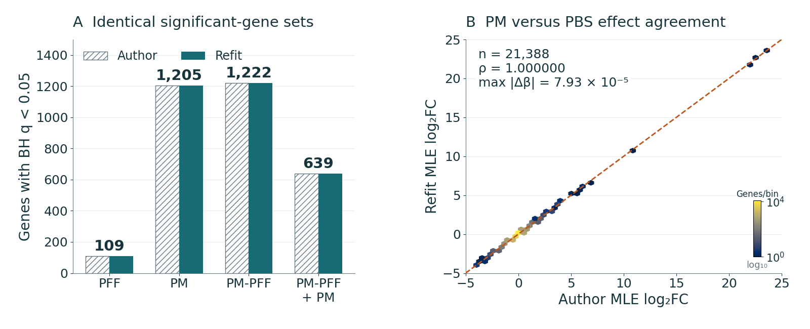{fig-alt="Matching bars recover 109 / 1,205 / 1,222 / 639 significant genes in the four author-aligned contrasts. The effect comparison lies on the identity line. Every significant-set Jaccard equals 1, confirming numerical recovery at the deposited-count level. The same source animals are reused, so this agreement does not add independent biological replication." width=100%}

::: {.figure-caption}
Matching bars recover 109 / 1,205 / 1,222 / 639 significant genes in the four author-aligned contrasts. The effect comparison lies on the identity line. Every significant-set Jaccard equals 1, confirming numerical recovery at the deposited-count level. The same source animals are reused, so this agreement does not add independent biological replication.
:::

::: {.source}
Analysis: this project[Zhang et al., Science 2025](https://doi.org/10.1126/science.adu4132)
:::

::: {.notes}
The contrast order is PFF, PM, PM-PFF and PM-PFF plus nasal PM, each versus PBS. There are zero discordant significant genes in every comparison. The maximum MLE effect discrepancy across contrasts is about 8.12×10⁻⁵, and the maximum nominal-p discrepancy is 1.94×10⁻⁶. All coefficient fits converge. Code-defined PCA recovers 29.2014% and 9.7606%, matching the rounded values 29.2% and 9.8%. Also recovered are 582 PM-exclusive genes and 323 genes exclusive to the PM/PM-PFF pair. Original GO table row counts were checked, without independently recomputing the original GSEA. This reconstructs count-based inference and selected outputs, rather than raw-read alignment or every experiment in the paper.
:::

## Reproducible output retains a source-quality question {#cortex-source-quality .figure-slide .figure-interpretation}

::: {.slide-eyebrow}
03  /  Author reproduction
:::

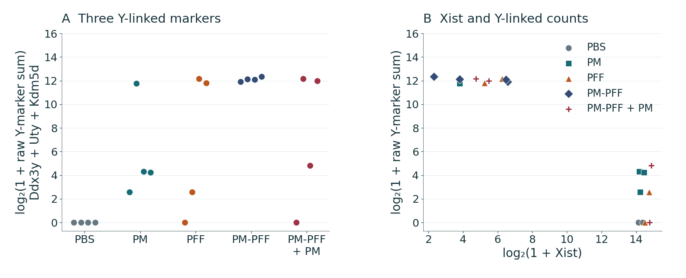{fig-alt="Points retain all 20 source animals. All four PBS controls have zero raw Ddx3y, Uty and Kdm5d counts, whereas other treatment groups vary. The Xist comparison provides another descriptive marker view. These patterns motivate checking source sex and sample identity, without assigning sex or proving confounding from expression alone." width=100%}

::: {.figure-caption}
Points retain all 20 source animals. All four PBS controls have zero raw Ddx3y, Uty and Kdm5d counts, whereas other treatment groups vary. The Xist comparison provides another descriptive marker view. These patterns motivate checking source sex and sample identity, without assigning sex or proving confounding from expression alone.
:::

::: {.source}
Analysis: this project[Zhang et al., Science 2025](https://doi.org/10.1126/science.adu4132)
:::

::: {.notes}
The plot preserves all 20 animals and their source treatment labels. These Y-linked markers raise a possible sex-composition or sample-identity question, while the source RNA-seq sex metadata remain unreported. They do not establish sex assignments or complete confounding by themselves. No animals were relabeled or removed, and no invented sex covariate entered the reproduction. Exact numerical agreement can coexist with an unresolved source-design concern. Independent metadata verification is the appropriate next step, rather than post hoc omission of inconvenient samples.
:::

## Hypothalamus comparison remains method-sensitive {#hy-reproduction .figure-slide .figure-interpretation}

::: {.slide-eyebrow}
03  /  Author reproduction
:::

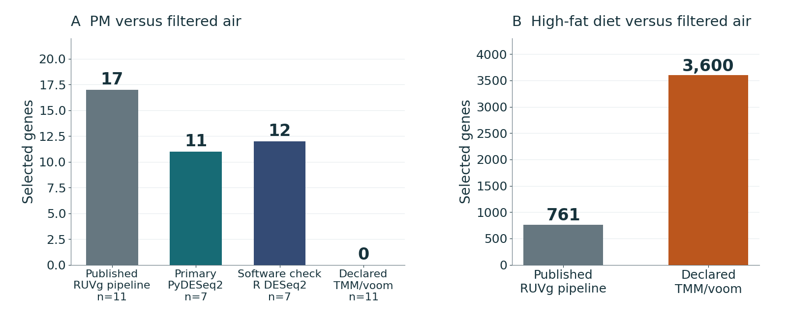{fig-alt="The original lists contain 17 PM and 761 HFD genes. The declared TMM/voom sensitivity returns 0 and 3,600 under different specified gates. The primary seven-animal analysis and its R implementation check are shown separately. Missing RUVg specifications prevent exact reconstruction, so these counts describe methodological sensitivity rather than biological nonreplication." width=100%}

::: {.figure-caption}
The original lists contain 17 PM and 761 HFD genes. The declared TMM/voom sensitivity returns 0 and 3,600 under different specified gates. The primary seven-animal analysis and its R implementation check are shown separately. Missing RUVg specifications prevent exact reconstruction, so these counts describe methodological sensitivity rather than biological nonreplication.
:::

::: {.source}
Analysis: this project[Rajagopalan et al., JCI 2020](https://doi.org/10.1172/JCI137315)
:::

::: {.notes}
The different numbers cannot be attributed uniquely to the unavailable RUVg adjustment. The empirical controls, number of factors, abundance-gate details and complete executable analysis are underdetermined. The project's independent primary analysis uses only 7 chow-fed FA/PM animals and returns 11 BH discoveries, without the author sensitivity analysis's coding/effect gates. These are different estimands and testing families. The defensible claim is transparent methodological sensitivity with unresolved reconstruction, rather than proof of biological nonreplication.
:::

## miR-574-5p direction agrees but BH confirmation does not {#mirna-reproduction .figure-slide .figure-interpretation}

::: {.slide-eyebrow}
03  /  Author reproduction
:::

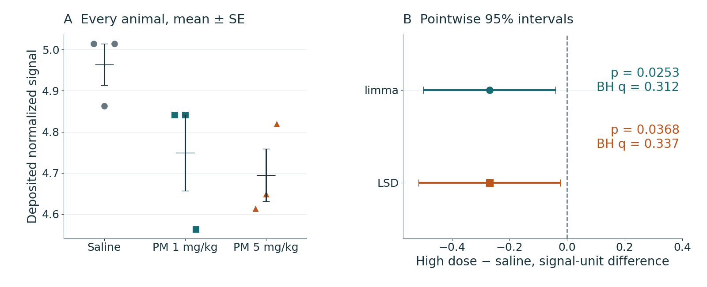{fig-alt="Animal points show lower miR-574-5p signal at high dose. Its estimated difference is −0.26945 deposited signal units. The nominal limma interval excludes zero, but p = 0.0253 becomes BH q = 0.312 across the array. ANOVA p = 0.0788 also prevents protected LSD. Directional agreement therefore exceeds the supported multiplicity-adjusted claim." width=100%}

::: {.figure-caption}
Animal points show lower miR-574-5p signal at high dose. Its estimated difference is −0.26945 deposited signal units. The nominal limma interval excludes zero, but p = 0.0253 becomes BH q = 0.312 across the array. ANOVA p = 0.0788 also prevents protected LSD. Directional agreement therefore exceeds the supported multiplicity-adjusted claim.
:::

::: {.source}
Analysis: this project[Ku et al., Part. Fibre Toxicol. 2017](https://doi.org/10.1186/s12989-017-0215-3) · [Ritchie et al., NAR 2015](https://doi.org/10.1093/nar/gkv007)
:::

::: {.notes}
Unprotected high-dose LSD gives p = .0368, and nominal intervals exclude zero, while array-wide BH does not confirm this target. Protected LSD requires a significant omnibus test, which fails at .05. These statements are compatible because they use different gates and multiplicity rules. The target's lower signal at both doses reproduces direction, without reproducing independent qPCR or a mechanistic rescue result. The new descriptive heatmap has a disclosed selection rule and does not claim the unknown original row order or selection.
:::

## Ozone genotype effects show conditional concordance {#ozone-reproduction .figure-slide .figure-interpretation}

::: {.slide-eyebrow}
03  /  Author reproduction
:::

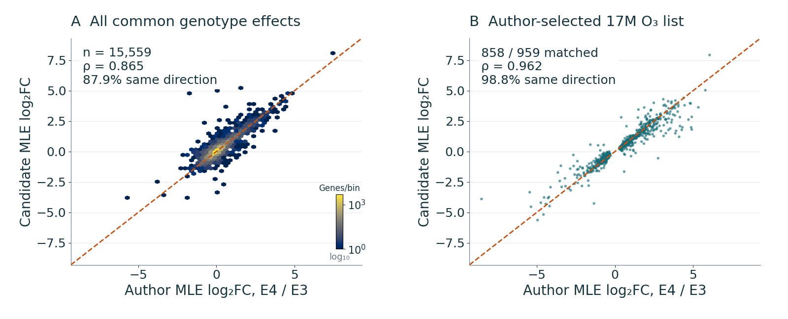{fig-alt="The deposited genotype threshold recovers 2,501 genes exactly. Across common finite effects, correlation is ρ = 0.865. The author-selected S3 subset gives ρ = 0.962 and 98.8% directional agreement among matched effects. Because the subset was selected and the source animals are reused, its stronger agreement cannot establish unbiased transcriptome-wide replication." width=100%}

::: {.figure-caption}
The deposited genotype threshold recovers 2,501 genes exactly. Across common finite effects, correlation is ρ = 0.865. The author-selected S3 subset gives ρ = 0.962 and 98.8% directional agreement among matched effects. Because the subset was selected and the source animals are reused, its stronger agreement cannot establish unbiased transcriptome-wide replication.
:::

::: {.source}
Analysis: this project[Nakamya et al., IJMS 2025](https://doi.org/10.3390/ijms26062407)
:::

::: {.notes}
The source table rule exactly recovers 1490 higher and 1011 lower genes. The new pooled genotype candidate has 15,559 common finite exact-symbol effects, 2362 nominal selections and a selected-set Jaccard of .612 in the common testable universe. The 17M/O₃ E4-versus-E3 S3 list contains 959 genes: 858 have finite matched effects, 848 retain direction, 543 retain nominal selection and 71 retain BH < .05. Selection-conditioned correlation cannot estimate unbiased transcriptome-wide agreement. The common-universe UpSet uses 15,661 genes, a different denominator from the 15,559-effect comparison. Hemoglobin concordance cannot establish blood–brain barrier function from bulk RNA alone.
:::

## Reproduction conclusions differ across studies {#reproduction-summary .layout-result}

::: {.slide-eyebrow}
03  /  Author reproduction
:::

| Study | Defensible result | Remaining limit |
|---|---|---|
| Cortex | Exact four significant-gene sets and code PCA | Read-level pipeline and source sex/identity unresolved |
| Hypothalamus | Declared TMM/voom sensitivity | RUVg controls and k unavailable |
| miRNA | Target direction and unprotected nominal agreement | Omnibus gate and array-wide BH do not confirm target |
| Ozone | Exact deposited threshold selection and matched effects | Different quantifier and selected-list conditioning |

::: {.source}
Scientific references[Rajagopalan et al., JCI 2020](https://doi.org/10.1172/JCI137315) · [Zhang et al., Science 2025](https://doi.org/10.1126/science.adu4132) · [Nakamya et al., IJMS 2025](https://doi.org/10.3390/ijms26062407)
:::

::: {.notes}
This is the conclusion of the reproduction block, not a ranking of biological plausibility. All comparisons reuse source animals. Exact output agreement is strongest for cortex and still requires source-quality follow-up. Partial reproduction should not be silently upgraded into full mechanism validation. The next block presents new project analyses, including models whose validation reveals limitations rather than successful reconstruction.
:::

## New analyses within this project {#new-results .section-slide data-background-color="#103d49"}

::: {.slide-eyebrow}
04  /  Project results
:::

Primary reanalysis, response heterogeneity, gene sets and spatial-reference modeling

::: {.notes}
These results add analyses to the repository, not new animals. “New” denotes project contribution and does not assert publication novelty or a confirmed biological mechanism.
:::

## Primary HY analysis identifies 11 BH discoveries {#hy-primary .figure-slide .figure-interpretation}

::: {.slide-eyebrow}
04  /  Project results
:::

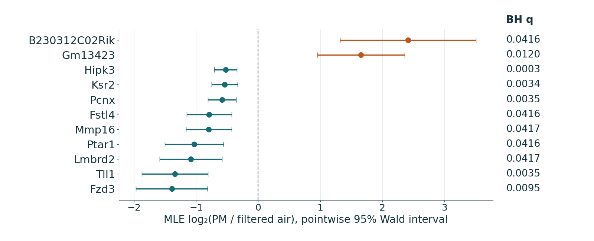{fig-alt="For 4 filtered-air and 3 PM animals, the primary model identifies 11 BH discoveries: two higher and nine lower. Points show MLE log₂ fold changes, and bars are pointwise Wald 95% intervals. Direction indicates the regional contrast. These intervals are neither simultaneous confidence bands nor evidence that each spatial cell changes similarly." width=100%}

::: {.figure-caption}
For 4 filtered-air and 3 PM animals, the primary model identifies 11 BH discoveries: two higher and nine lower. Points show MLE log₂ fold changes, and bars are pointwise Wald 95% intervals. Direction indicates the regional contrast. These intervals are neither simultaneous confidence bands nor evidence that each spatial cell changes similarly.
:::

::: {.source}
Analysis: this project[Rajagopalan et al., JCI 2020](https://doi.org/10.1172/JCI137315)
:::

::: {.notes}
The primary analysis retains 19,611 genes and has 19,452 finite Wald p values after 159 Cook-filtered tests. Tll1 has MLE −1.343708, q = .003497 and shrunken effect −1.224053. All coding primary hits decrease under the frozen current annotation, while the two increases are noncoding/pseudogene features. Leave-one-out produces 0–825 BH discoveries and preserves the direction of all 11 primary hits, but not significance in every fit. Tll1 retains q < .05 in 5/7 omissions. This small-n regional association does not identify a cell-specific or protein result.
:::

## Primary cortex analysis uses eight PM/PBS animals {#aca-primary .figure-slide .figure-interpretation}

::: {.slide-eyebrow}
04  /  Project results
:::

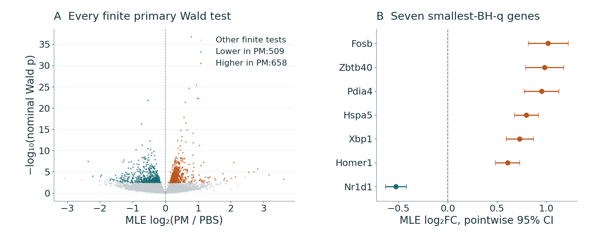{fig-alt="The volcano separates effect magnitude from nominal Wald evidence, while colors identify BH discoveries. The seven smallest-q genes have pointwise MLE intervals. The eight-animal primary comparison yields 1,167 discoveries, 658 higher and 509 lower. Its population and model differ from the 20-animal reconstruction that recovered 1,205 PM genes." width=100%}

::: {.figure-caption}
The volcano separates effect magnitude from nominal Wald evidence, while colors identify BH discoveries. The seven smallest-q genes have pointwise MLE intervals. The eight-animal primary comparison yields 1,167 discoveries, 658 higher and 509 lower. Its population and model differ from the 20-animal reconstruction that recovered 1,205 PM genes.
:::

::: {.source}
Analysis: this project[Zhang et al., Science 2025](https://doi.org/10.1126/science.adu4132)
:::

::: {.notes}
The primary matrix retains 19,235 genes and has 17,360 finite adjusted p values, with 10 Cook-filtered tests and additional adaptive independent filtering. Forty-five genes satisfy the exploratory joint gate BH < .05 and absolute shrunken LFC ≥ 1. The volcano displays the primary evidence, without choosing another threshold or claiming formal reproduction of the author's volcano. Fosb has MLE = 1.01816 and q = 2.265×10⁻¹⁹. Hspa5 is the top primary q-ranked example but is absent from the measured atlas panel. The unresolved study-level sex/identity signal limits attribution without implying that every selected gene is sex-linked.
:::

## New miRNA analysis retains the full test family {#mirna-primary .layout-statement}

::: {.slide-eyebrow}
04  /  Project results
:::

::: {.statement-grid}

::: {.statement-metric}

1 / 0

BH discoveries at low / high dose

:::

::: {.statement-copy}
| Contrast | Tested features | BH discoveries | Effect scale |
|---|---|---|---|
| PM 1 mg/kg versus control | 1,245 | 1 higher | Original signal difference |
| PM 5 mg/kg versus control | 1,245 | 0 | Original signal difference |
| Separate omnibus F | 1,245 | 1 | Joint condition difference |
The low-dose discovery is mmu-miR-5119. Lower detection flags remain visible, and no array is removed.
:::

:::

::: {.source}
Analysis: this project[Ku et al., Part. Fibre Toxicol. 2017](https://doi.org/10.1186/s12989-017-0215-3) · [Ritchie et al., NAR 2015](https://doi.org/10.1093/nar/gkv007)
:::

::: {.notes}
There are 823 low-detection features and 7722 negative signal values retained. The lower-bound pile-up near −3.3 and small n of 3/group caution against treating every continuous value as a precise abundance measurement. The absence of clear PCA separation does not justify reselecting animals. No high-dose BH discoveries does not establish equivalence or a monotonic dose-response reversal. Pairwise and omnibus families are corrected separately and have different null hypotheses. No miRNA-target network or mRNA GO analysis is inferred from names alone.
:::

## Ozone discovery counts depend on stratum and test {#ozone-primary .figure-slide .figure-interpretation}

::: {.slide-eyebrow}
04  /  Project results
:::

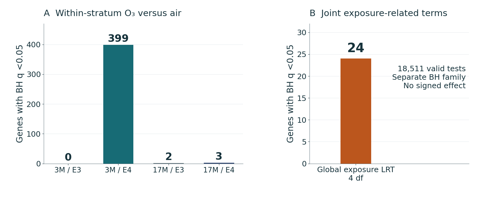{fig-alt="Separate within-stratum BH procedures yield 0 / 399 / 2 / 3 genes in starting-age/APOE order 3M/E3, 3M/E4, 17M/E3 and 17M/E4. The joint 4-df exposure LRT finds 24 genes in another testing family. Unequal discovery counts reflect evidence and precision together, and cannot by themselves establish an interaction." width=100%}

::: {.figure-caption}
Separate within-stratum BH procedures yield 0 / 399 / 2 / 3 genes in starting-age/APOE order 3M/E3, 3M/E4, 17M/E3 and 17M/E4. The joint 4-df exposure LRT finds 24 genes in another testing family. Unequal discovery counts reflect evidence and precision together, and cannot by themselves establish an interaction.
:::

::: {.source}
Analysis: this project[Nakamya et al., IJMS 2025](https://doi.org/10.3390/ijms26062407)
:::

::: {.notes}
The order is 3M/E3, 3M/E4, 17M/E3 and 17M/E4, with 3 FA and 3 O₃ animals in each stratum. Young E4 has 86 higher and 313 lower genes, old E3 has two higher genes, and old E4 has three lower genes. The global LRT has 18,511 valid tests. Supplementary BH across all four Wald families gives 1/43/4/6 and defines a different correction family, so its selected lists need not nest inside the per-contrast BH lists. We do not choose the largest discovery count as the preferred correction. Unequal stratum discoveries motivate direct heterogeneity tests, rather than proving age/genotype effect modification by themselves.
:::

## Age-dependent exposure has the clearest joint signal {#interaction-results .layout-statement}

::: {.slide-eyebrow}
04  /  Project results
:::

::: {.statement-grid}

::: {.statement-metric}

08

age-dependent response genes; 1 under pooled BH

:::

::: {.statement-copy}
| Secondary joint LRT | df | Within-family BH hits | Across-three-family BH hits |
|---|---|---|---|
| Genotype-dependent exposure | 2 | 0 | 0 |
| Age-dependent exposure | 2 | 8 | 1 |
| Three-way interaction | 1 | 0 | 0 |
Age-response genes: Ryr3, Rps24, Pkig, Rpl26, Inpp5d, Stk11, Rpl34 and Gm21586.
:::

:::

::: {.source}
Analysis: this project[Nakamya et al., IJMS 2025](https://doi.org/10.3390/ijms26062407) · [Love et al., Genome Biol. 2014](https://doi.org/10.1186/s13059-014-0550-8)
:::

::: {.notes}
All secondary LRTs preserve the original 18537-gene universe, fitted dispersions and length offsets. The age LRT tests AE and AGE jointly. Its 8 within-family hits reduce to 1 under the supplementary BH family across three LRTs. Signed genotype-response differences give 6 hits at 3M and 4 at 17M. Age-response differences give 2 in E3 and 4 in E4, while the triple signed contrast gives 0. These tests use different contrasts, validity masks and multiplicity families, so their discoveries need not agree with the joint LRTs. Zero discoveries in another family do not prove identical effects.
:::

## Animal-level profiles contextualize response differences {#interaction-animals .figure-slide .figure-interpretation}

::: {.slide-eyebrow}
04  /  Project results
:::

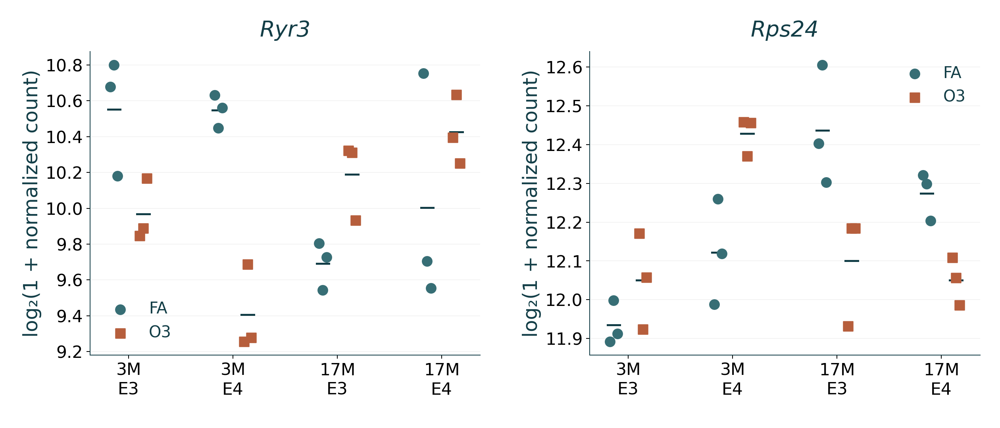{fig-alt="Each gene retains all 24 sequenced animals, grouped by starting age, APOE and exposure. Points show log₂(1 + normalized count), and short segments give descriptive means. Ryr3 and Rps24 belong to the eight age-dependent LRT discoveries. Fixed horizontal offsets only separate symbols, while the factorial model supplies the interaction test." width=100%}

::: {.figure-caption}
Each gene retains all 24 sequenced animals, grouped by starting age, APOE and exposure. Points show log₂(1 + normalized count), and short segments give descriptive means. Ryr3 and Rps24 belong to the eight age-dependent LRT discoveries. Fixed horizontal offsets only separate symbols, while the factorial model supplies the interaction test.
:::

::: {.source}
Analysis: this project[Nakamya et al., IJMS 2025](https://doi.org/10.3390/ijms26062407)
:::

::: {.notes}
Ryr3 and Rps24 come from the fixed age-response LRT selection, rather than a new search for visually impressive genes. Values are log2(1 + existing normalized count), with fixed tiny horizontal offsets and no pairing lines or inferential error bars. Model-based interaction p values come from the negative-binomial fit with covariance, rather than the visual separation of these points. Transformed means in the plot differ conceptually from count-scale GLM means. Three animals per stratum limit generalization.
:::

## ORA and ranked GSEA describe different evidence {#enrichment-results .layout-result}

::: {.slide-eyebrow}
04  /  Project results
:::

| Contrast | ORA up / down terms | GSEA algorithmic-FDR terms |
|---|---|---|
| HY | 0 / 0 | 916 |
| ACA | 86 / 2 | 223 |
| O₃ M3_E3 | 0 / 0 | 4 |
| O₃ M3_E4 | 0 / 0 | 368 |
| O₃ M17_E3 | 0 / 0 | 85 |
| O₃ M17_E4 | 0 / 0 | 23 |
These correlated terms are not counts of independent biological mechanisms.

::: {.source}
Analysis: this project[Subramanian et al., PNAS 2005](https://doi.org/10.1073/pnas.0506580102) · [Gene Ontology Consortium](https://geneontology.org/docs/go-enrichment-analysis/)
:::

::: {.notes}
HY has no ORA terms but 916 ranked GSEA terms because a thresholded foreground and coordinated ranks ask different questions. The large count does not imply 916 independent pathways or resolve the seven-animal uncertainty. ACA has 86 up and 2 down ORA terms. All ozone ORA families are empty at their thresholds, while GSEA finds 4, 368, 85 and 23 terms. Mapping, finite-test universes, propagated ancestry and algorithmic GSEA FDR rather than BH all matter. Enrichment is exploratory and inherits source-design limitations.
:::

## Selected GO patterns across the six RNA contrasts {#go-patterns .figure-slide .figure-interpretation}

::: {.slide-eyebrow}
04  /  Project results
:::

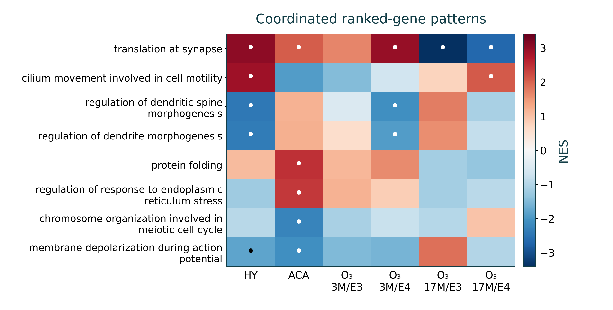{fig-alt="Color gives the signed normalized enrichment score on a common scale, and dots mark algorithmic GSEA FDR &lt; 0.05. Gray cells are ineligible or unavailable. These are the first eight terms of a fixed 22-term display selection. Correlated annotations and selected display terms prevent reading the matrix as independent mechanisms or exhaustive pathway activity." width=100%}

::: {.figure-caption}
Color gives the signed normalized enrichment score on a common scale, and dots mark algorithmic GSEA FDR < 0.05. Gray cells are ineligible or unavailable. These are the first eight terms of a fixed 22-term display selection. Correlated annotations and selected display terms prevent reading the matrix as independent mechanisms or exhaustive pathway activity.
:::

::: {.source}
Analysis: this project[Subramanian et al., PNAS 2005](https://doi.org/10.1073/pnas.0506580102) · [Gene Ontology Consortium](https://geneontology.org/docs/go-enrichment-analysis/)
:::

::: {.notes}
The presentation redraws the first 8 terms from the existing 22-term project display selection for projected readability, without rerunning enrichment. The full 22-term figure and 132 source rows remain in the repository. The selected terms are not an exhaustive or unbiased summary of all GO. A positive NES means enrichment toward the positive contrast rank, rather than demonstrated pathway activation. The separate 20-node GO overlap network has 15 edges at Jaccard ≥ .25 and depicts shared annotations, without establishing regulation, coexpression or spatial connectivity.
:::

## Gene products add biological context without measuring protein {#gene-products}

::: {.slide-eyebrow}
04  /  Project results
:::

| Gene | Annotated product / role | Measured panel |
|---|---|---|
| [Tll1](https://www.ncbi.nlm.nih.gov/gene/21892) | Tolloid-like extracellular processing protease | Yes |
| [Fosb](https://www.ncbi.nlm.nih.gov/gene/14282) | FosB, AP-1 transcription-factor subunit | Yes |
| [S1pr1](https://www.ncbi.nlm.nih.gov/gene/13609) | Sphingosine-1-phosphate receptor | Yes |
| [Hspa5](https://www.ncbi.nlm.nih.gov/gene/14828) | BiP/GRP78 endoplasmic-reticulum chaperone | No |
| [Ksr2](https://www.ncbi.nlm.nih.gov/gene/333050) | RAF–MEK/MAPK scaffold | No |
| [C730002L08Rik](https://www.ncbi.nlm.nih.gov/gene/320155) | Noncoding RNA, no annotated protein | Yes |

::: {.source}
Analysis: this project[NCBI Gene: Tll1](https://www.ncbi.nlm.nih.gov/gene/21892) · [UniProtKB: Tll1](https://www.uniprot.org/uniprotkb/Q62381/entry) · [Zhang et al., Nature 2023](https://doi.org/10.1038/s41586-023-06808-9)
:::

::: {.notes}
Product definitions summarize the frozen NCBI/UniProt evidence, with qualifiers preserved in the full annotation table. RNA expression does not establish enzymatic activity, protein abundance or an exposure mechanism. Fosb gene-level RNA cannot resolve FosB versus ΔFosB isoforms. Ksr2 is interpreted as a scaffold: reported low in-vitro kinase activity does not establish active catalysis here. Noncoding C730002L08Rik has no established protein product. Hspa5 and Ksr2 remain useful bulk candidates even though no measured spatial map is available. No absent gene is replaced with a similarly named atlas gene.
:::

## Measured cortical layers organize the reference cells {#aca-sections .figure-slide .figure-interpretation}

::: {.slide-eyebrow}
04  /  Project results
:::

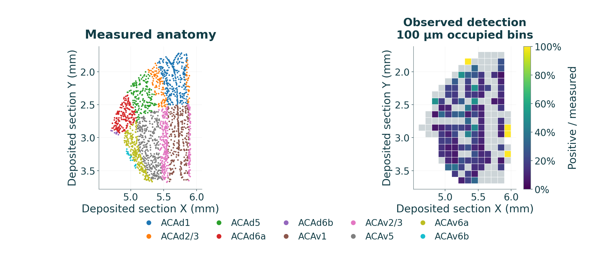{fig-alt="The largest ACA section contains 1,940 measured cells. Left, deposited positions and anatomical labels reveal cortical layers. Right, each occupied 100-µm bin shows measured Fosb-positive cells divided by all measured cells, including zeros. Empty bins remain unobserved. The pattern describes one unexposed donor and does not estimate a layer-specific PM effect." width=100%}

::: {.figure-caption}
The largest ACA section contains 1,940 measured cells. Left, deposited positions and anatomical labels reveal cortical layers. Right, each occupied 100-µm bin shows measured Fosb-positive cells divided by all measured cells, including zeros. Empty bins remain unobserved. The pattern describes one unexposed donor and does not estimate a layer-specific PM effect.
:::

::: {.source}
Analysis: this project[Zhang et al., Nature 2023](https://doi.org/10.1038/s41586-023-06808-9)
:::

::: {.notes}
The section is Zhuang-ABCA-2.023, selected by maximal regional n independently of expression. All measured cells, including zeros, contribute to bin denominators. Layer structure follows the original spatial positions and CCF annotations, without random placement or a simulated point cloud. Empty bins remain unobserved. The complete 18-section ACA reference includes 14582 cells and 10 layers/subdivisions, with the one-cell edge section preserved. These observations describe one unexposed male donor, without identifying layer-specific PM effects.
:::

## Measured hypothalamic nuclei and Tll1 detection {#hy-sections .figure-slide .figure-interpretation}

::: {.slide-eyebrow}
04  /  Project results
:::

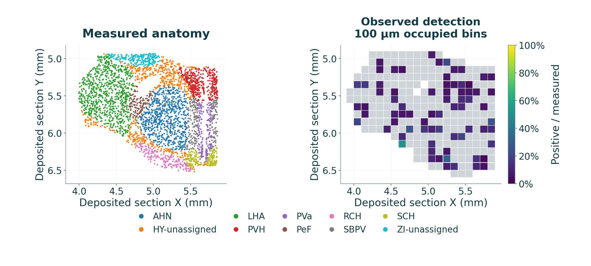{fig-alt="The largest HY section contains 3,565 measured cells. Anatomical labels organize the deposited cell positions, and occupied bins display positive/all-cell detection. Across the complete reference HY, Tll1 is detected in 667 of 37,811 cells, or 1.764%. Sparse detection can reflect biology and assay sensitivity, without resolving either explanation from these data alone." width=100%}

::: {.figure-caption}
The largest HY section contains 3,565 measured cells. Anatomical labels organize the deposited cell positions, and occupied bins display positive/all-cell detection. Across the complete reference HY, Tll1 is detected in 667 of 37,811 cells, or 1.764%. Sparse detection can reflect biology and assay sensitivity, without resolving either explanation from these data alone.
:::

::: {.source}
Analysis: this project[Zhang et al., Nature 2023](https://doi.org/10.1038/s41586-023-06808-9)
:::

::: {.notes}
The example physical section is .034, selected without using Tll1 expression. The complete HY reference has 20 sections and 49 anatomical labels, including unassigned labels. Overall Tll1 detection is 1.764%; a section-specific fraction can differ and retains its own denominator. A low raw count does not distinguish biological absence from limited assay detection. No new intermediate sections or bilateral copies are generated. Descriptive detection by nucleus is not an exposure association test.
:::

## Illustrative regional scaling preserves the measured geometry {#scenario-results .layout-result}

::: {.slide-eyebrow}
04  /  Project results
:::

**ACA / Fosb:** the shrunken bulk effect gives an approximately twofold scenario.

**HY / Tll1:** the shrunken bulk effect gives a 0.428-fold scenario.

- Every positive reference value receives the same regional multiplier for its gene.
- Measured zeros stay zero, and positions and cell counts stay fixed.
- The interface links measured candidates, gene products, source animal results and uncertainty targets.

[Open the paired 3D cortical viewer](https://amarusimonaguerojimenez.github.io/Air-Pollution-Brain-Omics-Mouse/cortex_viewer.html).

::: {.source}
Analysis: this project[Zhang et al., Nature 2023](https://doi.org/10.1038/s41586-023-06808-9)
:::

::: {.notes}
The interactive side-by-side display is a project deliverable, without independently validating a spatial effect. The static full-resolution reference/scenario figure remains linked in the results. A shared scale helps interpret uniform scaling but cannot create cell-specific response information. Relative spatial pattern and detection support remain unchanged under a positive multiplier. Bayesian baseline uncertainty is separate from the bulk Wald alternatives and must not be presented as an exposure interval.

[Full reference/scenario figure](https://amarusimonaguerojimenez.github.io/Air-Pollution-Brain-Omics-Mouse/assets/figures/spatial_cortex/reference_vs_simulation.png).
:::

## Hypothalamus: interactive reference and PM₂.₅ scenario {#hy-3d .figure-slide .figure-interpretation .map3d-slide .interactive-map-slide}

::: {.slide-eyebrow}
04  /  Project results
:::

::: {.inline-atlas data-region="HY" data-default-gene="Tll1"}

<button type="button" class="map-static-toggle" aria-pressed="false">Static image</button><button type="button" class="map-enlarge">Enlarge map</button><button type="button" class="map-focus-slides">Slide navigation</button>Loading interactive map…

::: {.map-stage}

::: {.map-poster}
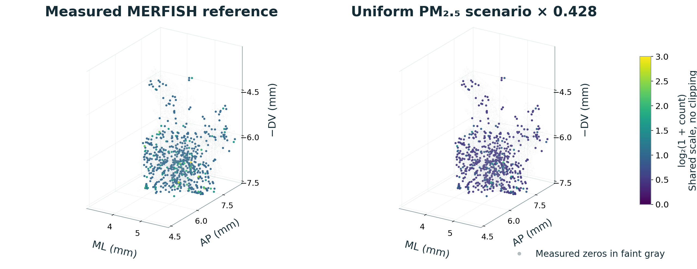{fig-alt="Left shows measured Tll1 counts. Right multiplies every value by 0.42808, carrying the regional shrunken effect into an illustrative scenario. Both panels retain 37,811 positions and the same 667 positive cells. A common color scale reveals the magnitude change. The display does not identify cell-specific exposure responses or infer cell loss." width=100%}

::: {.static-map-caption}
Left shows measured Tll1 counts. Right multiplies every value by 0.42808, carrying the regional shrunken effect into an illustrative scenario. Both panels retain 37,811 positions and the same 667 positive cells. A common color scale reveals the magnitude change. The display does not identify cell-specific exposure responses or infer cell loss.
:::

:::
<iframe class="map-frame" data-map-src="assets/defense-slides/inline-map.html?region=HY&amp;lang=en&amp;defaultgene=Tll1" title="Interactive hypothalamus map" referrerpolicy="same-origin"></iframe>
:::

::: {.live-map-caption}
Drag either map to rotate both scenes. Choose a measured gene and apply it. The panels retain the same registered cells. PM₂.₅ applies one regional multiplier, without identifying cell-specific exposure responses.
:::

:::

::: {.source}
Analysis: this project[Rajagopalan et al., JCI 2020](https://doi.org/10.1172/JCI137315) · [Zhang et al., Nature 2023](https://doi.org/10.1038/s41586-023-06808-9)
:::

::: {.notes}
Static starting example: Hypothalamus, Tll1. Left: actually measured MERFISH imaging counts from the unexposed male Zhuang-ABCA-2 donor. Right: those same counts uniformly multiplied by 2^(-1.224053)=0.42807853, using the regional shrunken bulk effect. All 37,811 cells appear in each panel, without resampling, jitter, interpolation or mirroring. There are 667 measured positive cells; scaling preserves detection and measured zeros. Cameras, axis limits and the log₂(1+count) color scale are identical, with the full joint maximum and no value clipping. Positions belong to the registered hemisphere and are plotted ML, AP, −DV in CCF mm. These coordinates derive from registered sections rather than direct isotropic 3D acquisition. The right panel is an illustration, not a measurement of exposed cells or a Bayesian prediction. The interactive frame is inside the slide. Its current gene and evidence label update together; the static image remains the original Tll1 example. Enlarge opens a dialog inside this presentation. Click Slide navigation to return keyboard focus to the deck. All 1,122 measured genes and their original regional eligibility rules are retained. The complete ZIP includes local viewer assets for offline interaction in a compatible browser.
:::

## Cortex: interactive reference and PM₂.₅ scenario {#aca-3d .figure-slide .figure-interpretation .map3d-slide .interactive-map-slide}

::: {.slide-eyebrow}
04  /  Project results
:::

::: {.inline-atlas data-region="ACA" data-default-gene="Fosb"}

<button type="button" class="map-static-toggle" aria-pressed="false">Static image</button><button type="button" class="map-enlarge">Enlarge map</button><button type="button" class="map-focus-slides">Slide navigation</button>Loading interactive map…

::: {.map-stage}

::: {.map-poster}
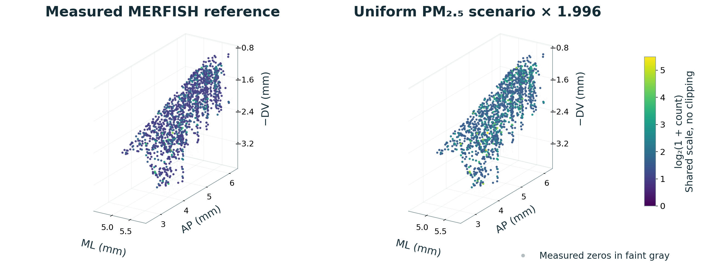{fig-alt="Left shows measured Fosb counts. Right applies the regional 1.996-fold multiplier to the same reference. The 14,582 positions and 1,418 positive cells remain fixed, with a shared full color scale. The brighter scenario illustrates a bulk effect. It does not establish which cortical layers or cell types respond to PM₂.₅." width=100%}

::: {.static-map-caption}
Left shows measured Fosb counts. Right applies the regional 1.996-fold multiplier to the same reference. The 14,582 positions and 1,418 positive cells remain fixed, with a shared full color scale. The brighter scenario illustrates a bulk effect. It does not establish which cortical layers or cell types respond to PM₂.₅.
:::

:::
<iframe class="map-frame" data-map-src="assets/defense-slides/inline-map.html?region=ACA&amp;lang=en&amp;defaultgene=Fosb" title="Interactive cortex map" referrerpolicy="same-origin"></iframe>
:::

::: {.live-map-caption}
Drag either map to rotate both scenes. Choose a measured gene and apply it. The panels retain the same registered cells. PM₂.₅ applies one regional multiplier, without identifying cell-specific exposure responses.
:::

:::

::: {.source}
Analysis: this project[Zhang et al., Science 2025](https://doi.org/10.1126/science.adu4132) · [Zhang et al., Nature 2023](https://doi.org/10.1038/s41586-023-06808-9)
:::

::: {.notes}
Static starting example: Anterior cingulate cortex, Fosb. Left: actually measured MERFISH imaging counts from the unexposed male Zhuang-ABCA-2 donor. Right: those same counts uniformly multiplied by 2^(0.997109)=1.99599627, using the regional shrunken bulk effect. All 14,582 cells appear in each panel, without resampling, jitter, interpolation or mirroring. There are 1,418 measured positive cells; scaling preserves detection and measured zeros. Cameras, axis limits and the log₂(1+count) color scale are identical, with the full joint maximum and no value clipping. Positions belong to the registered hemisphere and are plotted ML, AP, −DV in CCF mm. These coordinates derive from registered sections rather than direct isotropic 3D acquisition. The right panel is an illustration, not a measurement of exposed cells or a Bayesian prediction. The interactive frame is inside the slide. Its current gene and evidence label update together; the static image remains the original Fosb example. Enlarge opens a dialog inside this presentation. Click Slide navigation to return keyboard focus to the deck. All 1,122 measured genes and their original regional eligibility rules are retained. The complete ZIP includes local viewer assets for offline interaction in a compatible browser.
:::

## Spatial Gaussian regression rarely improves the baseline {#gaussian-rmse .figure-slide .figure-interpretation}

::: {.slide-eyebrow}
04  /  Project results
:::

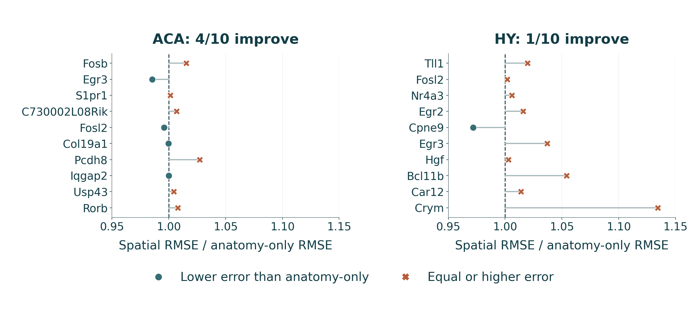{fig-alt="Each point compares spatial-model RMSE with anatomy-only RMSE on identical held-out sections. A ratio below 1 favors the spatial model, which improves 4/10 ACA genes and 1/10 HY genes. Added coordinates and basis functions therefore provide limited benefit here. A smooth full-reference map alone would not reveal this prediction failure." width=100%}

::: {.figure-caption}
Each point compares spatial-model RMSE with anatomy-only RMSE on identical held-out sections. A ratio below 1 favors the spatial model, which improves 4/10 ACA genes and 1/10 HY genes. Added coordinates and basis functions therefore provide limited benefit here. A smooth full-reference map alone would not reveal this prediction failure.
:::

::: {.source}
Analysis: this project[Zhang et al., Nature 2023](https://doi.org/10.1038/s41586-023-06808-9) · [Murphy, 2007, Gaussian conjugacy](https://www.cs.ubc.ca/~murphyk/Papers/bayesGauss.pdf)
:::

::: {.notes}
Tll1 RMSE is .109713 for the spatial model, .107582 for anatomy only and .107175 for kNN. Fosb RMSE is .297687, .293223 and .301802, respectively. All losses use natural ln(1 + raw imaging count). Ratios below 1 favor the spatial model, but these are descriptive comparisons within one donor, without a significance test assuming independent cells. Four prespecified sensitivity configurations inspect length and prior choices without test-selected tuning. Smooth maps alone do not establish predictive gain.
:::

## Overall coverage hides important Gaussian limitations {#gaussian-diagnostics .figure-slide .figure-interpretation}

::: {.slide-eyebrow}
04  /  Project results
:::

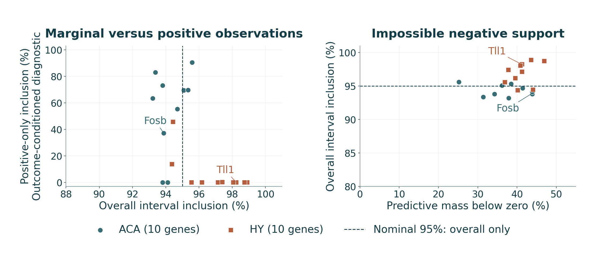{fig-alt="Left, overall interval inclusion can be high while inclusion among positive observations is poor. Positive-only inclusion is a conditional diagnostic, without a nominal 95% target. Right, the Gaussian predictive distribution assigns mass below zero on log(1 + count), an impossible range. Together these checks expose limitations hidden by marginal coverage alone." width=100%}

::: {.figure-caption}
Left, overall interval inclusion can be high while inclusion among positive observations is poor. Positive-only inclusion is a conditional diagnostic, without a nominal 95% target. Right, the Gaussian predictive distribution assigns mass below zero on log(1 + count), an impossible range. Together these checks expose limitations hidden by marginal coverage alone.
:::

::: {.source}
Analysis: this project[Zhang et al., Nature 2023](https://doi.org/10.1038/s41586-023-06808-9) · [Murphy, 2007, Gaussian conjugacy](https://www.cs.ubc.ca/~murphyk/Papers/bayesGauss.pdf)
:::

::: {.notes}
Median marginal coverage is 97.27% in HY and 94.00% in ACA. Positive-tail inclusion medians are 0% and 66.46%; the 95% nominal marginal target does not apply after conditioning on a positive realized outcome. Nevertheless, median predictive mass below zero is 41.06% in HY and 38.19% in ACA, which is physically impossible for ln(1 + count). Tll1 overall coverage of 98.24% coexists with 0/667 positive inclusion and 41.24% negative predictive mass. These findings and limited baseline gains prevent a validated cellular RNA reconstruction claim. Negative means and bounds remain visible rather than being clipped.
:::

## Bounded detection improves modestly in ACA but fails in HY {#beta-performance .figure-slide .figure-interpretation}

::: {.slide-eyebrow}
04  /  Project results
:::

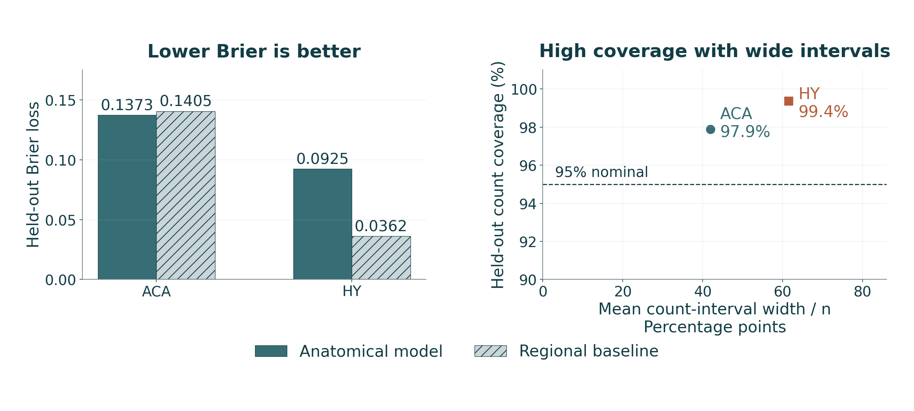{fig-alt="Lower Brier loss favors the model. ACA improves modestly, 0.13725 versus 0.14051, while HY worsens, 0.09246 versus 0.03621. The coverage–width plot shows that high predictive count coverage accompanies wide intervals. These held-out comparisons retain prior-only anatomical groups, so bounded probabilities alone do not establish accurate or transferable prediction." width=100%}

::: {.figure-caption}
Lower Brier loss favors the model. ACA improves modestly, 0.13725 versus 0.14051, while HY worsens, 0.09246 versus 0.03621. The coverage–width plot shows that high predictive count coverage accompanies wide intervals. These held-out comparisons retain prior-only anatomical groups, so bounded probabilities alone do not establish accurate or transferable prediction.
:::

::: {.source}
Analysis: this project[Zhang et al., Nature 2023](https://doi.org/10.1038/s41586-023-06808-9) · [SciPy, beta-binomial distribution](https://docs.scipy.org/doc/scipy/reference/generated/scipy.stats.betabinom.html)
:::

::: {.notes}
Pooled ten-gene count PI coverage is 1253/1280 = 97.89% for ACA and 1848/1860 = 99.35% for HY. Mean count PI width divided by n is 41.9 and 61.5 percentage points. These are gene×section×anatomy evaluations, without independent animals. In HY, 79/186 unique groups per gene and 10416/37811 actual cells are prior-only under the held-out folds. The fixed symmetric prior can predict detection poorly for rare genes. Trained-anatomy-only HY Brier of .032557 versus .032877 is a small restricted improvement and does not replace full-support failure. The model targets detection, rather than count magnitude.
:::

## Prediction quality depends on error, coverage and support {#explain-model-failure .explanation-slide}

::: {.slide-eyebrow}
04  /  Project results
:::

**Prediction error.** The bounded model has slightly lower Brier loss than the regional baseline in ACA. In HY, its full evaluation is worse than the baseline.

**Training support.** In each HY gene evaluation, 79 of 186 reserved section–anatomy groups contain anatomical labels unavailable in training. Their predictions depend only on the stated prior and remain in the score.

**Uncertainty.** Wide intervals can cover many outcomes while providing little precision. Bounded probabilities, stable numerical integration and visually plausible maps do not by themselves demonstrate useful prediction or higher spatial resolution.

::: {.source}
Analysis: this project[Zhang et al., Nature 2023](https://doi.org/10.1038/s41586-023-06808-9) · [Murphy, 2007, Gaussian conjugacy](https://www.cs.ubc.ca/~murphyk/Papers/bayesGauss.pdf) · [SciPy, beta-binomial distribution](https://docs.scipy.org/doc/scipy/reference/generated/scipy.stats.betabinom.html)
:::

::: {.notes}
Brier loss is the mean squared error of predicted detection probabilities against cell detection outcomes, here using the specified cell weighting. Lower values are better only for the same evaluation target and cells. The 79/186 figures are unique HY section×anatomy groups per gene, and 10,416 of 37,811 actual reference cells fall in prior-only groups. Repeating evaluation across ten genes does not create new cells. The restricted trained-anatomy HY comparison improves slightly, but excluding unsupported groups would answer a narrower question and cannot replace the full reported failure.
:::

## ACA posterior detection separates uncertainty targets {#beta-aca .figure-slide .figure-interpretation}

::: {.slide-eyebrow}
04  /  Project results
:::

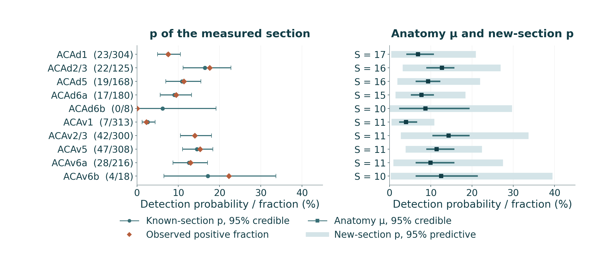{fig-alt="For Fosb, the left panel compares observed fractions with known-section posterior probabilities. The right panel separates anatomy-mean credible intervals from new-section propensity predictions. The pale interval expresses section-to-section uncertainty, and its target differs from the dark hypermean interval. These full-reference estimates describe the unexposed donor, while held-out performance is evaluated separately." width=100%}

::: {.figure-caption}
For Fosb, the left panel compares observed fractions with known-section posterior probabilities. The right panel separates anatomy-mean credible intervals from new-section propensity predictions. The pale interval expresses section-to-section uncertainty, and its target differs from the dark hypermean interval. These full-reference estimates describe the unexposed donor, while held-out performance is evaluated separately.
:::

::: {.source}
Analysis: this project[Zhang et al., Nature 2023](https://doi.org/10.1038/s41586-023-06808-9) · [SciPy, beta-binomial distribution](https://docs.scipy.org/doc/scipy/reference/generated/scipy.stats.betabinom.html)
:::

::: {.notes}
At the selected known section, p conditioned on its own observed counts is a fitted summary, without being an out-of-fold prediction. Anatomy μ is a mean over exchangeable section propensities, whereas the measured pooled fraction weights actual cells. The new-section p distribution models section heterogeneity and differs from a count prediction with denominator n. Small layers can have wider or differently shaped uncertainty, without resolving exposure effects. ACA/Fosb held-out Brier of .08745 versus .08803 shows only a small gain, with count PI coverage of 99.2% and width fraction .345.
:::

## HY fitted anatomy does not guarantee held-out prediction {#beta-hy .figure-slide .figure-interpretation}

::: {.slide-eyebrow}
04  /  Project results
:::

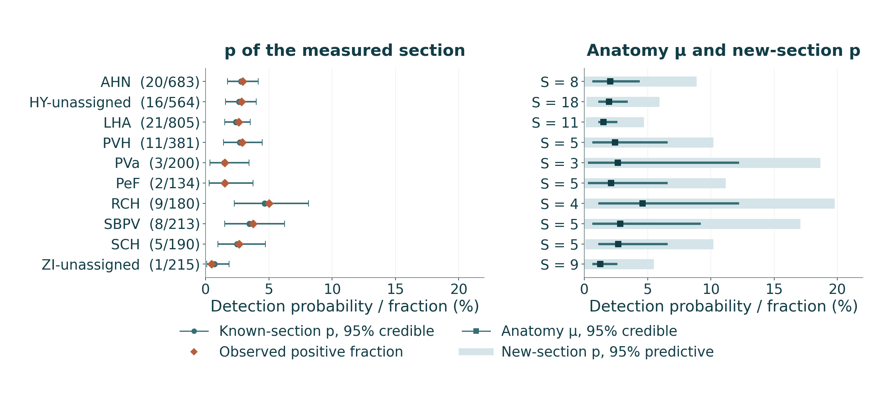{fig-alt="For Tll1, fitted section probabilities remain within 0–1 despite sparse detections. The anatomy mean and new-section propensity carry different uncertainty. A fitted map can still look plausible when held-out anatomical labels lack training support. The full HY evaluation retains those groups, making the resulting prior dependence visible in the reported prediction error." width=100%}

::: {.figure-caption}
For Tll1, fitted section probabilities remain within 0–1 despite sparse detections. The anatomy mean and new-section propensity carry different uncertainty. A fitted map can still look plausible when held-out anatomical labels lack training support. The full HY evaluation retains those groups, making the resulting prior dependence visible in the reported prediction error.
:::

::: {.source}
Analysis: this project[Zhang et al., Nature 2023](https://doi.org/10.1038/s41586-023-06808-9) · [SciPy, beta-binomial distribution](https://docs.scipy.org/doc/scipy/reference/generated/scipy.stats.betabinom.html)
:::

::: {.notes}
HY/Tll1 all-group held-out Brier of .08329 is worse than the regional value .01772. Count coverage is 98.9%, but mean width/n is .600 and 79 of 186 groups are prior-only. The displayed full-reference posterior uses all reference sections and can therefore look reasonable even when guarded prediction fails. Showing both prevents conflating fit and generalization. A class filter in the interface hides the all-class estimates instead of pretending to refit a class-specific model. The posterior forest adds neither spatial resolution nor PM-responsive cells.
:::

## Numerical stability and predictive usefulness are separate {#numerics .layout-result}

::: {.slide-eyebrow}
04  /  Project results
:::

| 64×48 versus 96×64 grid | ACA | HY |
|---|---|---|
| Maximum mean μ change | 0.000192 | 0.000537 |
| Maximum μ interval endpoint change | 0.0203 | 0.0181 |
| Maximum new-section p endpoint change | 0.00254 | 0.00358 |
| Held-out count coverage | 97.89% → 98.05% | 99.35% unchanged |
Finite-grid and seeded simulation checks support computational review. They do not repair weak prediction or validate the priors biologically.

::: {.source}
Analysis: this project[Zhang et al., Nature 2023](https://doi.org/10.1038/s41586-023-06808-9) · [Murphy, 2007, Gaussian conjugacy](https://www.cs.ubc.ca/~murphyk/Papers/bayesGauss.pdf) · [SciPy, beta-binomial distribution](https://docs.scipy.org/doc/scipy/reference/generated/scipy.stats.betabinom.html)
:::

::: {.notes}
OOF Brier differences are at most 10⁻⁶ in the fine-grid comparison. Coverage status changes for four ACA groups and no HY groups. Discrete μ interval quantiles can move more than means, so reporting mean stability alone would overstate uncertainty convergence. Deterministic new-p CDF inversion removes Monte Carlo noise from that particular diagnostic; known-section p and held-out counts still use 8192 seeded draws. An independent Gaussian posterior simulation check verifies analytic uncertainty transport without proving likelihood adequacy. Implementation checks do not establish blanket scientific success.
:::

## Limits that change the scientific interpretation {#limits .small .layout-result}

::: {.slide-eyebrow}
05  /  Interpretation
:::

| Evidence layer | Supported inference | Boundary |
|---|---|---|
| Author reproduction | Numerical recovery using source data | No new biological replicates |
| Bulk / miRNA contrasts | Study-specific regional associations | Composition, small n and source metadata |
| GO and response interactions | Exploratory coordinated patterns / defined contrasts | Multiplicity, correlated terms, model assumptions |
| Measured atlas | Detection at original cell positions | One donor, targeted panel, section gaps |
| Spatial Bayesian models | Conditional reference estimates and held-out diagnostics | Limited baseline gain, prior support, model misspecification |
| PM₂.₅ scenario | Uniform group-effect illustration | No identified cellular exposure response |

::: {.source}
Scientific references[Rajagopalan et al., JCI 2020](https://doi.org/10.1172/JCI137315) · [Zhang et al., Science 2025](https://doi.org/10.1126/science.adu4132) · [Nakamya et al., IJMS 2025](https://doi.org/10.3390/ijms26062407)
:::

::: {.notes}
These operational limits determine the claims the figures support. One donor cannot establish population-level spatial prevalence. A finer plotting grid cannot increase acquisition resolution. Direct pollutant-exposed spatial RNA or matched single-cell data would be needed to estimate cellular responses rather than assume uniform scaling. Additional independent donors are needed to assess the transfer of spatial priors and calibrate uncertainty beyond one reference specimen.
:::

## Conclusions supported by the completed work {#conclusions .layout-statement}

::: {.slide-eyebrow}
05  /  Interpretation
:::

::: {.statement-grid}

::: {.statement-metric}

04

conclusions supported by the evidence

:::

::: {.statement-copy}
1. Cortex author-aligned reconstruction recovers all four significant-gene sets, alongside an unresolved source-quality signal.
2. New reanalyses expose model, testing-family and small-sample sensitivity. Age-dependent ozone response receives the clearest joint interaction signal.
3. Measured sections, gene products and bounded detection models improve interpretation of the reference atlas.
4. Spatial validation reports limited prediction gains and model failures openly. The work does not establish an exposed cellular brain reconstruction.
:::

:::

::: {.source}
Scientific references[Rajagopalan et al., JCI 2020](https://doi.org/10.1172/JCI137315) · [Zhang et al., Science 2025](https://doi.org/10.1126/science.adu4132) · [Nakamya et al., IJMS 2025](https://doi.org/10.3390/ijms26062407)
:::

::: {.notes}
A defense should preserve the strengths and failures together. The strongest exact computational result is cortex count-level reproduction. The most direct newly tested exposure-heterogeneity evidence is the age-dependent joint LRT, with multiplicity-family sensitivity explicit. The spatial contribution is a reproducible measured-reference explorer and evaluated conditional models, without resolution enhancement. “New” denotes a project-specific contribution. Independent experimental validation and complete source metadata remain future requirements.
:::

## Future work requires independent biological information {#future .layout-statement}

::: {.slide-eyebrow}
05  /  Interpretation
:::

::: {.statement-grid}

::: {.statement-metric}

NEXT

independent biological validation

:::

::: {.statement-copy}
- Recover source sex/identity metadata and missing author RUVg specifications.
- Validate bulk candidates in independent animals and matched cell populations.
- Evaluate sparse-count or hurdle models and cross-donor spatial prediction.
- Acquire pollutant-exposed spatial/single-cell measurements before inferring cell-specific responses.
- Explore UCSC Genome Browser, Ensembl and ENCODE for compatible brain epigenomic evidence.
:::

:::

::: {.notes}
The epigenomics item records the user's proposed next direction, without completed retrieval or analysis. This deck claims no epigenetic track, enhancer assignment, chromatin accessibility result or NO₂ exposure dataset. Compatibility would require matching species, genome build, brain region, cell type, age and assay. A compatible reference chromatin track would provide baseline regulatory context, rather than a measured pollution response unless the experimental design supports that contrast. Alternative statistical models should be judged using prespecified held-out units and uncertainty calibration, rather than selecting models for more visually detailed maps.
:::

## Reproducibility and discussion {#discussion}

::: {.slide-eyebrow}
05  /  Interpretation
:::

**Complete evidence:** source mappings, analytical populations, model code, frozen references, tables and bilingual figures.

**Presentation controls:** arrow keys navigate, Esc opens overview, Notes opens the detailed explanation, and the language switch keeps the same slide.

[Scientific report](https://amarusimonaguerojimenez.github.io/Air-Pollution-Brain-Omics-Mouse/) · [Repository](https://github.com/AmaruSimonAgueroJimenez/Air-Pollution-Brain-Omics-Mouse)

The following appendix contains protocols, formulas, sensitivity checks, candidate lists and references.

::: {.notes}
This is a convenient end of the main presentation. The appendix supports methodological questioning without requiring every technical table during the oral defense. The HTML embeds its figures, stylesheet, runtime and native math for offline display. Online source/report links still require access to the repository or published site. Notes are available through the in-page drawer even when the standard external speaker window cannot load offline. No new model fitting occurs when opening the slides.
:::

## Technical appendix {#appendix .section-slide data-background-color="#103d49"}

::: {.slide-eyebrow}
06  /  Technical appendix
:::

Protocols, testing families, prior definitions and reproducibility

::: {.notes}
The appendix supports detailed examination. It is not necessary to project all appendix slides during the main presentation.
:::

## PM₂.₅ exposure protocols remain distinct {#a-pm-protocols .appendix .small .layout-study}

::: {.slide-eyebrow}
06  /  Technical appendix
:::

| Arm | Starting context | Protocol | Timing caution |
|---|---|---|---|
| HY / GSE145840 | Male C57BL/6J, 3 weeks | About 60–120 µg/m³, mean 80; 6 h/day, 5 days/week, 14 weeks | Terminal age/harvest lag not independently reported |
| ACA / GSE297423 | hWT αSyn, 2 months, sex unreported | 2 µL of 5 mg/mL PM intranasal, every 2 days for 2 months | Separate from older conventional-mouse arm |
| miRNA / GSE93967 | Male C57BL/6, about 8 weeks | 1 or 5 mg/kg oropharyngeal aspiration, every other day for 4 weeks | Harvest 18 h after final dose |

::: {.source}
Scientific references[Rajagopalan et al., JCI 2020](https://doi.org/10.1172/JCI137315) · [Zhang et al., Science 2025](https://doi.org/10.1126/science.adu4132) · [Ku et al., Part. Fibre Toxicol. 2017](https://doi.org/10.1186/s12989-017-0215-3)
:::

::: {.notes}
These protocols come from the saved source-paper/deposited metadata review, with per-arm evidence locators in reproducibility record. Atmosphere concentration is not converted into an instilled body-weight dose. Arithmetic starting-age plus duration is not substituted for a reported terminal age. The cortex and miRNA liquid administration routes should not be described as chamber inhalation. Exact platform and sample IDs remain linked in the accession metadata.
:::

## Ozone protocol and sequenced sample size {#a-ozone-protocol .appendix}

::: {.slide-eyebrow}
06  /  Technical appendix
:::

- Male human APOE3/APOE4 targeted-replacement mice.
- Start exposure at 3 or 17 months.
- **0.8 ppm O₃, 7 h/day for five days**, followed by nine days of filtered air.
- Repeat eight cycles. Left hippocampus enters RNA-seq.
- Paper-wide 14–16 animals per group differs from **three sequenced animals per stratum**.
- One SDRF strain string differs for Sample1 / ERR14708304.

::: {.source}
Scientific references[Nakamya et al., IJMS 2025](https://doi.org/10.3390/ijms26062407)
:::

::: {.notes}
Eight 14-day cycles imply 112 days, a calendar calculation rather than an individually recorded collection date. Chamber geometry and the exact lag from the last ozone exposure to tissue collection are not independently established in the reviewed source, so no whole-body/nose-only label or precise terminal age is added. The one strain-string exception remains an annotation caveat, without an assertion that it confounds the entire genotype comparison. The sequenced subset defines the inferential n.
:::

## Median-of-ratios normalization and length offsets {#a-normalization .appendix .formula-slide .layout-equation}

::: {.slide-eyebrow}
06  /  Technical appendix
:::

::: {.equation-grid}

::: {.equation-core}
$$G_g=\left(\prod_i K_{gi}\right)^{1/m},\qquad
s_i=\operatorname{median}_{g}\left(\frac{K_{gi}}{G_g}\right)$$
:::

::: {.equation-detail}
For count genes with a usable geometric mean:

Normalized PM counts are $K_{gi}/s_i$. Size factors use the retained analysis universe.

Ozone uses sample/gene effective-length normalization through tximport. TPM is not substituted as negative-binomial input.

VST/PCA and row-standardized heatmaps are descriptive transforms, separate from the count likelihood.
:::

:::

::: {.source}
Scientific references[Love et al., Genome Biol. 2014](https://doi.org/10.1186/s13059-014-0550-8) · [Soneson et al. 2015](https://doi.org/10.12688/f1000research.7563.2) · [Rajagopalan et al., JCI 2020](https://doi.org/10.1172/JCI137315)
:::

::: {.notes}
This is the standard ratio definition on usable positive geometric means, not a promise that every retained gene contributes to every factor. The project saves estimated size factors and unchanged source matrices. Within-gene heatmap z scores remove magnitude and are not cross-gene expression levels. A PCA dimension is not a biological cell type or an adjusted exposure effect. Those visual transformations do not alter the original likelihood input or multiplicity family.
:::

## Empirical-Bayes moderation in limma {#a-limma .appendix .formula-slide .layout-equation}

::: {.slide-eyebrow}
06  /  Technical appendix
:::

::: {.equation-grid}

::: {.equation-core}
$$s_{f,\mathrm{post}}^2=
\frac{d_0s_{0f}^2+d_fs_f^2}{d_0+d_f}$$

$$t_{f,\mathrm{mod}}=
\frac{\widehat\Delta_f}{s_{f,\mathrm{post}}\sqrt{v_f}}$$
:::

::: {.equation-detail}
The prior variance trend depends on signal level. Moderation borrows information across features.

Pointwise moderated t intervals and BH across features answer different questions.

No verified pairing or batch variable is invented for the nine arrays.
:::

:::

::: {.source}
Scientific references[Ritchie et al., NAR 2015](https://doi.org/10.1093/nar/gkv007) · [Ku et al., Part. Fibre Toxicol. 2017](https://doi.org/10.1186/s12989-017-0215-3)
:::

::: {.notes}
The formula expresses the residual variance moderation used by limma, with v_f the unscaled contrast variance. trend=TRUE permits a signal-dependent prior scale. The model uses robust=FALSE. Total moderated degrees of freedom enter t tests and intervals, subject to limma's implementation conventions. This is an empirical-Bayes array analysis, distinct from the fixed-prior hierarchical spatial model. It does not resolve uncertainty in the supplied measurement scale.
:::

## Multiplicity families and non-nested discovery lists {#a-multiplicity .appendix}

::: {.slide-eyebrow}
06  /  Technical appendix
:::

| Example | Family | BH discoveries |
|---|---|---|
| O₃ stratum tests | Each stratum separately | 0 / 399 / 2 / 3 |
| O₃ stratum tests | All four valid p-value families | 1 / 43 / 4 / 6 |
| Age-dependent exposure LRT | Its own gene family | 8 |
| Three secondary LRTs | All valid tests pooled | 1 age-response hit |
Pooled BH adjusts a different p-value collection. Neither list is selected to maximize discoveries.

::: {.source}
Scientific references[Nakamya et al., IJMS 2025](https://doi.org/10.3390/ijms26062407) · [Love et al., Genome Biol. 2014](https://doi.org/10.1186/s13059-014-0550-8)
:::

::: {.notes}
A pooled BH family can alter both m and the ranks of a stratum's p values, so selected sets need not nest within a smaller separately corrected family. All denominator and validity rules are preserved. The primary hypothesis and supplementary sensitivity remain labeled. GSEA algorithmic FDR is not inserted into these BH comparisons. A q threshold is a decision rule under a model, not a discontinuous biological boundary.
:::

## Software and leave-one-animal-out sensitivity {#a-software-loo .appendix}

::: {.slide-eyebrow}
06  /  Technical appendix
:::

| HY check | Saved result |
|---|---|
| PyDESeq2 versus R BH hits | 11 versus 12 |
| Effect Pearson correlation | 0.9999999996 |
| Cook status agreement | All 19,611 retained genes |
| Discordant BH threshold gene | Tnrc6c: Python 0.05211, R 0.03992 |
| Leave-one-out BH hit range | 0–825 |
| Direction of 11 primary hits | Preserved in all seven omissions |

::: {.source}
Scientific references[Love et al., Genome Biol. 2014](https://doi.org/10.1186/s13059-014-0550-8) · [Muzellec et al. 2023](https://doi.org/10.1093/bioinformatics/btad547) · [Rajagopalan et al., JCI 2020](https://doi.org/10.1172/JCI137315)
:::

::: {.notes}
Tnrc6c effects differ by only about −3.3×10⁻⁶ log2 units, while small SE differences cross the q decision boundary. This is implementation sensitivity, not evidence that one software is biologically correct. Neither the software choice nor an animal omission was selected to increase hits. No primary hit retains q < .05 in every omission, even when every direction agrees. These checks illustrate why effect continuity, uncertainty and threshold decisions should be discussed together.
:::

## Hypothalamic measured candidates {#a-genes-hy .appendix .tiny}

::: {.slide-eyebrow}
06  /  Technical appendix
:::

| Gene | Primary q | MLE log₂FC | Shrunken log₂FC | Evidence |
|---|---|---|---|---|
| Tll1 | 0.0035 | -1.344 | -1.224 | q<.05 |
| Fosl2 | 0.0574 | -1.343 | -1.149 | q≥.05 |
| Nr4a3 | 0.0574 | -1.451 | -1.246 | q≥.05 |
| Egr2 | 0.0766 | -3.943 | -0.024 | q≥.05 |
| Cpne9 | 0.0793 | +2.253 | +1.915 | q≥.05 |
| Egr3 | 0.0793 | -4.238 | -0.020 | q≥.05 |
| Hgf | 0.106 | -3.455 | -0.027 | q≥.05 |
| Bcl11b | 0.111 | -3.601 | -0.023 | q≥.05 |
| Car12 | 0.111 | -3.652 | -0.023 | q≥.05 |
| Crym | 0.111 | -3.629 | -0.023 | q≥.05 |
Only Tll1 is primary-BH significant in HY; nine displayed candidates remain exploratory.

::: {.notes}
The rows preserve the frozen measured-panel priority rule and original regional inference. The source table also provides pointwise 95% intervals, gene products, biotypes, source URLs and QC flags. These estimates are regional bulk effects, not individual-cell changes. The Bayesian atlas models use baseline measurements of these candidate transcripts and do not refit the regional contrast.
:::

## Cortical measured candidates {#a-genes-aca .appendix .tiny}

::: {.slide-eyebrow}
06  /  Technical appendix
:::

| Gene | Primary q | MLE log₂FC | Shrunken log₂FC | Evidence |
|---|---|---|---|---|
| Fosb | 2.27e-19 | +1.018 | +0.997 | q<.05 |
| Egr3 | 6.33e-14 | +0.629 | +0.611 | q<.05 |
| S1pr1 | 1.95e-07 | +0.539 | +0.512 | q<.05 |
| C730002L08Rik | 1.51e-06 | -0.630 | -0.594 | q<.05 |
| Fosl2 | 3.11e-06 | +0.542 | +0.509 | q<.05 |
| Col19a1 | 5.3e-06 | -0.494 | -0.463 | q<.05 |
| Pcdh8 | 7.43e-06 | +0.474 | +0.444 | q<.05 |
| Iqgap2 | 1.79e-05 | +0.440 | +0.410 | q<.05 |
| Usp43 | 3.09e-05 | -0.867 | -0.800 | q<.05 |
| Rorb | 3.36e-05 | -0.418 | -0.388 | q<.05 |
All ten displayed ACA candidates satisfy the primary regional BH threshold.

::: {.notes}
The rows preserve the frozen measured-panel priority rule and original regional inference. The source table also provides pointwise 95% intervals, gene products, biotypes, source URLs and QC flags. These estimates are regional bulk effects, not individual-cell changes. The Bayesian atlas models use baseline measurements of these candidate transcripts and do not refit the regional contrast.
:::

## Gaussian assumptions and prespecified sensitivity {#a-gaussian-assumptions .appendix}

::: {.slide-eyebrow}
06  /  Technical appendix
:::

| Component | Primary specification | Sensitivity / limitation |
|---|---|---|
| Residual | Normal, variance σ² | Sparse nonnegative response may violate support |
| Section effect | Normal, variance 0.25σ² | New section contributes 0.25σ² |
| RBF lengths AP/DV/ML | 0.60 / 0.45 / 0.45 mm | Multiply all by 0.5 or 2 |
| Spatial prior variances | Fixed diagonal entries | Multiply by 0.25 or 4 |
| Unknown anatomy | Prior mean 0, extra variance 1×σ² | Report unavailable training anatomy |
| Validation | 5 guarded whole-section blocks | Within one donor only |

::: {.source}
Scientific references[Zhang et al., Nature 2023](https://doi.org/10.1038/s41586-023-06808-9) · [Murphy, 2007, Gaussian conjugacy](https://www.cs.ubc.ca/~murphyk/Papers/bayesGauss.pdf) · [Rasmussen & Williams, 2006, ch. 2](https://gaussianprocess.org/gpml/chapters/RW2.pdf)
:::

::: {.notes}
The implementation performs 60 fold-level Gaussian fits and two full-reference fits across the two regions. Each solve processes ten response columns while retaining gene-specific coefficients and residual scales. The fold-level fits cover the primary spatial model, the anatomy-only baseline and four prespecified spatial sensitivity configurations. kNN is evaluated separately. A successful linear algebra check or posterior simulation test verifies computation, without validating the Gaussian likelihood. Hyperparameters remain fixed, with no held-out tuning.
:::

## Beta-binomial likelihood and new-section prediction {#a-beta-marginal .appendix .formula-slide .layout-equation}

::: {.slide-eyebrow}
06  /  Technical appendix
:::

::: {.equation-grid}

::: {.equation-core}
$$P(Y=y\mid n,\mu,\kappa)=\binom ny
\frac{B(y+\mu\kappa,n-y+(1-\mu)\kappa)}
{B(\mu\kappa,(1-\mu)\kappa)}$$

$$\rho=\frac1{\kappa+1}$$

$$p_s\mid y,n,\mu,\kappa\sim
\operatorname{Beta}(\mu\kappa+y,(1-\mu)\kappa+n-y).$$
:::

::: {.equation-detail}
Known-section components update to

Hyperposterior-weighted mixtures preserve parameter uncertainty.
:::

:::

::: {.source}
Scientific references[Zhang et al., Nature 2023](https://doi.org/10.1038/s41586-023-06808-9) · [SciPy, beta-binomial distribution](https://docs.scipy.org/doc/scipy/reference/generated/scipy.stats.betabinom.html)
:::

::: {.notes}
For a new section, draw or integrate p from the unupdated Beta(muκ, (1−mu)κ) mixture, then sample a binomial count at the desired n if the target is Y. The known-section posterior conditions on the observed section itself, which is legitimate for fitted estimation but not for an out-of-fold prediction. Conditional intraclass correlation rho summarizes the beta-binomial overdispersion model, not an experimentally measured cell correlation. Fits are independent by anatomy/gene and do not borrow a spatially adjacent anatomy's data as if it were the same category.
:::

## Marginal coverage and outcome-conditioned diagnostics {#a-coverage .appendix .formula-slide .layout-equation .wide-equation}

::: {.slide-eyebrow}
06  /  Technical appendix
:::

::: {.equation-core}
$$P\{Y_*\in I_{0.95}(X_*,D)\}\approx0.95.$$

$$P\{Y_*\in I_{0.95}(X_*,D)\mid Y_*>0\}=0.95.$$
:::

::: {.equation-detail}
A nominal prediction interval targets a marginal statement:

It does not impose

Positive-only inclusion is a descriptive tail-recovery diagnostic.

Impossible negative predictive support is a separate likelihood limitation.
:::

::: {.source}
Scientific references[Zhang et al., Nature 2023](https://doi.org/10.1038/s41586-023-06808-9) · [Murphy, 2007, Gaussian conjugacy](https://www.cs.ubc.ca/~murphyk/Papers/bayesGauss.pdf) · [SciPy, beta-binomial distribution](https://docs.scipy.org/doc/scipy/reference/generated/scipy.stats.betabinom.html)
:::

::: {.notes}
This distinction prevents the misleading conclusion that positive-only inclusion below 95% by itself disproves marginal calibration. The Gaussian model can have high overall coverage because zeros dominate. Poor positive-tail recovery remains scientifically informative for the goal of reconstructing positive RNA observations. Combined with negative support and weak baseline performance, it limits usefulness. Beta count-interval coverage uses a different discrete target and must be interpreted alongside its substantial widths and prior-only strata.
:::

## Data and analyses outside the completed scope {#a-outstanding .appendix}

::: {.slide-eyebrow}
06  /  Technical appendix
:::

- NO₂ brain papers remain in the literature inventory, without a complete expression matrix entering these four models.
- No exposed spatial or single-cell brain dataset is synthesized as measured evidence.
- Genes outside the targeted MERFISH panel remain unmeasured.
- UCSC, Ensembl and ENCODE epigenomic integration remains proposed future work.
- Independent cross-donor and exposure validation remains outstanding.

::: {.notes}
A defense deck should not turn an earlier search, downloaded paper or proposed future direction into a completed analysis. The original scope includes PM2.5 and O3 brain experiments and a separate unexposed spatial reference. An unavailable matrix cannot be replaced by supplementary hit lists for sample-level modeling. Cross-study differences in routes, ages, genotypes and measurement scales preclude a pooled pollutant coefficient in this project.
:::

## Primary studies and spatial reference {#a-primary-refs .appendix .small}

::: {.slide-eyebrow}
06  /  Technical appendix
:::

**Rajagopalan et al. (2020).** Metabolic effects of air pollution exposure and reversibility. J Clin Invest. [doi:10.1172/JCI137315](https://doi.org/10.1172/JCI137315)

**Zhang et al. (2025).** Lewy body dementia promotion by air pollutants. Science. [doi:10.1126/science.adu4132](https://doi.org/10.1126/science.adu4132)

**Ku et al. (2017).** NF-κB-regulated microRNA-574-5p underlies synaptic and cognitive impairment in response to atmospheric PM₂.₅ aspiration. Particle and Fibre Toxicology. [doi:10.1186/s12989-017-0215-3](https://doi.org/10.1186/s12989-017-0215-3)

**Nakamya et al. (2025).** Age- and ApoE Genotype-Dependent Transcriptomic Responses to O₃ in the Hippocampus of Mice. Int J Mol Sci. [doi:10.3390/ijms26062407](https://doi.org/10.3390/ijms26062407)

**Zhang et al. (2023).** Molecularly defined and spatially resolved cell atlas of the whole mouse brain. Nature. [doi:10.1038/s41586-023-06808-9](https://doi.org/10.1038/s41586-023-06808-9)

::: {.notes}
These are the primary source studies, not five matched exposure cohorts. Exact full bibliographic records, article-reading copies and source locators are retained locally. Public material links to original publications rather than redistributing restricted full text.
:::

## Statistical software references {#a-method-refs .appendix .small}

::: {.slide-eyebrow}
06  /  Technical appendix
:::

**DESeq2:** Love et al. 2014. [10.1186/s13059-014-0550-8](https://doi.org/10.1186/s13059-014-0550-8)

**PyDESeq2:** Muzellec et al. 2023. [10.1093/bioinformatics/btad547](https://doi.org/10.1093/bioinformatics/btad547)

**limma:** Ritchie et al. 2015. [10.1093/nar/gkv007](https://doi.org/10.1093/nar/gkv007)

**Salmon:** Patro et al. 2017. [10.1038/nmeth.4197](https://doi.org/10.1038/nmeth.4197)

**tximport:** Soneson et al. 2015. [10.12688/f1000research.7563.2](https://doi.org/10.12688/f1000research.7563.2)

**apeglm:** Zhu et al. 2019. [10.1093/bioinformatics/bty895](https://doi.org/10.1093/bioinformatics/bty895)

::: {.notes}
The presentation describes the installed frozen versions in the repository, rather than claiming that every contemporary release has identical behavior. Versioned R session and Python environment records accompany analyses. Software citation does not establish biological validity.
:::

## Bayesian derivation and implementation sources {#a-bayes-refs .appendix}

::: {.slide-eyebrow}
06  /  Technical appendix
:::

- Fixed-basis Bayesian regression and prediction: [Rasmussen and Williams, chapter 2](https://gaussianprocess.org/gpml/chapters/RW2.pdf).
- Conjugate Gaussian analysis: [Murphy, technical note](https://www.cs.ubc.ca/~murphyk/Papers/bayesGauss.pdf).
- Beta-binomial distribution: [official SciPy documentation](https://docs.scipy.org/doc/scipy/reference/generated/scipy.stats.betabinom.html).
- Project formulas, priors and validation: frozen method files and source implementations.

The reference models are project implementations with explicitly evaluated assumptions.

::: {.source}
Scientific references[Rasmussen & Williams, 2006, ch. 2](https://gaussianprocess.org/gpml/chapters/RW2.pdf) · [Murphy, 2007, Gaussian conjugacy](https://www.cs.ubc.ca/~murphyk/Papers/bayesGauss.pdf) · [SciPy, beta-binomial distribution](https://docs.scipy.org/doc/scipy/reference/generated/scipy.stats.betabinom.html)
:::

::: {.notes}
These references support the mathematical foundations. They are not validations of the particular fixed length scales, priors, anatomy categories or Gaussian count approximation used here. The complete source code defines the implementation.
:::

## Rebuilding the presentation without refitting the science {#a-rebuild .appendix .small}

::: {.slide-eyebrow}
06  /  Technical appendix
:::

The builder reads saved result tables and produces presentation-sized figures, paired QMD sources and HTML.

    .venv-analysis/bin/python scripts/build_defense_slides.py --figures
    .venv-analysis/bin/python scripts/render_docs.py --page defense.qmd
    .venv-analysis/bin/python scripts/build_defense_slides.py --package
    .venv-analysis/bin/python scripts/validate_defense_slides.py

Source hashes, equal EN/ES slide IDs, figure provenance and browser review accompany the deck.

::: {.notes}
Rebuilding this presentation does not rerun the original RNA-seq/array models, raw-read pipeline or Bayesian fits. Their separate reproducibility commands remain in the website and source scripts. The presentation audit verifies scope, source consistency, slide structure, assets and layout within checked limits, not universal scientific validity.
:::
