## Alcance científico y niveles de evidencia {#scope .layout-statement}

::: {.slide-eyebrow}
01  /  Contexto
:::

::: {.statement-grid}

::: {.statement-metric}

04

estudios de exposición independientes

:::

::: {.statement-copy}
- **Pregunta:** ¿qué patrones regionales de expresión acompañan los experimentos originales de exposición en ratón?
- **Reproducción:** recuperar resultados de los autores usando los mismos animales fuente.
- **Extensiones del proyecto:** contrastes principales nuevos, enriquecimiento, interacciones y modelos de referencia espacial.
- **Interpretación espacial:** se distinguen células medidas sin exposición, estimaciones ajustadas y un escenario ilustrativo con PM₂.₅.
:::

:::

::: {.source}
Referencias científicas[Rajagopalan et al., JCI 2020](https://doi.org/10.1172/JCI137315) · [Zhang et al., Science 2025](https://doi.org/10.1126/science.adu4132) · [Nakamya et al., IJMS 2025](https://doi.org/10.3390/ijms26062407)
:::

::: {.notes}
Esta presentación organiza trabajo computacional terminado, sin afirmar un experimento animal nuevo ni replicación biológica independiente. «Nuevo» significa incorporado por el proyecto, no novedad biológica demostrada. Los análisis y referencias se completaron el 18–20 de octubre de 2026; la presentación se preparó el 28 de octubre de 2026. Los datos no contienen cerebros espaciales o single-cell expuestos y emparejados. Ninguna matriz de expresión de NO₂ entra en los cuatro estudios analizados. El botón Notas amplía la discusión metodológica, las flechas navegan, Esc abre la vista general y S permite la ventana opcional del presentador. Los idiomas comparten identificadores explícitos de diapositiva.
:::

## La región cerebral y el diseño de exposición definen la pregunta {#intro}

::: {.slide-eyebrow}
01  /  Contexto
:::

Las mediciones regionales de ARN permiten estudiar asociaciones de expresión bajo una ruta, dosis, genotipo y edad concretos.

El proyecto aborda tres preguntas relacionadas:

1. ¿Se pueden reconstruir los análisis depositados por los autores?
2. ¿Qué muestran los reanálisis explícitos y las pruebas de interacción de respuesta?
3. ¿Dónde se detectan los transcritos priorizados en una referencia cerebral medida e independiente?

::: {.source}
Referencias científicas[Rajagopalan et al., JCI 2020](https://doi.org/10.1172/JCI137315) · [Zhang et al., Science 2025](https://doi.org/10.1126/science.adu4132) · [Nakamya et al., IJMS 2025](https://doi.org/10.3390/ijms26062407)
:::

::: {.notes}
La introducción es deliberadamente breve. Los cuatro artículos originales motivan preguntas hipotalámicas, corticales e hipocampales sobre material particulado y ozono, pero sus rutas y unidades no son intercambiables. Una asociación en tejido bulk puede reflejar regulación, composición, calidad de la fuente o una combinación. La anatomía de referencia permite localizar detección basal, pero no identificar qué células individuales respondieron en el experimento original. La presentación prioriza la evidencia computacional y los límites necesarios para defender cada inferencia.
:::

## Dos estudios RNA-seq de PM₂.₅ {#studies-rna .layout-study}

::: {.slide-eyebrow}
01  /  Contexto
:::

| Característica | Hipotálamo | Corteza cingulada anterior |
|---|---|---|
| Depósito | GSE145840 | GSE297423 |
| Animales principales | 4 FA + 3 PM | 4 PBS + 4 PM |
| Modelo / contexto | C57BL/6J macho, dieta estándar | α-sinucleína hWT humanizada, sexo no informado |
| Ruta de exposición | Inhalación de aerosol ambiental concentrado | Suspensión de PM intranasal repetida |
| Material de partida | Siete archivos de conteos génicos | Ocho bibliotecas de una matriz de 20 |
| Inferencia principal | PyDESeq2, PM frente a FA | PyDESeq2, PM frente a PBS |

::: {.source}
Referencias científicas[Rajagopalan et al., JCI 2020](https://doi.org/10.1172/JCI137315) · [Zhang et al., Science 2025](https://doi.org/10.1126/science.adu4132)
:::

::: {.notes}
FA significa aire filtrado y PBS es el vehículo de control de corteza. Las cuatro bibliotecas hipotalámicas HFD no son controles FA adicionales. El brazo RNA-seq cortical comienza a los dos meses en ratones con α-sinucleína hWT humanizada; no debe confundirse con el brazo distinto de ratones convencionales mayores del artículo. Ambos reanálisis parten de conteos depositados, sin reconstruir alineamiento ni QC de lecturas de forma independiente. El apéndice detalla protocolos y plataformas.
:::

## Estudios hipocampales de miRNA y ozono {#studies-hippocampus .layout-study}

::: {.slide-eyebrow}
01  /  Contexto
:::

| Característica | miRNA con PM₂.₅ | RNA-seq de ozono |
|---|---|---|
| Depósito | GSE93967 | E-MTAB-14917 |
| Animales medidos | 9 arrays, 3 por grupo | 24 animales, 3 en cada uno de 8 estratos |
| Diseño | Salina, PM de 1 o 5 mg/kg | 2 edades × 2 genotipos APOE × 2 exposiciones |
| Ensayo | Microarray Agilent miRNA V19 | RNA-seq paired-end de hipocampo izquierdo |
| Entrada | Señal con normalización cuantílica depositada | Pares FASTQ originales |
| Escala | Unidades originales de señal | Fragmentos génicos estimados + offsets de longitud |

::: {.source}
Referencias científicas[Ku et al., Part. Fibre Toxicol. 2017](https://doi.org/10.1186/s12989-017-0215-3) · [Nakamya et al., IJMS 2025](https://doi.org/10.3390/ijms26062407)
:::

::: {.notes}
El experimento de miRNA utiliza aspiración orofaríngea, no dosis ambiental aérea. Las edades de ozono de 3 y 17 meses corresponden al inicio de exposición. El número total de animales del artículo no es el tamaño transcriptómico: entran tres ratones secuenciados por estrato edad/genotipo/exposición. APOE3/APOE4 son genotipos humanos de reemplazo dirigido. Cuantificar con referencia de ratón no establece expresión alélica humana de APOE. La señal miRNA tiene valores negativos y un historial log₂ no confirmado; no se impuso otra transformación logarítmica ni una verosimilitud de conteos.
:::

## Unidades experimentales y poblaciones analíticas {#units .layout-statement}

::: {.slide-eyebrow}
01  /  Contexto
:::

::: {.statement-grid}

::: {.statement-metric}

01

donante espacial sin exposición

:::

::: {.statement-copy}
- **Bulk y arrays:** el animal secuenciado o medido es la réplica biológica.
- **Reproducción de autores:** los mismos animales depositados permiten evaluar concordancia computacional.
- **Referencia espacial:** 52,393 células ACA/HY proceden de un donante sin exposición.
- **Validación espacial:** reservar cortes evalúa predicción dentro del donante.

No se estima una dosis conjunta de contaminantes, un efecto combinado entre estudios ni una prueba de exposición con células independientes.
:::

:::

::: {.source}
Referencias científicas[Rajagopalan et al., JCI 2020](https://doi.org/10.1172/JCI137315) · [Zhang et al., Science 2025](https://doi.org/10.1126/science.adu4132) · [Nakamya et al., IJMS 2025](https://doi.org/10.3390/ijms26062407)
:::

::: {.notes}
Esta diapositiva previene pseudorreplicación. Miles de células no sustituyen animales expuestos y controles independientes. Los bloques espaciales permiten comprobar predicción en cortes de referencia reservados, pero no validar entre donantes o exposiciones. Evaluar una célula para diez genes no crea diez células nuevas. Ajustar otra implementación de software a los mismos siete animales tampoco crea un experimento nuevo.
:::

## Flujo del proyecto y procedencia {#workflow .figure-slide}

::: {.slide-eyebrow}
01  /  Contexto
:::

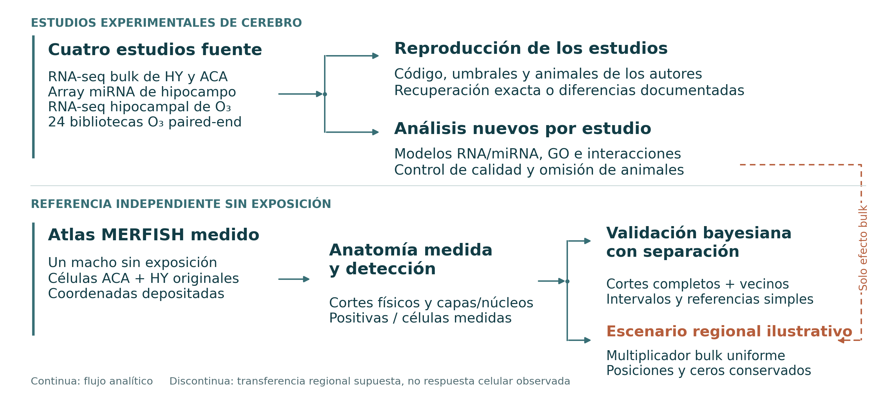{fig-alt="Cuatro estudios experimentales y una referencia espacial independiente alimentan ramas analíticas explícitas." width=100%}

::: {.figure-caption}
Cuatro estudios experimentales y una referencia espacial independiente alimentan ramas analíticas explícitas.
:::

::: {.source}
Análisis: este proyecto[Rajagopalan et al., JCI 2020](https://doi.org/10.1172/JCI137315) · [Zhang et al., Science 2025](https://doi.org/10.1126/science.adu4132) · [Nakamya et al., IJMS 2025](https://doi.org/10.3390/ijms26062407)
:::

::: {.notes}
Las entradas, correspondencias muestrales, modelos y resultados conservan identificadores, hashes y tablas descargables. La rama de ozono parte de lecturas originales; bulk PM, de conteos suministrados; miRNA, de arrays normalizados depositados. La reproducción y el reanálisis principal permanecen diferenciados. La priorización vincula resultados regionales con cobertura del panel medido; el atlas sustenta cortes observados, escalamiento ilustrativo y modelos basales. Las flechas representan procesamiento, no un diagrama causal biológico.
:::

## Metodología {#methods .section-slide data-background-color="#103d49"}

::: {.slide-eyebrow}
02  /  Metodología
:::

Reconstrucción de los estudios originales, análisis estadísticos nuevos y referencia espacial medida

::: {.notes}
El bloque siguiente define qué estima cada modelo antes de presentar resultados. Los supuestos detallados y las fuentes permanecen en las notas y el apéndice.
:::

## Criterios de reproducción computacional {#reproduction-criteria}

::: {.slide-eyebrow}
02  /  Metodología
:::

| Nivel | Comparación | Interpretación |
|---|---|---|
| Entradas | Identificadores, conteos, muestras y hashes | Verificar el mismo punto de partida |
| Modelo | Diseño, normalización, filtro y familia de multiplicidad | Reconstruir el procedimiento declarado |
| Salidas | Identidades, efectos, valores p y conjuntos seleccionados | El número de genes por sí solo es insuficiente |
| Especificación faltante | Parámetros no recuperados o cuantificación distinta | Declarar sensibilidad o concordancia |

::: {.source}
Referencias científicas[Rajagopalan et al., JCI 2020](https://doi.org/10.1172/JCI137315) · [Zhang et al., Science 2025](https://doi.org/10.1126/science.adu4132) · [Nakamya et al., IJMS 2025](https://doi.org/10.3390/ijms26062407)
:::

::: {.notes}
Se distingue reconstrucción exacta de salidas de un flujo sustituto transparente. La recuperación exacta se limita al nivel efectivamente cotejado; no implica reconstruir alineamiento, histología, proteínas ni todas las figuras. Los parámetros ausentes no se eligen buscando maximizar concordancia. El proyecto conserva discrepancias y preguntas de calidad junto con la reproducción numérica exitosa.
:::

## Análisis cortical de conteos alineado con los autores {#cortex-author-method .small}

::: {.slide-eyebrow}
02  /  Metodología
:::

1. Cotejar la matriz original de Zenodo con el depósito GEO.
2. Conservar las **20 bibliotecas de cinco grupos de tratamiento**.
3. Retener genes con ≥10 conteos en ≥4 bibliotecas: **21,388 genes**.
4. Reconstruir R DESeq2 con diseño <code>~group</code>.
5. Conservar α = 0.1 del filtrado independiente por defecto y seleccionar **BH q < 0.05**.
6. Reconstruir el PCA definido por código: TMM log₂CPM, 500 genes más variables y escalamiento por varianza.

::: {.source}
Referencias científicas[Zhang et al., Science 2025](https://doi.org/10.1126/science.adu4132)
:::

::: {.notes}
Los cinco brazos son PBS, PM nasal, inoculación PFF, inoculación PM-PFF y PM-PFF más PM nasal. No forman un factorial PM×PFF completo estándar, porque el material inoculado difiere. El repositorio reimplementa el código pertinente, sin ejecutar íntegramente un script descargado arbitrario. El texto menciona filterByExpr, pero el código depositado usa un filtro explícito de conteos; se documenta la discrepancia. El α de R DESeq2 controla la elección del filtrado independiente; el umbral final sigue siendo q<.05. Esta reconstrucción de 20 animales no se sustituye por el resultado principal del proyecto con ocho animales.
:::

## La especificación RUVg hipotalámica sigue incompleta {#hypothalamus-author-method}

::: {.slide-eyebrow}
02  /  Metodología
:::

El artículo describe normalización por carril, controles empíricos y RUVg antes de las pruebas.

- No están disponibles los **5,000 genes de control negativo** exactos ni el número **k** de factores.
- Una sensibilidad declarada utiliza las 11 bibliotecas FA/PM/HFD con TMM/voom y limma, **sin inventar factores RUVg**.
- Universo común: 50,417 características. Se excluyen 91 filas exclusivas HFD sin inventar ceros.
- El filtro codificante GENCODE M13 y el filtro CPM dejan 13,398 genes evaluados.

::: {.source}
Referencias científicas[Rajagopalan et al., JCI 2020](https://doi.org/10.1172/JCI137315)
:::

::: {.notes}
La sensibilidad retiene CPM>2 en al menos tres bibliotecas y exige BH<.05, |log₂FC|>.8 y AveExpr>1. La redacción de abundancia principal y suplementaria difiere, y la selección original de controles negativos es ambigua. Ningún sustituto recupera de forma única el RUVg ausente. Por eso se trata de una comparación metodológica, no una reproducción exacta fallida ni evidencia de ausencia biológica. El análisis PyDESeq2 principal de siete animales excluye HFD.
:::

## Reconstrucción del objetivo miRNA y criterios de prueba {#mirna-author-method}

::: {.slide-eyebrow}
02  /  Metodología
:::

- Recuperar el objetivo preespecificado de la Figura 6: **mmu-miR-574-5p**.
- Conservar los nueve arrays y su señal normalizada original.
- Reconstruir ANOVA y comparaciones LSD con MSE agrupado.
- Distinguir la **prueba pareada no protegida** del **LSD protegido que exige significación ómnibus**.
- Comparar el objetivo con el análisis limma moderado nuevo y su familia BH de todo el array.

::: {.source}
Referencias científicas[Ku et al., Part. Fibre Toxicol. 2017](https://doi.org/10.1186/s12989-017-0215-3) · [Ritchie et al., NAR 2015](https://doi.org/10.1093/nar/gkv007)
:::

::: {.notes}
El artículo describe ANOVA/LSD de forma general, sin aportar toda la configuración de GeneSpring ni la selección original del heatmap. Se muestran las lecturas alternativas de la secuencia de pruebas. «Entre pares de grupos» se refiere a grupos independientes, no animales pareados. No se puede reconstruir exactamente el heatmap si se desconoce la selección de filas. Los arrays no reproducen independientemente qPCR, ChIP, rescate, proteínas, BACE1 ni comportamiento.
:::

## Reconstrucción de tablas de ozono y comparación entre flujos {#ozone-author-method}

::: {.slide-eyebrow}
02  /  Metodología
:::

**Reconstrucción exacta de selección**

La tabla depositada E4/E3 contiene efectos de genotipo. Aplicar su regla de p nominal < 0.05 y |log₂FC| > 0.3.

**Concordancia condicional de efectos**

Comparar efectos finitos con símbolo exacto obtenidos de los conteos Salmon/tximport nuevos con resultados publicados. Reestimar dispersiones en los modelos candidatos declarados.

No se reconstruyen íntegramente HISAT2/featureCounts, la anotación histórica ni toda la especificación de pruebas.

::: {.source}
Referencias científicas[Nakamya et al., IJMS 2025](https://doi.org/10.3390/ijms26062407)
:::

::: {.notes}
El CSV original de genotipo no es una matriz de conteos de exposición. Otras comparaciones usan un umbral absoluto .1; se respetan los umbrales de cada contraste. Se informan dos modelos candidatos de genotipo, sin seleccionar por cercanía al número publicado. La comparación S3 E4/E3 bajo ozono a 17 meses está condicionada a los genes seleccionados y a los mismos animales fuente. Ni una correlación alta en esa lista ni un UpSet aportan replicación independiente o una prueba de interacción.
:::

## Modelo binomial negativo para conteos de ARN {#count-model .formula-slide .layout-equation}

::: {.slide-eyebrow}
02  /  Metodología
:::

::: {.equation-grid}

::: {.equation-core}
$$K_{gi}\sim\mathrm{NB}(\mu_{gi},\alpha_g),\qquad
\operatorname{Var}(K_{gi})=\mu_{gi}+\alpha_g\mu_{gi}^{2}$$

$$\log\mu_{gi}=\log o_{gi}+\mathbf x_i^\top\boldsymbol\beta_g$$
:::

::: {.equation-detail}
- $K_{gi}$: conteos asignados o fragmentos estimados redondeados.
- $\alpha_g$: dispersión por gen, estimada con regularización.
- $o_{gi}$: factor de normalización. En ozono incorpora información de longitud efectiva.
- La matriz de diseño define la comparación antes de la prueba.
:::

:::

::: {.source}
Referencias científicas[Love et al., Genome Biol. 2014](https://doi.org/10.1186/s13059-014-0550-8) · [Muzellec et al. 2023](https://doi.org/10.1093/bioinformatics/btad547)
:::

::: {.notes}
La notación del GLM utiliza logaritmo natural. Los coeficientes y efectos reportados por DESeq2 se expresan en log₂. En los contrastes PM simples, o_gi se reduce al factor muestral estimado con los conteos retenidos. En ozono, DESeqDataSetFromTximport construye normalización gen/muestra a partir de longitudes efectivas y profundidad; describirla como mero tamaño de biblioteca sería incorrecto. La verosimilitud admite sobredispersión, pero no controla automáticamente confusión no medida ni infiere composición celular.
:::

## Filtrado de conteos y poblaciones de normalización {#filters}

::: {.slide-eyebrow}
02  /  Metodología
:::

| Análisis | Filtro de conteos | Genes retenidos | Muestras ajustadas |
|---|---|---|---|
| HY principal | ≥10 en ≥3 | 19,611 | 7 |
| ACA principal | ≥10 en ≥4 | 19,235 | 8 |
| ACA reconstrucción autores | ≥10 en ≥4 | 21,388 | 20 |
| O₃ principal | ≥10 en ≥3 | 18,537 | 24 |
Los análisis PM principales usan factores por mediana de cocientes. Cambiar las muestras ajustadas modifica el filtro y las dispersiones.

::: {.source}
Referencias científicas[Rajagopalan et al., JCI 2020](https://doi.org/10.1172/JCI137315) · [Zhang et al., Science 2025](https://doi.org/10.1126/science.adu4132) · [Nakamya et al., IJMS 2025](https://doi.org/10.3390/ijms26062407)
:::

::: {.notes}
Los filtros se aplican a la población analítica especificada. El mismo umbral puede dejar universos distintos. La entrada hipotalámica tiene 50,417 símbolos; corteza, 56,748 IDs Ensembl; ozono, 54,347 resúmenes génicos. Se mantienen identificadores exactos. Retener un gen no garantiza p válido: Cook, filtrado independiente o validez numérica pueden retirar inferencia. No se equipara el denominador retenido con la familia finita BH sin revisar la tabla correspondiente.
:::

## Evidencia Wald, regularización y pruebas múltiples {#testing .formula-slide .layout-equation .wide-equation}

::: {.slide-eyebrow}
02  /  Metodología
:::

::: {.equation-core}
$$z_g=\frac{\widehat\beta_g}{\operatorname{SE}(\widehat\beta_g)},
\qquad \mathrm{IC}_{95\%}=\widehat\beta_g\pm1.959964\,\operatorname{SE}(\widehat\beta_g)$$

$$q_{(i)}=\min\!\left(1,\min_{j\ge i}\frac{m\,p_{(j)}}{j}\right)$$
:::

::: {.equation-detail}
- MLE, SE y valores p originales definen la evidencia Wald/BH.
- Los efectos regularizados tipo apeglm apoyan visualización y estabilidad.
- Los intervalos puntuales no son simultáneos ni ajustados por selección.
- Cada familia de pruebas declarada tiene su corrección de multiplicidad.
:::

::: {.source}
Referencias científicas[Love et al., Genome Biol. 2014](https://doi.org/10.1186/s13059-014-0550-8) · [Zhu et al. 2019](https://doi.org/10.1093/bioinformatics/bty895) · [Rajagopalan et al., JCI 2020](https://doi.org/10.1172/JCI137315)
:::

::: {.notes}
La expresión BH describe el valor p ajustado monótono entre las pruebas finitas válidas de esa familia. No se sustituye la moda regularizada en el estadístico Wald original. PyDESeq2 usa su prior adaptativo tipo apeGLM documentado; ozono y los flujos R alineados con autores usan apeglm en R. No se declaran idénticas estas implementaciones. Un intervalo nominal que excluye cero puede coexistir con BH q>.05. Cambiar la familia modifica la corrección de forma no trivial; las salidas entre familias son análisis separados.
:::

## Control de calidad y sensibilidad a animales {#qc}

::: {.slide-eyebrow}
02  /  Metodología
:::

- Para entradas de conteos de ARN, verificar enteros no negativos, IDs exactos y asignación muestral.
- Inspeccionar tamaño de biblioteca, normalización, PCA y correlaciones.
- Conservar indicadores de inferencia filtrada por Cook y convergencia.
- Retener los animales seleccionados. El PCA por sí solo no justifica exclusión.
- Reajustar HY omitiendo un animal por vez.
- Cotejar la hipótesis HY fija entre implementaciones Python y R.

::: {.source}
Referencias científicas[Rajagopalan et al., JCI 2020](https://doi.org/10.1172/JCI137315) · [Zhang et al., Science 2025](https://doi.org/10.1126/science.adu4132) · [Love et al., Genome Biol. 2014](https://doi.org/10.1186/s13059-014-0550-8)
:::

::: {.notes}
Los gráficos QC diagnostican, sin certificar ausencia de lote o problemas de identidad. HY usa VST con diseño y ACA VST blind; ambos PCA usan 500 genes variables centrados, sin escalar por varianza. Difieren del PCA cortical original TMM logCPM escalado. Cook retira 159 pruebas génicas de HY, no 159 animales. Reemplazar conteos exige al menos siete réplicas en un grupo elegible, condición ausente en los grupos PM principales. Se informa la variación leave-one-out sin elegir una omisión favorable.
:::

## Modelado lineal de señales miRNA depositadas {#mirna-model .formula-slide .small .layout-equation .wide-equation}

::: {.slide-eyebrow}
02  /  Metodología
:::

::: {.equation-core}
$$y_{fi}=\mathbf x_i^\top\boldsymbol\beta_f+\epsilon_{fi},
\qquad \Delta_f=\beta_{f,\mathrm{PM}}-\beta_{f,\mathrm{Control}}$$
:::

::: {.equation-detail}
- 1,268 filas → se excluyen 21 controles/no anotadas + 2 inutilizables → **1,245 características evaluadas**.
- Diseño limma <code>~0+condition</code>, dos contrastes y prueba F moderada ómnibus separada.
- Bayes empírico: trend = TRUE, robust = FALSE.
- Se conservan 823 indicadores de baja detección y las señales negativas.
- Los efectos son **diferencias medias en unidades de señal depositada**.
:::

::: {.source}
Referencias científicas[Ku et al., Part. Fibre Toxicol. 2017](https://doi.org/10.1186/s12989-017-0215-3) · [Ritchie et al., NAR 2015](https://doi.org/10.1093/nar/gkv007)
:::

::: {.notes}
La señal GeneSpring depositada tiene normalización cuantílica, pero su transformación log₂ no está establecida explícitamente. Los negativos se conservan porque pertenecen a esa escala. Otra transformación o un modelo binomial negativo inventaría el modelo de medición. Las SE e intervalos t moderados usan varianza residual posterior y grados de libertad totales de limma. BH se aplica a todas las características retenidas por contraste y de forma separada al ómnibus. Los indicadores de detección contextualizan, sin excluir características de la familia.
:::

## Ozono se procesa desde todas las lecturas originales {#ozone-raw-qc}

::: {.slide-eyebrow}
02  /  Metodología
:::

1. Vincular 24 SourceNames biológicos con pares FASTQ y ocho estratos.
2. Inspeccionar los primeros 200,000 pares por biblioteca con fastp.
3. Recortar adaptadores de forma consistente en las bibliotecas completas.
4. Conservar QC antes/después. Desactivar filtros de calidad, longitud, poli-G y duplicados.
5. Procesar **532,781,354 fragmentos paired-end** de las 24 bibliotecas.

Q30 muestreado: 92.37–96.49%. Se conservan todos los animales secuenciados.

::: {.source}
Referencias científicas[Nakamya et al., IJMS 2025](https://doi.org/10.3390/ijms26062407)
:::

::: {.notes}
SDRF tiene dos filas por animal debido a los archivos pareados; el número biológico deduplica SourceName, no filas FASTQ. La correspondencia se coteja independientemente con metadatos depositados. Sample1/ERR14708304 tiene una cadena de cepa distinta; se conserva como indicador de calidad, sin declararla confusión completa por genotipo. El QC inicial inspecciona un prefijo, no una muestra aleatoria. Sus adaptadores motivan recorte de bibliotecas completas. Se documenta la conducta de fastp ante dímeros aunque los demás filtros estén desactivados.
:::

## Alineamiento selectivo y offsets de longitud efectiva {#ozone-quant}

::: {.slide-eyebrow}
02  /  Metodología
:::

**Salmon 2.5.1**

Transcriptoma GENCODE M25 + genoma primario GRCm38 completo como decoys. Tipo de biblioteca automático y modelos de sesgo de secuencia y GC.

**tximport**

Fragmentos estimados y longitudes génicas efectivas ponderadas por abundancia por muestra. <code>countsFromAbundance = "no"</code>.

**DESeqDataSetFromTximport**

Los offsets de longitud gen/muestra entran en la inferencia. El mapeo varía de **72.31% a 88.33%**.

::: {.source}
Referencias científicas[Patro et al. 2017](https://doi.org/10.1038/nmeth.4197) · [Soneson et al. 2015](https://doi.org/10.12688/f1000research.7563.2) · [Nakamya et al., IJMS 2025](https://doi.org/10.3390/ijms26062407)
:::

::: {.notes}
Este flujo difiere deliberadamente del HISAT2/featureCounts original. El alineamiento selectivo con decoys genómicos limita asignaciones transcriptómicas espurias, sin reproducir íntegramente los conteos históricos. TPM no sustituye los conteos de entrada binomial negativa. La longitud efectiva varía con el uso de transcritos y entra en los offsets. La referencia de ratón no resuelve expresión alélica humana de APOE. Se conservan versiones, hashes de referencia y puntos de control de cuantificación.
:::

## Modelo factorial de ozono con ocho parámetros {#ozone-factorial .formula-slide .layout-equation .wide-equation}

::: {.slide-eyebrow}
02  /  Metodología
:::

::: {.equation-core}
$$\log\mu=\log o+\beta_0+\beta_A A+\beta_G G+\beta_E E
+\beta_{AG}AG+\beta_{AE}AE+\beta_{GE}GE+\beta_{AGE}AGE$$
:::

::: {.equation-detail}
$A=1$: inicio a 17 meses; $G=1$: APOE4; $E=1$: O₃.

- Diseño completo: edad × genotipo × exposición.
- 24 animales, 3 en cada uno de 8 estratos. Rango del diseño = 8.
- 18,537 genes retenidos.
- Prefiltro fijo, verificaciones Cook y máscaras de validez. Sin filtrado independiente adaptativo.
:::

::: {.source}
Referencias científicas[Nakamya et al., IJMS 2025](https://doi.org/10.3390/ijms26062407) · [Love et al., Genome Biol. 2014](https://doi.org/10.1186/s13059-014-0550-8)
:::

::: {.notes}
El modelo utiliza información de 24 animales, no solo ocho medias. El GLM matemático emplea coeficientes en logaritmo natural; los contrastes DESeq2 se reportan en log₂. Si todos los conteos son cero en un estrato necesario, se retiran su efecto y p antes de BH, aunque exista un coeficiente numérico. No se inventan covariables de lote o RIN ausentes. El factorial es un reanálisis del proyecto, no una reconstrucción exacta del modelo original.
:::

## Efectos por estrato y diferencias con covarianza {#ozone-contrasts .formula-slide .layout-equation .wide-equation}

::: {.slide-eyebrow}
02  /  Metodología
:::

::: {.equation-core}
$$\widehat\Delta=\mathbf c^\top\widehat{\boldsymbol\beta},
\qquad \operatorname{SE}(\widehat\Delta)
=\sqrt{\mathbf c^\top\widehat V\mathbf c}$$
:::

::: {.equation-detail}
| Efecto O₃ frente a FA | Combinación lineal |
|---|---|
| 3M / E3 | $\beta_E$ |
| 3M / E4 | $\beta_E+\beta_{GE}$ |
| 17M / E3 | $\beta_E+\beta_{AE}$ |
| 17M / E4 | $\beta_E+\beta_{AE}+\beta_{GE}+\beta_{AGE}$ |

Comparar respuestas exige un contraste específico.
:::

::: {.source}
Referencias científicas[Nakamya et al., IJMS 2025](https://doi.org/10.3390/ijms26062407) · [Love et al., Genome Biol. 2014](https://doi.org/10.1186/s13059-014-0550-8)
:::

::: {.notes}
La covarianza importa: restar dos efectos suponiendo SE independientes sería incorrecto, pues ambos proceden del mismo modelo. Una parametrización equivalente de ocho grupos aporta coeficientes individuales para el despliegue apeglm. Los análisis secundarios de diferencias preservan dispersiones y offsets de longitud originales. Sus intervalos Wald puntuales no son simultáneos ni corresponden a células del atlas.
:::

## Pruebas globales de exposición y heterogeneidad {#ozone-lrt .formula-slide .layout-equation .wide-equation}

::: {.slide-eyebrow}
02  /  Metodología
:::

::: {.equation-core}
$$D=2(\ell_{\mathrm{completo}}-\ell_{\mathrm{reducido}})
\ \overset{H_0}{\approx}\ \chi^2_{\Delta df}$$
:::

::: {.equation-detail}
| Prueba | Términos retirados bajo la nula | gl |
|---|---|---|
| Cualquier efecto de exposición | E, AE, GE, AGE | 4 |
| Respuesta dependiente de genotipo | GE, AGE | 2 |
| Respuesta dependiente de edad | AE, AGE | 2 |
| Interacción triple | AGE | 1 |

Se informan familias BH separadas y correcciones suplementarias conjuntas.
:::

::: {.source}
Referencias científicas[Nakamya et al., IJMS 2025](https://doi.org/10.3390/ijms26062407) · [Love et al., Genome Biol. 2014](https://doi.org/10.1186/s13059-014-0550-8)
:::

::: {.notes}
El LRT global pregunta si se necesita algún coeficiente asociado con exposición. Los tres LRT secundarios plantean preguntas más específicas sobre heterogeneidad. Sus hipótesis, grados de libertad y familias de multiplicidad difieren. Significación en un estrato y ausencia en otro no demuestra interacción. Los Wald con signo responden alternativas distintas de los LRT multiparámetro; no se exigen conjuntos de hallazgos anidados.
:::

## La sobrerrepresentación GO utiliza un universo evaluable {#ora .formula-slide .layout-equation}

::: {.slide-eyebrow}
02  /  Metodología
:::

::: {.equation-grid}

::: {.equation-core}
$$P(X\ge k)=\sum_{x=k}^{\min(K,n)}
\frac{\binom Kx\binom{N-K}{n-x}}{\binom Nn}$$
:::

::: {.equation-detail}
- $N$: genes únicos mapeados con p ajustado DE finito.
- $n$: conjunto BH significativo, separado por signo MLE.
- $K$: miembros GO-BP del universo; $k$: intersección.
- Evaluar términos de 15–500 miembros. Conservar los de intersección cero con p = 1.
- BH entre todos los términos elegibles por contraste/dirección.
:::

:::

::: {.source}
Referencias científicas[Subramanian et al., PNAS 2005](https://doi.org/10.1073/pnas.0506580102) · [Gene Ontology Consortium](https://geneontology.org/docs/go-enrichment-analysis/)
:::

::: {.notes}
Las anotaciones oficiales GO Biological Process de ratón usan taxón10090, excluyen NOT y propagan solo is_a y part_of. Se mapean símbolos exactos o alias únicos. Los duplicados eligen el representante de mayor baseMean antes de examinar significación. El universo incluye genes mapeados evaluables sin BP específico, sin limitarse a genes bien anotados. Esto no elimina todo sesgo de detectabilidad o longitud. No se infiere enriquecimiento de blancos miRNA sin un mapa respaldado independientemente.
:::

## El enriquecimiento por rango conserva señales coordinadas débiles {#gsea .formula-slide .layout-equation}

::: {.slide-eyebrow}
02  /  Metodología
:::

::: {.equation-grid}

::: {.equation-core}
$$RS(t)=
\frac{\sum_{j\le t,\ j\in S}|r_j|}{\sum_{j\in S}|r_j|}
-\frac{\#\{j\le t:j\notin S\}}{N-|S|}$$
:::

::: {.equation-detail}
- Rango $r_j$: estadístico Wald no regularizado con p original finito.
- Sin preselección por BH génico o tamaño de efecto.
- GSEApy prerank, peso 1, 1,000 permutaciones de conjuntos y semilla fija.
- NES y **FDR algorítmica GSEA** difieren de ORA/BH.
- Compartir genes y ancestros GO correlaciona los términos.
:::

:::

::: {.source}
Referencias científicas[Subramanian et al., PNAS 2005](https://doi.org/10.1073/pnas.0506580102) · [Gene Ontology Consortium](https://geneontology.org/docs/go-enrichment-analysis/)
:::

::: {.notes}
La fórmula muestra el puntaje acumulado con peso1 antes de seleccionar su extremo con signo y normalizar. Se exige p original finito aunque persista estadístico Wald, para excluir pruebas no fiables filtradas por Cook. Un gen con p original finito y p ajustado ausente por filtrado independiente puede seguir en el rango. Son permutaciones de conjuntos/etiquetas génicas, no de fenotipos; no propagan toda la incertidumbre muestral ni preservan correlación entre genes. q=0 es una estimación de simulación finita, no probabilidad de error nula. El enriquecimiento apoya asociaciones exploratorias de rango, sin demostrar activación o supresión de vías.
:::

## Una referencia espacial medida de un donante {#atlas}

::: {.slide-eyebrow}
02  /  Metodología
:::

| Característica | ACA | HY |
|---|---|---|
| Células medidas | 14,582 | 37,811 |
| Cortes físicos | 18 | 20 |
| Clases celulares | 16 | 26 |
| Subdivisiones anatómicas | 10 | 49 |
| Casillas ocupadas de 100 µm | 1,656 | 3,772 |
Zhuang-ABCA-2: un macho adulto sin exposición, un hemisferio registrado y **1,122 genes MERFISH medidos**.

::: {.source}
Referencias científicas[Zhang et al., Nature 2023](https://doi.org/10.1038/s41586-023-06808-9)
:::

::: {.notes}
La referencia proviene de un atlas mayor, pero el proyecto usa este donante específico para conservar identidad celular, conteos de imagen y coordenadas. Se mantienen las 52,393 células ACA/HY sin submuestreo. ACA incluye ACAd y ACAv con capas1,2/3,5,6a,6b. HY tiene49 etiquetas de núcleos/subregiones, incluidas HY-unassigned y ZI-unassigned; no son49 núcleos nombrados. Las anotaciones provienen del flujo fuente y la referencia no constituye controles emparejados de los animales expuestos.
:::

## Coordenadas depositadas del corte y anatomía registrada {#coordinates}

::: {.slide-eyebrow}
02  /  Metodología
:::

**Mapas dentro del corte**

x/y experimentales depositadas tras rotación/alineación del tejido. z experimental estima AP de adquisición.

**Anatomía 3D y base gaussiana**

CCF AP/DV/ML registradas en milímetros. La visualización usa ML, AP y −DV.

La separación coronal nominal es aproximadamente 200 µm. Los pasos de malla de 50–150 µm describen representación, no adquisición de expresión.

::: {.source}
Referencias científicas[Zhang et al., Nature 2023](https://doi.org/10.1038/s41586-023-06808-9)
:::

::: {.notes}
Las x/y experimentales no equivalen a CCF ML/DV. La malla3D deriva de la anotación AllenCCF25µm con marching cubes y pasos de representación .15mm cerebro,.075mmHY,.05mmACA. Una malla más densa no agrega resolución de ARN medida. No se usa la transformación RAS centrada del NIfTI para distancias CCF fuente. La concordancia coordenada-parcelación es94.05% en10,000 célulasHY diagnósticas y93.54% deACA; es consistencia, no exactitud frente a una verdad de referencia. No se refleja el hemisferio ausente.
:::

## Priorización génica y cobertura del panel medido {#gene-selection}

::: {.slide-eyebrow}
02  /  Metodología
:::

1. Conservar BH q y efectos regionales principales originales.
2. Ordenar por q y después símbolo fuente o ID exacto.
3. Mapear HY por símbolo fuente exacto y ACA por ID Ensembl exacto.
4. Anotar productos y funciones con registros oficiales NCBI/UniProt congelados.

**Cobertura:** se mide físicamente 1 de 11 hallazgos HY y 76 de 1,167 hallazgos ACA.

El top diez HY incluye nueve candidatos exploratorios. Los diez ACA cumplen BH q < 0.05 principal.

::: {.source}
Referencias científicas[Zhang et al., Nature 2023](https://doi.org/10.1038/s41586-023-06808-9) · [Rajagopalan et al., JCI 2020](https://doi.org/10.1172/JCI137315) · [Zhang et al., Science 2025](https://doi.org/10.1126/science.adu4132)
:::

::: {.notes}
Es un ordenamiento transparente de evidencia, no un puntaje de importancia causal. Los alias actuales no reemplazan silenciosamente la identidad original. La anotación actual se muestra junto a la fuente. HY carece de IDs Ensembl originales, lo que limita vinculación entre recursos. Seis candidatosHY medidos presentan regularización fuerte. Se identifican ARN no codificante y pseudogenes; los genes ausentes del atlas no se imputan. Cuarenta y seis genes distintos producen51 filas por la pertenencia a grupos regionales/de selección.
:::

## Las fracciones de detección conservan ceros medidos {#detection-method .formula-slide .layout-equation}

::: {.slide-eyebrow}
02  /  Metodología
:::

::: {.equation-grid}

::: {.equation-core}
$$d_{ig}=\mathbf1(c_{ig}>0),\qquad
\widehat f_{gA}=\frac{\sum_{i\in A}d_{ig}}{n_A}$$

$$b_x=\lfloor x/0.1\rfloor,\qquad b_y=\lfloor y/0.1\rfloor$$
:::

::: {.equation-detail}
- $A$: corte, anatomía, clase celular o casilla ocupada seleccionados.
- El denominador incluye todas las células medidas, incluidos los ceros.
- Las casillas de 0.1 × 0.1 mm se separan por corte físico.
- Las casillas vacías no están observadas. No se agrega interpolación ni una afirmación de densidad.
:::

:::

::: {.source}
Referencias científicas[Zhang et al., Nature 2023](https://doi.org/10.1038/s41586-023-06808-9)
:::

::: {.notes}
Cero de imagen significa conteo no detectado en este ensayo, no ausencia biológica demostrada. Las casillas usan intervalos semiabiertos en múltiplos globales experimentales. El corte de borde con una célula conserva su denominador. Una combinación vacía de filtros tiene detección no disponible, no0%. Las figuras estáticas y3D usan log₂(1+conteo); el mapa interactivo y la respuesta gaussiana usan ln(1+conteo). Cada transformación se rotula. La detección descriptiva no recibe p de exposición con células independientes.
:::

## Escenario regional uniforme con PM₂.₅ {#scenario-method .formula-slide .layout-equation .wide-equation}

::: {.slide-eyebrow}
02  /  Metodología
:::

::: {.equation-core}
$$E_{\mathrm{escenario}}(c,g)
=E_{\mathrm{referencia}}(c,g)\,
2^{\widehat\beta^{\,\mathrm{regularizada}}_g}$$
:::

::: {.equation-detail}
| Ejemplo | log₂FC regional regularizado | Multiplicador |
|---|---:|---:|
| HY / Tll1 | −1.22405 | 0.42808 |
| ACA / Fosb | +0.99711 | 1.99600 |

Se mantienen posiciones y número de células. Una escala común por gen permite comparar.

Es una propagación ilustrativa del efecto regional a una referencia sin exposición.
:::

::: {.source}
Referencias científicas[Zhang et al., Nature 2023](https://doi.org/10.1038/s41586-023-06808-9)
:::

::: {.notes}
El escalamiento uniforme no está identificado biológicamente: el mismo efecto bulk puede surgir de regulación específica o composición. No estima células respondedoras, pérdida, migración ni mecanismo causal. MLE Wald±1.96SE aporta escenarios grupales alternativos separados del valor regularizado por defecto, no intervalos celulares. El límite opcional común del percentil99 afecta solo el color; conserva los valores. Suavizar o reflejar un hemisferio agregaría supuestos, no observaciones. El donante del atlas no es control experimental emparejado.
:::

## Referencia gaussiana con bases espaciales fijas {#gaussian-features .formula-slide .layout-equation .wide-equation}

::: {.slide-eyebrow}
02  /  Metodología
:::

::: {.equation-core}
$$y_{ig}=\ln(1+c_{ig})
=\mathbf x_i^\top\boldsymbol\beta_g+\epsilon_{ig}$$

$$\phi_j(\mathbf r)=
\exp\!\left[-\frac12\sum_k\frac{(r_k-m_{jk})^2}{\ell_k^2}\right],
\qquad\boldsymbol\ell=(0.60,0.45,0.45)\ \mathrm{mm}$$
:::

::: {.equation-detail}
Variables: intercepto, indicadores anatómicos, tres coordenadas CCF estandarizadas, 36 RBF anisótropas e interceptos de corte.

No se usan predictores de clase celular derivados de expresión.
:::

::: {.source}
Referencias científicas[Zhang et al., Nature 2023](https://doi.org/10.1038/s41586-023-06808-9) · [Murphy, 2007, Gaussian conjugacy](https://www.cs.ubc.ca/~murphyk/Papers/bayesGauss.pdf) · [Rasmussen & Williams, 2006, ch. 2](https://gaussianprocess.org/gpml/chapters/RW2.pdf)
:::

::: {.notes}
RBF significa función de base radial. Los36centros forman cuantiles de entrenamiento4×3×3: AP.05/.35/.65/.95 yDV/ML.1/.5/.9. Las longitudes AP,DV,ML se fijan antes de evaluar. Estandarización, centrado RBF y vocabulario anatómico usan solo entrenamiento. Los efectos de corte absorben variación, sin separar toda fuente técnica de biología. Excluir etiquetas celulares derivadas de expresión reduce filtración del transcrito objetivo. Es regresión bayesiana con bases finitas, no un proceso gaussiano completo ni Tangram, BayesSpace o cell2location.
:::

## Priors propios y posterior analítica {#gaussian-priors .formula-slide .layout-equation .wide-equation}

::: {.slide-eyebrow}
02  /  Metodología
:::

::: {.equation-core}
$$\boldsymbol\beta\mid\sigma^2\sim
\mathcal N(0,\sigma^2V_0),\qquad \sigma^2\sim IG(3,1)$$

$$V_n=(X^\top X+V_0^{-1})^{-1},\quad
m_n=V_nX^\top y,\quad a_n=3+n/2$$

$$b_n=1+\frac12\left(y^\top y-m_n^\top V_n^{-1}m_n\right)$$
:::

::: {.equation-detail}
Multiplicadores de varianza previa: intercepto25, anatomía1, coordenadas0.25, cada RBF1/36 y cada corte0.25.

El cálculo Cholesky verifica ecuaciones normales y escala posterior.
:::

::: {.source}
Referencias científicas[Zhang et al., Nature 2023](https://doi.org/10.1038/s41586-023-06808-9) · [Murphy, 2007, Gaussian conjugacy](https://www.cs.ubc.ca/~murphyk/Papers/bayesGauss.pdf) · [Rasmussen & Williams, 2006, ch. 2](https://gaussianprocess.org/gpml/chapters/RW2.pdf)
:::

::: {.notes}
La inversa-Gamma usa forma a y escala b con densidad proporcional a (sigma²)^(-a-1)exp(-b/sigma²). Los efectos aleatorios de corte son coeficientes con prior gaussiano propio de varianza.25sigma². Los priors son supuestos de modelado, no priors neuronales validados empíricamente. La implementación verifica b_n mediante la suma cuadrática residual más prior para revisar cancelación numérica, además de simetría e inversión de covarianza. La integración es analítica condicional al modelo, sin demostrar adecuación gaussiana a conteos no negativos dispersos.
:::

## Intervalos creíbles y predictivos de un corte nuevo {#gaussian-intervals .formula-slide .layout-equation .wide-equation}

::: {.slide-eyebrow}
02  /  Metodología
:::

::: {.equation-core}
**Media latente ajustada por corte**

$$f_*\mid y\sim t_{2a_n}\left(x_*^\top m_n,\
\sqrt{\frac{b_n}{a_n}x_*^\top V_nx_*}\right)$$

**Célula nueva en un corte físico nuevo**

$$y_*\mid y\sim t_{2a_n}\left(x_*^\top m_n,\
\sqrt{\frac{b_n}{a_n}\left(1.25+x_*^\top V_nx_*\right)}\right)$$
:::

::: {.equation-detail}
Los segundos argumentos son **escalas t de Student**, no varianzas.

Los mapas muestran ajuste con toda la referencia en posiciones medidas. La predicción reservada se evalúa aparte.
:::

::: {.source}
Referencias científicas[Zhang et al., Nature 2023](https://doi.org/10.1038/s41586-023-06808-9) · [Murphy, 2007, Gaussian conjugacy](https://www.cs.ubc.ca/~murphyk/Papers/bayesGauss.pdf) · [Rasmussen & Williams, 2006, ch. 2](https://gaussianprocess.org/gpml/chapters/RW2.pdf)
:::

::: {.notes}
Los mapas latentes promedian a cero el desplazamiento de corte, sin informar el corrimiento ajustado de cada uno. El1.25 predictivo suma varianza residual1 y de corte nuevo.25. Una anatomía no vista añade varianza previa1 y media0 explícitas, sin sustituirse por una conocida. Se conservan medias, límites y soporte negativos como diagnóstico de la aproximación. No se aplica exponencial para afirmar conteos esperados. La incertidumbre depende de bases, priors, anatomía y registro, y omite variación no modelada entre donantes y registro.
:::

## Validación por cortes completos con separación vecina {#guarded-cv .figure-slide}

::: {.slide-eyebrow}
02  /  Metodología
:::

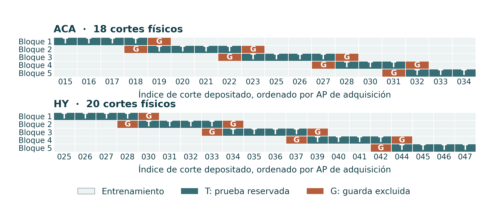{fig-alt="Cinco bloques contiguos de prueba. Cortes representados vecinos actúan como separación y cada célula se evalúa una vez." width=100%}

::: {.figure-caption}
Cinco bloques contiguos de prueba. Cortes representados vecinos actúan como separación y cada célula se evalúa una vez.
:::

::: {.source}
Análisis: este proyecto[Zhang et al., Nature 2023](https://doi.org/10.1038/s41586-023-06808-9)
:::

::: {.notes}
Los cortes se ordenan por AP experimental de adquisición; los predictores gaussianos usan CCF registrado. Se retira del entrenamiento el corte representado más próximo de cada lado. Si la región está ausente en cortes intermedios, la separación puede abarcar más de un paso de adquisición. Vocabulario anatómico, escalas y centros se aprenden con el entrenamiento restante. Priors y longitudes no se eligen por rendimiento de prueba. Ambos modelos usan los mismos bloques. Es predicción de referencia dentro del donante, sin validar exposición ni generalización entre donantes.
:::

## Modelo jerárquico de probabilidad de detección acotada {#beta-model .formula-slide .layout-equation}

::: {.slide-eyebrow}
02  /  Metodología
:::

::: {.equation-grid}

::: {.equation-core}
$$Y_{sag}\mid p_{sag}\sim
\operatorname{Binomial}(n_{sa},p_{sag})$$

$$p_{sag}\mid\mu_{ag},\kappa_{ag}\sim
\operatorname{Beta}(\mu_{ag}\kappa_{ag},(1-\mu_{ag})\kappa_{ag})$$

$$\mu_{ag}\sim\operatorname{Beta}(0.5,0.5),\qquad
\ln\kappa_{ag}\sim\mathcal N(\ln20,1.5^2)$$
:::

::: {.equation-detail}
Se ajustan genes/anatomías por separado. Las propensiones de corte son intercambiables dentro de cada ajuste. Las probabilidades permanecen entre 0 y 1.
:::

:::

::: {.source}
Referencias científicas[Zhang et al., Nature 2023](https://doi.org/10.1038/s41586-023-06808-9) · [SciPy, beta-binomial distribution](https://docs.scipy.org/doc/scipy/reference/generated/scipy.stats.betabinom.html)
:::

::: {.notes}
Y cuenta células positivas y n incluye ceros en un grupo corte×anatomía. Mu es la media de propensiones de corte intercambiables, no la fracción agrupada ponderada por células. Kappa controla heterogeneidad; la correlación intraclase beta-binomial condicional es1/(kappa+1). Los priors son propios y se fijan antes de evaluar. No incluye tendencia AP, proceso espacial local, respuesta por clase ni exposición. La intercambiabilidad no separa variación AP biológica de variación técnica. La binomial condicional puede omitir dependencia residual entre células.
:::

## Integración por cuadrícula y cálculo de incertidumbre {#beta-integration}

::: {.slide-eyebrow}
02  /  Metodología
:::

- Cuadrícula principal: **64 μ × 48 κ cuantiles previos**, con pesos iguales.
- Normalizar pesos de log-verosimilitud beta-binomial con log-sum-exp.
- Intervalos de μ: cuantiles ponderados de la cuadrícula discreta.
- Intervalos de p conocido y conteo reservado: **8,192 sorteos de mezcla con semilla**.
- Intervalos de p de un corte nuevo con referencia completa: inversión numérica de la CDF de mezcla Beta.
- Revisar 32 × 24 y 96 × 64 sin seleccionar por desempeño reservado.

::: {.source}
Referencias científicas[Zhang et al., Nature 2023](https://doi.org/10.1038/s41586-023-06808-9) · [SciPy, beta-binomial distribution](https://docs.scipy.org/doc/scipy/reference/generated/scipy.stats.betabinom.html)
:::

::: {.notes}
En coordenadas de cuantiles previos, los nodos equiponderados ya representan el prior; multiplicar de nuevo por densidad/Jacobiano lo contaría dos veces. La posterior discreta aproxima una continua, sin afirmar convergencia MCMC. Las mezclas conocidas actualizan cada Beta con y/n del corte y pesos de hiperpósterior de referencia completa. La predicción de conteos sortea además binomiales con el denominador real reservado. La semilla20261020 usa flujos reproducibles por clave. La sensibilidad numérica se distingue del rendimiento científico.
:::

## Tres objetivos distintos de incertidumbre de detección {#beta-targets .formula-slide}

::: {.slide-eyebrow}
02  /  Metodología
:::

| Objetivo | Condicionamiento | Interpretación |
|---|---|---|
| $p_{sa}$ de corte conocido | Positivas y denominador observados | Intervalo creíble del corte ajustado |
| Media anatómica $\mu_a$ | Información de cortes intercambiables | Intervalo creíble de la hipermedia |
| $p_*$ o $Y_*$ de corte nuevo | Sin conteos de ese corte nuevo | Distribución predictiva de propensión o conteo |

Una anatomía reservada ausente del entrenamiento queda **solo con prior** y se conserva en evaluación.

Un intervalo ajustado conocido no es una predicción reservada.

::: {.source}
Referencias científicas[Zhang et al., Nature 2023](https://doi.org/10.1038/s41586-023-06808-9) · [SciPy, beta-binomial distribution](https://docs.scipy.org/doc/scipy/reference/generated/scipy.stats.betabinom.html)
:::

::: {.notes}
Los intervalos estiman cantidades aleatorias diferentes. No se afirma que el intervalo de corte nuevo siempre sea más ancho, pues posición y mezcla paramétrica pueden diferir. La cobertura reservada de conteos corresponde a Y dado n observado, no a una probabilidad verdadera no observada ni intensidad gaussiana. En la interfaz, filtrar una clase oculta este ajuste de todas las clases porque no estima probabilidades específicas. Mu solo con prior tiene media.5 bajo el prior simétrico fijo, lo que puede predecir mal genes raros; se conserva ese fallo en la evaluación.
:::

## Métricas predictivas y comparación con referencias {#metrics .formula-slide .layout-equation}

::: {.slide-eyebrow}
02  /  Metodología
:::

::: {.equation-grid}

::: {.equation-core}
$$\operatorname{RMSE}=
\sqrt{\frac1N\sum_i(y_i-\widehat y_i)^2}$$

$$\operatorname{Brier}=
\frac{\sum_j[Y_j(1-\widehat p_j)^2+
(n_j-Y_j)\widehat p_j^2]}{\sum_j n_j}$$
:::

::: {.equation-detail}
Referencia gaussiana: comparar regresión de solo anatomía y predicción con30 vecinos.

Referencia de detección: colapsar anatomía en cada corte permitido de entrenamiento.

Informar cobertura reservada **junto con amplitud**. Menor pérdida predictiva es mejor.
:::

:::

::: {.source}
Referencias científicas[Zhang et al., Nature 2023](https://doi.org/10.1038/s41586-023-06808-9) · [Murphy, 2007, Gaussian conjugacy](https://www.cs.ubc.ca/~murphyk/Papers/bayesGauss.pdf) · [SciPy, beta-binomial distribution](https://docs.scipy.org/doc/scipy/reference/generated/scipy.stats.betabinom.html)
:::

::: {.notes}
Brier es pérdida descriptiva ponderada por células, reconstruida con grupos corte×anatomía, no una prueba con células independientes. Agrupar diez genes multiplica evaluaciones de grupos/células, no células o cortes reales. kNN usa30 vecinos de entrenamiento de la misma anatomía cuando existen y una alternativa más amplia explícita. Las referencias respetan prueba y separación idénticas. La sensibilidad gaussiana cambia longitudes por.5/2 y varianzas previas espaciales por.25/4. La cobertura95% es marginal: condicionar por resultado positivo crea un diagnóstico distinto, sin objetivo nominal95%.
:::

## Resultados reconstruidos de los estudios originales {#replicated-results .section-slide data-background-color="#103d49"}

::: {.slide-eyebrow}
03  /  Reproducción de autores
:::

Recuperación exacta de salidas, sensibilidad metodológica parcial y concordancia condicional

::: {.notes}
Este bloque utiliza los animales fuente originales. Cada diapositiva nombra el nivel de reproducción, sin agrupar toda concordancia como replicación biológica.
:::

## Se recuperan exactamente los conjuntos corticales significativos {#cortex-reproduction .figure-slide}

::: {.slide-eyebrow}
03  /  Reproducción de autores
:::

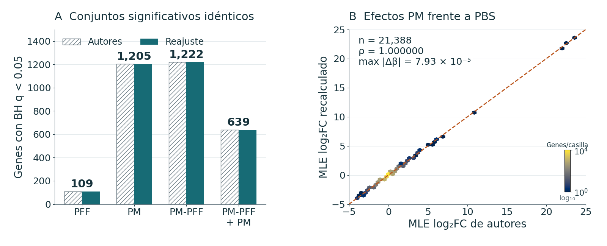{fig-alt="Cuatro contrastes alineados recuperan 109 / 1,205 / 1,222 / 639 genes. Todos los Jaccard de conjuntos FDR son 1." width=100%}

::: {.figure-caption}
Cuatro contrastes alineados recuperan 109 / 1,205 / 1,222 / 639 genes. Todos los Jaccard de conjuntos FDR son 1.
:::

::: {.source}
Análisis: este proyecto[Zhang et al., Science 2025](https://doi.org/10.1126/science.adu4132)
:::

::: {.notes}
El orden de los contrastes es PFF, PM, PM-PFF y PM-PFF más PM nasal, cada uno frente a PBS. No hay genes significativos discordantes. La discrepancia MLE máxima es aproximadamente 8.12×10⁻⁵, y la de p nominal es 1.94×10⁻⁶. Todos los ajustes convergen. El PCA definido por el código recupera 29.2014% y 9.7606%, que coinciden con 29.2% y 9.8% al redondear. Se recuperan 582 genes exclusivos de PM y 323 exclusivos del par PM/PM-PFF. Se cotejaron las cantidades de filas GO originales sin repetir su GSEA. Se reconstruyen la inferencia de conteos y salidas seleccionadas, sin afirmar reproducción del alineamiento original ni de todos los experimentos.
:::

## La salida reproducible conserva una pregunta de calidad {#cortex-source-quality .figure-slide}

::: {.slide-eyebrow}
03  /  Reproducción de autores
:::

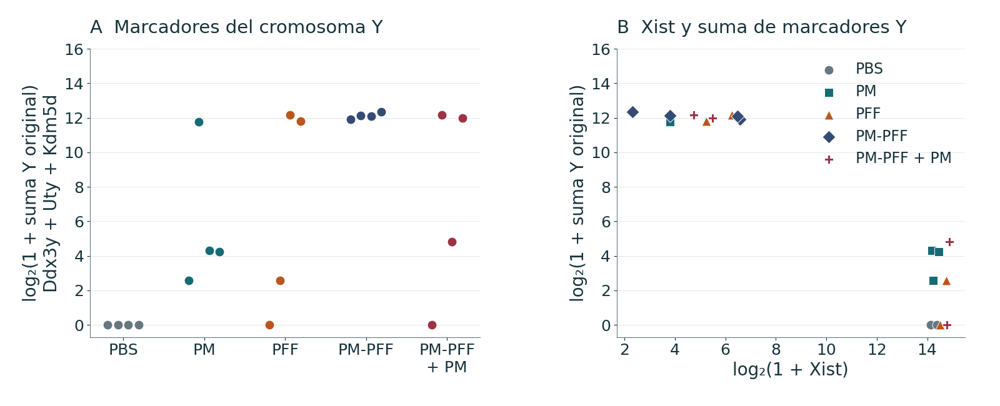{fig-alt="Los cuatro controles PBS tienen cero conteos Ddx3y, Uty y Kdm5d. Los otros grupos son heterogéneos." width=100%}

::: {.figure-caption}
Los cuatro controles PBS tienen cero conteos Ddx3y, Uty y Kdm5d. Los otros grupos son heterogéneos.
:::

::: {.source}
Análisis: este proyecto[Zhang et al., Science 2025](https://doi.org/10.1126/science.adu4132)
:::

::: {.notes}
Se preservan los 20 animales y sus tratamientos originales. Los marcadores ligados a Y plantean una pregunta sobre composición por sexo o identidad de las muestras, mientras el sexo de los animales RNA-seq sigue sin informarse. Por sí solos no establecen el sexo individual ni una confusión completa. No se reasignaron ni excluyeron animales, y no se inventó una covariable de sexo. La reproducción numérica exacta puede coexistir con una preocupación de diseño. El siguiente paso es verificar los metadatos de manera independiente, sin omitir muestras inconvenientes a posteriori.
:::

## La comparación hipotalámica conserva sensibilidad metodológica {#hy-reproduction .figure-slide}

::: {.slide-eyebrow}
03  /  Reproducción de autores
:::

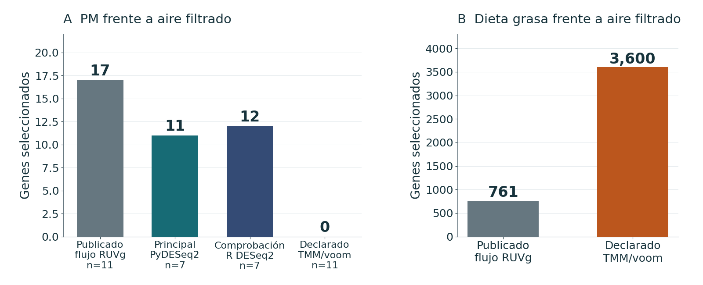{fig-alt="Las listas HY implican 17 genes PM y 761 HFD. La sensibilidad declarada sin RUVg produce 0 y 3,600 bajo sus criterios." width=100%}

::: {.figure-caption}
Las listas HY implican 17 genes PM y 761 HFD. La sensibilidad declarada sin RUVg produce 0 y 3,600 bajo sus criterios.
:::

::: {.source}
Análisis: este proyecto[Rajagopalan et al., JCI 2020](https://doi.org/10.1172/JCI137315)
:::

::: {.notes}
Las diferencias no pueden atribuirse de manera única al ajuste RUVg ausente. Se desconocen los controles empíricos, la cantidad de factores, los detalles del criterio de abundancia y el código completo. El análisis principal independiente del proyecto usa siete animales FA/PM con dieta estándar y obtiene 11 hallazgos BH, sin los criterios de genes codificantes y efecto de la sensibilidad metodológica. Son estimandos y familias de pruebas distintos. La afirmación defendible es sensibilidad metodológica transparente con reconstrucción incompleta, sin demostrar una ausencia de replicación biológica.
:::

## La dirección de miR-574-5p coincide sin confirmación BH {#mirna-reproduction .figure-slide}

::: {.slide-eyebrow}
03  /  Reproducción de autores
:::

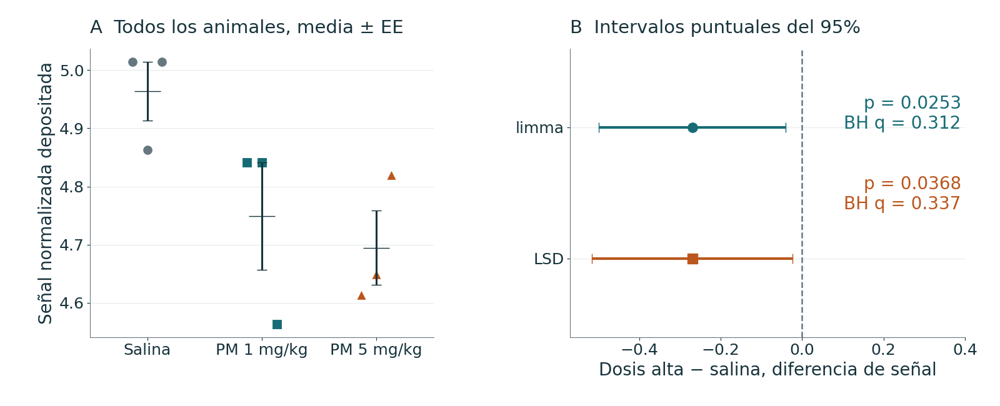{fig-alt="Diferencia a dosis alta −0.26945 unidades. limma p = 0.0253, BH q = 0.312. ANOVA p = 0.0788 impide LSD protegido." width=100%}

::: {.figure-caption}
Diferencia a dosis alta −0.26945 unidades. limma p = 0.0253, BH q = 0.312. ANOVA p = 0.0788 impide LSD protegido.
:::

::: {.source}
Análisis: este proyecto[Ku et al., Part. Fibre Toxicol. 2017](https://doi.org/10.1186/s12989-017-0215-3) · [Ritchie et al., NAR 2015](https://doi.org/10.1093/nar/gkv007)
:::

::: {.notes}
LSD no protegido a dosis alta da p = .0368, e intervalos nominales que excluyen cero, pero BH de todo el array no confirma el objetivo. LSD protegido exige un ómnibus significativo, que no supera el criterio de .05. Estas afirmaciones son compatibles porque usan criterios y reglas de multiplicidad distintos. La menor señal a ambas dosis reproduce dirección, sin reproducir qPCR independiente ni un rescate mecanístico. El mapa de calor descriptivo nuevo tiene una selección declarada y no afirma recuperar el orden o la selección original desconocidos.
:::

## Los efectos de genotipo en ozono muestran concordancia condicional {#ozone-reproduction .figure-slide}

::: {.slide-eyebrow}
03  /  Reproducción de autores
:::

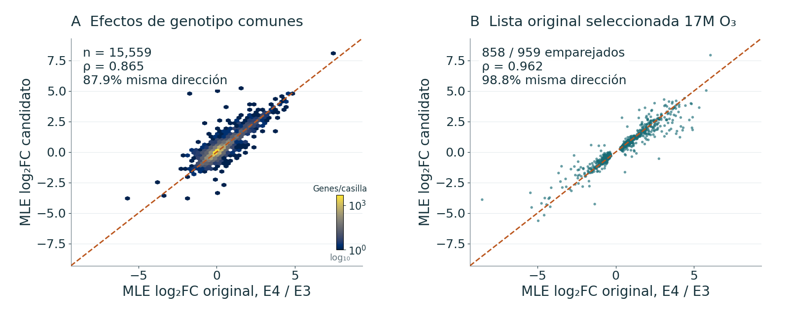{fig-alt="Selección publicada de genotipo: 2,501 genes. Comparación global de efectos ρ = 0.865; lista S3 seleccionada ρ = 0.962 y 98.8% de dirección concordante." width=100%}

::: {.figure-caption}
Selección publicada de genotipo: 2,501 genes. Comparación global de efectos ρ = 0.865; lista S3 seleccionada ρ = 0.962 y 98.8% de dirección concordante.
:::

::: {.source}
Análisis: este proyecto[Nakamya et al., IJMS 2025](https://doi.org/10.3390/ijms26062407)
:::

::: {.notes}
La regla de la tabla fuente recupera exactamente 1490 genes mayores y 1011 menores. El candidato conjunto de genotipo tiene 15,559 efectos finitos con símbolo exacto, 2362 selecciones nominales y Jaccard de .612 en el universo común evaluable. La lista S3 de E4 frente a E3 bajo O₃ a 17M contiene 959 genes: 858 tienen efectos finitos cotejados, 848 conservan dirección, 543 conservan selección nominal y 71 conservan BH < .05. La correlación condicionada por selección no estima concordancia transcriptómica global no sesgada. El UpSet común usa 15,661 genes, un denominador distinto. La concordancia de hemoglobinas no demuestra función de barrera hematoencefálica con ARN bulk.
:::

## Las conclusiones de reproducción difieren entre estudios {#reproduction-summary .layout-result}

::: {.slide-eyebrow}
03  /  Reproducción de autores
:::

| Estudio | Resultado defendible | Límite pendiente |
|---|---|---|
| Corteza | Cuatro conjuntos y PCA del código exactos | Sin flujo de lecturas completo ni sexo/identidad resueltos |
| Hipotálamo | Sensibilidad TMM/voom declarada | Sin controles RUVg ni k |
| miRNA | Dirección y evidencia nominal no protegida | Ómnibus y BH del array no confirman el objetivo |
| Ozono | Selección exacta de tabla y efectos cotejados | Otro cuantificador y condicionamiento por selección |

::: {.source}
Referencias científicas[Rajagopalan et al., JCI 2020](https://doi.org/10.1172/JCI137315) · [Zhang et al., Science 2025](https://doi.org/10.1126/science.adu4132) · [Nakamya et al., IJMS 2025](https://doi.org/10.3390/ijms26062407)
:::

::: {.notes}
Se cierra el bloque de reproducción, sin ordenar plausibilidad biológica. Todos reutilizan animales fuente. Corteza ofrece la concordancia de salidas más fuerte y aún requiere aclarar calidad. Una reproducción parcial no se eleva a validación mecanística. El bloque siguiente contiene análisis nuevos del proyecto, incluidos modelos cuya evaluación identifica limitaciones en vez de reconstrucción exitosa.
:::

## Análisis nuevos dentro del proyecto {#new-results .section-slide data-background-color="#103d49"}

::: {.slide-eyebrow}
04  /  Resultados del proyecto
:::

Reanálisis principal, heterogeneidad de respuesta, conjuntos génicos y modelado de referencia espacial

::: {.notes}
Estos resultados incorporan análisis al repositorio, no animales nuevos. «Nuevo» denota aporte del proyecto, sin afirmar novedad publicable o mecanismo biológico confirmado.
:::

## El análisis HY principal identifica 11 hallazgos BH {#hy-primary .figure-slide}

::: {.slide-eyebrow}
04  /  Resultados del proyecto
:::

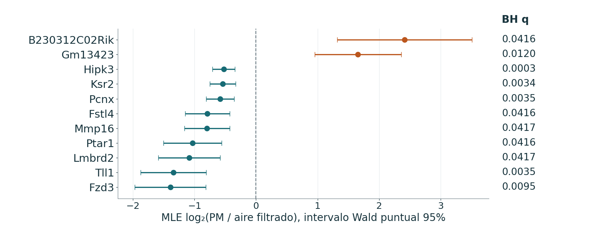{fig-alt="4 animales FA frente a 3 PM. Dos genes mayores y nueve menores con BH q &lt; 0.05. Intervalos Wald MLE puntuales." width=100%}

::: {.figure-caption}
4 animales FA frente a 3 PM. Dos genes mayores y nueve menores con BH q < 0.05. Intervalos Wald MLE puntuales.
:::

::: {.source}
Análisis: este proyecto[Rajagopalan et al., JCI 2020](https://doi.org/10.1172/JCI137315)
:::

::: {.notes}
Se retienen 19,611 genes y se obtienen 19,452 valores p Wald finitos tras 159 pruebas filtradas por Cook. Tll1 tiene MLE = −1.343708, q = .003497 y efecto regularizado −1.224053. Todos los hallazgos codificantes disminuyen bajo la anotación actual congelada, mientras los dos aumentos corresponden a una característica no codificante y un pseudogén. Leave-one-out produce 0–825 hallazgos BH y conserva la dirección de los 11, sin conservar significación en todos los ajustes. Tll1 mantiene q < .05 en 5/7 omisiones. La asociación regional con n pequeño no identifica un resultado celular específico ni proteico.
:::

## El análisis cortical principal usa ocho animales PM/PBS {#aca-primary .figure-slide}

::: {.slide-eyebrow}
04  /  Resultados del proyecto
:::

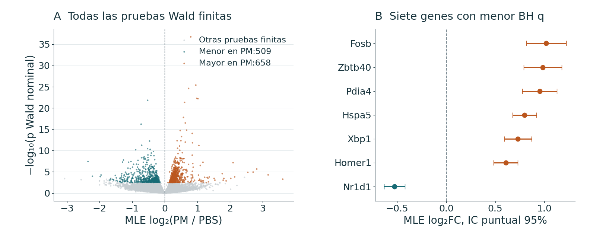{fig-alt="1,167 hallazgos BH: 658 mayores y 509 menores. La población y el modelo difieren de la reconstrucción de autores con 20 animales y 1,205 genes." width=100%}

::: {.figure-caption}
1,167 hallazgos BH: 658 mayores y 509 menores. La población y el modelo difieren de la reconstrucción de autores con 20 animales y 1,205 genes.
:::

::: {.source}
Análisis: este proyecto[Zhang et al., Science 2025](https://doi.org/10.1126/science.adu4132)
:::

::: {.notes}
La matriz principal retiene 19,235 genes y tiene 17,360 valores p ajustados finitos, con 10 pruebas filtradas por Cook y filtrado independiente adicional. Cuarenta y cinco genes cumplen el criterio exploratorio conjunto BH < .05 y |LFC regularizado| ≥ 1. El gráfico volcano representa la evidencia principal, sin elegir otro umbral ni afirmar una reproducción formal del volcano original. Fosb tiene MLE = 1.01816 y q = 2.265×10⁻¹⁹. Hspa5 es el ejemplo mejor ordenado por q principal, pero no se mide en el panel. La señal de sexo/identidad del estudio limita la atribución, sin implicar que todo gen seleccionado esté ligado al sexo.
:::

## El análisis miRNA nuevo conserva toda la familia de pruebas {#mirna-primary .layout-statement}

::: {.slide-eyebrow}
04  /  Resultados del proyecto
:::

::: {.statement-grid}

::: {.statement-metric}

1 / 0

hallazgos BH a dosis baja / alta

:::

::: {.statement-copy}
| Contraste | Características | Hallazgos BH | Escala |
|---|---|---|---|
| PM 1 mg/kg frente a control | 1,245 | 1 mayor | Diferencia original de señal |
| PM 5 mg/kg frente a control | 1,245 | 0 | Diferencia original de señal |
| F ómnibus separada | 1,245 | 1 | Diferencia conjunta de condición |
El hallazgo de dosis baja es mmu-miR-5119. Se muestran indicadores de baja detección y no se excluye ningún array.
:::

:::

::: {.source}
Análisis: este proyecto[Ku et al., Part. Fibre Toxicol. 2017](https://doi.org/10.1186/s12989-017-0215-3) · [Ritchie et al., NAR 2015](https://doi.org/10.1093/nar/gkv007)
:::

::: {.notes}
Se conservan 823 características con baja detección y 7722 valores negativos. La acumulación cerca de −3.3 y n de 3/grupo limitan su interpretación como abundancia precisa. La ausencia de separación clara en PCA no justifica seleccionar animales nuevamente. Cero hallazgos BH a dosis alta no establece equivalencia ni una inversión monotónica de dosis-respuesta. Las familias por contraste y ómnibus se corrigen por separado y plantean hipótesis nulas distintas. No se infiere una red de blancos ni GO de mRNA a partir de nombres de miRNA.
:::

## Los hallazgos de ozono dependen del estrato y la prueba {#ozone-primary .figure-slide}

::: {.slide-eyebrow}
04  /  Resultados del proyecto
:::

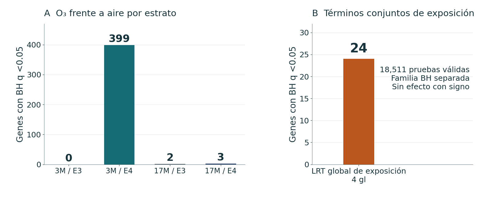{fig-alt="Hallazgos BH por estrato: 0 / 399 / 2 / 3. El LRT global separado de exposición, con 4 gl, identifica 24 genes." width=100%}

::: {.figure-caption}
Hallazgos BH por estrato: 0 / 399 / 2 / 3. El LRT global separado de exposición, con 4 gl, identifica 24 genes.
:::

::: {.source}
Análisis: este proyecto[Nakamya et al., IJMS 2025](https://doi.org/10.3390/ijms26062407)
:::

::: {.notes}
El orden es 3M/E3, 3M/E4, 17M/E3 y 17M/E4, con 3 FA y 3 O₃ por estrato. E4 joven tiene 86 genes mayores y 313 menores, E3 mayor tiene dos mayores y E4 mayor tiene tres menores. El LRT global tiene 18,511 pruebas válidas. La BH suplementaria de las cuatro familias Wald da 1/43/4/6 y define otra familia de corrección, por lo que sus listas no tienen que anidarse en las de BH por contraste. No se escoge el mayor número como corrección preferida. Los recuentos distintos motivan pruebas directas de heterogeneidad, sin demostrar por sí solos modificación por edad/genotipo.
:::

## La respuesta dependiente de edad tiene la señal conjunta más clara {#interaction-results .layout-statement}

::: {.slide-eyebrow}
04  /  Resultados del proyecto
:::

::: {.statement-grid}

::: {.statement-metric}

08

genes de respuesta por edad; 1 con BH conjunta

:::

::: {.statement-copy}
| LRT conjunto secundario | gl | Hallazgos BH por familia | BH conjunta tres familias |
|---|---|---|---|
| Respuesta dependiente de genotipo | 2 | 0 | 0 |
| Respuesta dependiente de edad | 2 | 8 | 1 |
| Interacción triple | 1 | 0 | 0 |
Genes de respuesta por edad: Ryr3, Rps24, Pkig, Rpl26, Inpp5d, Stk11, Rpl34 y Gm21586.
:::

:::

::: {.source}
Análisis: este proyecto[Nakamya et al., IJMS 2025](https://doi.org/10.3390/ijms26062407) · [Love et al., Genome Biol. 2014](https://doi.org/10.1186/s13059-014-0550-8)
:::

::: {.notes}
Los LRT secundarios conservan el universo original de 18537 genes, las dispersiones ajustadas y los offsets. El LRT de edad prueba AE y AGE conjuntamente. Sus 8 hallazgos por familia pasan a 1 con la BH suplementaria entre tres LRT. Las diferencias de respuesta por genotipo dan 6 a 3M y 4 a 17M. Las diferencias por edad dan 2 en E3 y 4 en E4, mientras el contraste triple da 0. Son contrastes, máscaras de validez y familias de multiplicidad diferentes, por lo que sus hallazgos no tienen que coincidir con los LRT conjuntos. Cero hallazgos en otra familia no demuestra igualdad de efectos.
:::

## Los perfiles animales contextualizan diferencias de respuesta {#interaction-animals .figure-slide}

::: {.slide-eyebrow}
04  /  Resultados del proyecto
:::

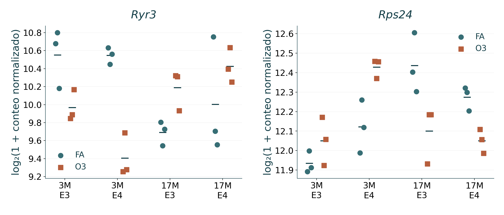{fig-alt="Se muestran los 24 animales por gen. Los puntos representan animales y los segmentos cortos muestran medias descriptivas." width=100%}

::: {.figure-caption}
Se muestran los 24 animales por gen. Los puntos representan animales y los segmentos cortos muestran medias descriptivas.
:::

::: {.source}
Análisis: este proyecto[Nakamya et al., IJMS 2025](https://doi.org/10.3390/ijms26062407)
:::

::: {.notes}
Ryr3 y Rps24 proceden de la selección fija del LRT de edad, sin buscar nuevos gráficos llamativos. Los valores son log₂(1 + conteo normalizado existente), con pequeños desplazamientos horizontales fijos y sin líneas de pareamiento ni barras inferenciales. Los valores p de interacción derivan del ajuste binomial negativo con covarianza, sin inferirse de la separación visual. Las medias transformadas difieren de las medias GLM en escala de conteos. Tres animales por estrato limitan la generalización.
:::

## ORA y GSEA por rango describen evidencia diferente {#enrichment-results .layout-result}

::: {.slide-eyebrow}
04  /  Resultados del proyecto
:::

| Contraste | Términos ORA mayores / menores | Términos FDR algorítmica GSEA |
|---|---|---|
| HY | 0 / 0 | 916 |
| ACA | 86 / 2 | 223 |
| O₃ M3_E3 | 0 / 0 | 4 |
| O₃ M3_E4 | 0 / 0 | 368 |
| O₃ M17_E3 | 0 / 0 | 85 |
| O₃ M17_E4 | 0 / 0 | 23 |
Estos términos correlacionados no cuentan mecanismos biológicos independientes.

::: {.source}
Análisis: este proyecto[Subramanian et al., PNAS 2005](https://doi.org/10.1073/pnas.0506580102) · [Gene Ontology Consortium](https://geneontology.org/docs/go-enrichment-analysis/)
:::

::: {.notes}
HY no tiene términos ORA, pero sí 916 términos GSEA, porque el conjunto umbralizado y los rangos coordinados responden preguntas distintas. No implica 916 vías independientes ni resuelve la incertidumbre de siete animales. ACA presenta 86 términos ORA positivos y 2 negativos. Las familias ORA de ozono están vacías con sus umbrales, mientras GSEA obtiene 4, 368, 85 y 23 términos. Importan el mapeo, los universos finitos, los ancestros propagados y la FDR algorítmica de GSEA, distinta de BH. El enriquecimiento es exploratorio y hereda las limitaciones del diseño.
:::

## Patrones GO seleccionados en seis contrastes de ARN {#go-patterns .figure-slide}

::: {.slide-eyebrow}
04  /  Resultados del proyecto
:::

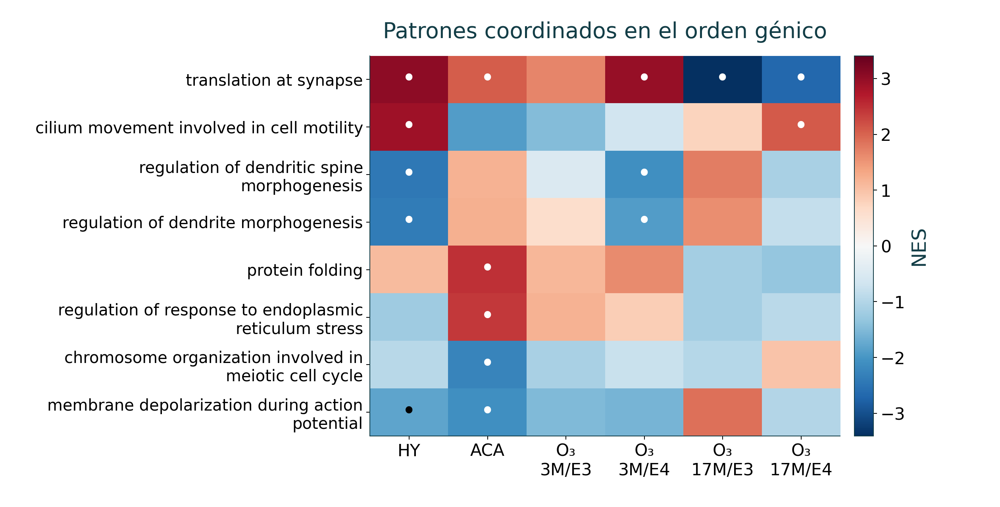{fig-alt="Selección gráfica fija y escala NES común. Punto: FDR algorítmica de GSEA &lt; 0.05. Gris: no elegible o no disponible." width=100%}

::: {.figure-caption}
Selección gráfica fija y escala NES común. Punto: FDR algorítmica de GSEA < 0.05. Gris: no elegible o no disponible.
:::

::: {.source}
Análisis: este proyecto[Subramanian et al., PNAS 2005](https://doi.org/10.1073/pnas.0506580102) · [Gene Ontology Consortium](https://geneontology.org/docs/go-enrichment-analysis/)
:::

::: {.notes}
Se redibujan los primeros 8 términos de la selección gráfica existente de 22 para facilitar la lectura proyectada, sin repetir el enriquecimiento. La figura completa y las 132 filas fuente permanecen en el repositorio. Los términos seleccionados no constituyen un resumen exhaustivo ni no sesgado de todo GO. NES positivo significa enriquecimiento hacia el rango positivo, sin demostrar activación de vías. La red GO separada de 20 nodos tiene 15 aristas con Jaccard ≥ .25 y representa anotaciones compartidas, sin establecer regulación, coexpresión ni conectividad espacial.
:::

## Los productos génicos contextualizan sin medir proteínas {#gene-products}

::: {.slide-eyebrow}
04  /  Resultados del proyecto
:::

| Gen | Producto / función anotada | Panel medido |
|---|---|---|
| [Tll1](https://www.ncbi.nlm.nih.gov/gene/21892) | Proteasa extracelular de procesamiento tolloid-like | Sí |
| [Fosb](https://www.ncbi.nlm.nih.gov/gene/14282) | FosB, subunidad del factor transcripcional AP-1 | Sí |
| [S1pr1](https://www.ncbi.nlm.nih.gov/gene/13609) | Receptor de esfingosina-1-fosfato | Sí |
| [Hspa5](https://www.ncbi.nlm.nih.gov/gene/14828) | Chaperona BiP/GRP78 del retículo endoplásmico | No |
| [Ksr2](https://www.ncbi.nlm.nih.gov/gene/333050) | Andamio RAF–MEK/MAPK | No |
| [C730002L08Rik](https://www.ncbi.nlm.nih.gov/gene/320155) | ARN no codificante, sin proteína anotada | Sí |

::: {.source}
Análisis: este proyecto[NCBI Gene: Tll1](https://www.ncbi.nlm.nih.gov/gene/21892) · [UniProtKB: Tll1](https://www.uniprot.org/uniprotkb/Q62381/entry) · [Zhang et al., Nature 2023](https://doi.org/10.1038/s41586-023-06808-9)
:::

::: {.notes}
Las definiciones resumen registros NCBI/UniProt congelados y conservan sus calificadores en la tabla completa. La expresión de ARN no establece actividad enzimática, abundancia proteica ni un mecanismo de exposición. El ARN de Fosb no distingue las isoformas FosB/ΔFosB. Ksr2 se interpreta como andamio: la baja actividad cinasa in vitro informada no demuestra catálisis activa aquí. C730002L08Rik no tiene producto proteico establecido. Hspa5 y Ksr2 siguen siendo candidatos bulk útiles aunque carezcan de un mapa medido. No se reemplaza un gen ausente por otro de nombre parecido.
:::

## Las capas corticales medidas organizan las células de referencia {#aca-sections .figure-slide}

::: {.slide-eyebrow}
04  /  Resultados del proyecto
:::

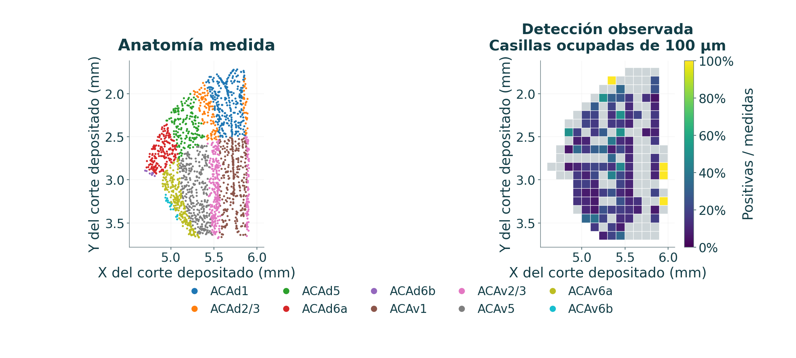{fig-alt="Corte ACA de mayor n: 1,940 células. Los colores anatómicos y la detección de Fosb usan el plano experimental depositado." width=100%}

::: {.figure-caption}
Corte ACA de mayor n: 1,940 células. Los colores anatómicos y la detección de Fosb usan el plano experimental depositado.
:::

::: {.source}
Análisis: este proyecto[Zhang et al., Nature 2023](https://doi.org/10.1038/s41586-023-06808-9)
:::

::: {.notes}
El corte es Zhuang-ABCA-2.023, seleccionado por mayor n regional sin usar la expresión. Todas las células medidas, incluidos los ceros, aportan a los denominadores. La organización laminar procede de las posiciones originales y las anotaciones CCF, sin colocación aleatoria ni una nube simulada. Las casillas vacías quedan sin observación. La referencia ACA completa contiene 14582 células, 18 cortes y 10 subdivisiones, incluido el corte de una célula. Describe un macho sin exposición, sin identificar efectos PM por capa.
:::

## Núcleos hipotalámicos medidos y detección Tll1 {#hy-sections .figure-slide}

::: {.slide-eyebrow}
04  /  Resultados del proyecto
:::

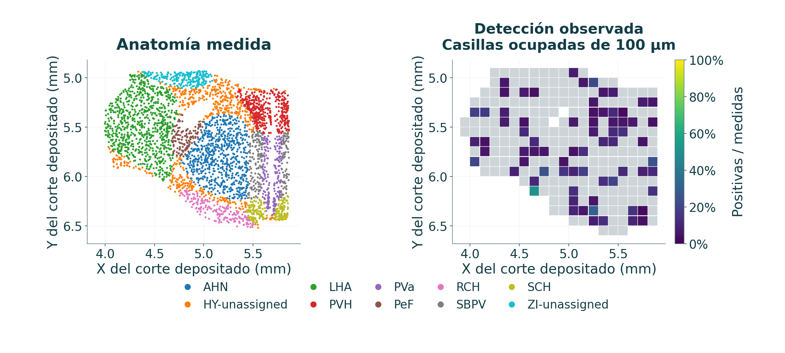{fig-alt="Corte HY de mayor n: 3,565 células. Tll1 es positivo en 667 de las 37,811 células de la región HY completa." width=100%}

::: {.figure-caption}
Corte HY de mayor n: 3,565 células. Tll1 es positivo en 667 de las 37,811 células de la región HY completa.
:::

::: {.source}
Análisis: este proyecto[Zhang et al., Nature 2023](https://doi.org/10.1038/s41586-023-06808-9)
:::

::: {.notes}
El corte físico de ejemplo es .034, seleccionado sin usar Tll1. La referencia HY tiene 20 cortes y 49 etiquetas anatómicas, incluidas etiquetas no asignadas. La detección global de Tll1 es 1.764%; una fracción por corte puede diferir y conserva su propio denominador. Un conteo bajo no distingue ausencia biológica de detectabilidad limitada. No se generan cortes intermedios ni copias bilaterales. La detección descriptiva por núcleo no constituye una prueba de asociación con la exposición.
:::

## El escalamiento ilustrativo preserva la geometría medida {#scenario-results .layout-result}

::: {.slide-eyebrow}
04  /  Resultados del proyecto
:::

**ACA / Fosb:** el efecto bulk regularizado produce un escenario cercano al doble.

**HY / Tll1:** el efecto bulk regularizado produce un escenario de 0.428 veces.

- Cada valor positivo recibe el mismo multiplicador regional de su gen.
- Los ceros, las posiciones y la cantidad de células se mantienen.
- La interfaz vincula candidatos medidos, productos génicos, resultados de animales fuente e incertidumbre.

[Abrir el visor cortical 3D emparejado](https://amarusimonaguerojimenez.github.io/Air-Pollution-Brain-Omics-Mouse/es/cortex_viewer.html).

::: {.source}
Análisis: este proyecto[Zhang et al., Nature 2023](https://doi.org/10.1038/s41586-023-06808-9)
:::

::: {.notes}
El visor lado a lado es un aporte del proyecto, sin validar de manera independiente un efecto espacial. La figura estática completa de referencia/escenario permanece en los resultados. La escala común ayuda a interpretar el escalamiento uniforme, sin crear información de respuesta celular específica. Un multiplicador positivo conserva el patrón relativo y el soporte de detección. La incertidumbre basal bayesiana es distinta de las alternativas Wald del bulk y no representa un intervalo de exposición.

[Figura completa referencia/escenario](https://amarusimonaguerojimenez.github.io/Air-Pollution-Brain-Omics-Mouse/assets/figures/spatial_cortex/reference_vs_simulation_es.png).
:::

## La regresión gaussiana espacial mejora pocas veces la referencia {#gaussian-rmse .figure-slide}

::: {.slide-eyebrow}
04  /  Resultados del proyecto
:::

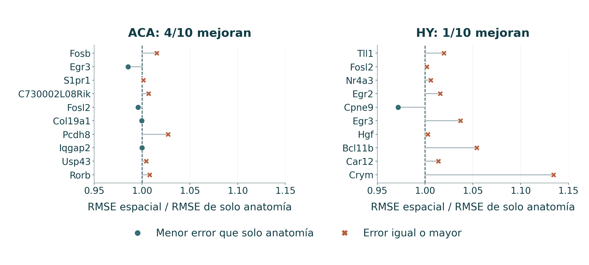{fig-alt="El RMSE mejora respecto a solo anatomía en 4/10 genes ACA y 1/10 HY, con los mismos bloques de cortes." width=100%}

::: {.figure-caption}
El RMSE mejora respecto a solo anatomía en 4/10 genes ACA y 1/10 HY, con los mismos bloques de cortes.
:::

::: {.source}
Análisis: este proyecto[Zhang et al., Nature 2023](https://doi.org/10.1038/s41586-023-06808-9) · [Murphy, 2007, Gaussian conjugacy](https://www.cs.ubc.ca/~murphyk/Papers/bayesGauss.pdf)
:::

::: {.notes}
El RMSE de Tll1 es .109713 para el modelo espacial, .107582 para solo anatomía y .107175 para kNN. Para Fosb es .297687, .293223 y .301802, respectivamente. Las pérdidas usan ln(1 + conteo de imagen). Cocientes menores que 1 favorecen el modelo espacial, pero son comparaciones descriptivas de un donante, sin una prueba que suponga células independientes. Cuatro configuraciones predefinidas revisan longitudes y priors, sin selección por los datos de prueba. Un mapa suave no demuestra ganancia predictiva.
:::

## La cobertura global oculta limitaciones gaussianas importantes {#gaussian-diagnostics .figure-slide}

::: {.slide-eyebrow}
04  /  Resultados del proyecto
:::

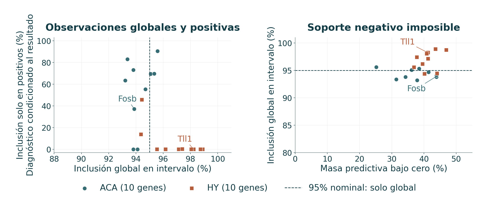{fig-alt="La cobertura global, la inclusión solo en positivos y el soporte predictivo negativo imposible son diagnósticos distintos." width=100%}

::: {.figure-caption}
La cobertura global, la inclusión solo en positivos y el soporte predictivo negativo imposible son diagnósticos distintos.
:::

::: {.source}
Análisis: este proyecto[Zhang et al., Nature 2023](https://doi.org/10.1038/s41586-023-06808-9) · [Murphy, 2007, Gaussian conjugacy](https://www.cs.ubc.ca/~murphyk/Papers/bayesGauss.pdf)
:::

::: {.notes}
Las medianas de cobertura marginal son 97.27% en HY y 94.00% en ACA. Las medianas de inclusión en la cola positiva son 0% y 66.46%; el objetivo marginal nominal de 95% no se aplica al condicionar por el resultado positivo. Aun así, la masa predictiva bajo cero es 41.06% en HY y 38.19% en ACA, imposible para ln(1 + conteo). Tll1 tiene 98.24% de inclusión global, 0/667 en positivos y 41.24% de masa negativa. Junto con las ganancias basales limitadas, esto impide afirmar una reconstrucción celular del ARN validada. Se conservan las medias y los límites negativos sin recortarlos.
:::

## La detección acotada mejora modestamente en ACA y falla en HY {#beta-performance .figure-slide}

::: {.slide-eyebrow}
04  /  Resultados del proyecto
:::

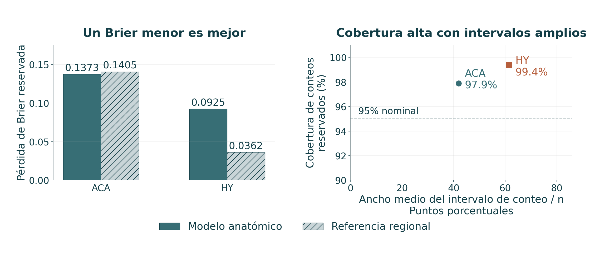{fig-alt="Brier ACA de 0.13725 frente a 0.14051 regional. HY de 0.09246 frente a 0.03621. La cobertura alta de conteos acompaña intervalos amplios." width=100%}

::: {.figure-caption}
Brier ACA de 0.13725 frente a 0.14051 regional. HY de 0.09246 frente a 0.03621. La cobertura alta de conteos acompaña intervalos amplios.
:::

::: {.source}
Análisis: este proyecto[Zhang et al., Nature 2023](https://doi.org/10.1038/s41586-023-06808-9) · [SciPy, beta-binomial distribution](https://docs.scipy.org/doc/scipy/reference/generated/scipy.stats.betabinom.html)
:::

::: {.notes}
La cobertura agrupada de diez genes es 1253/1280 = 97.89% para ACA y 1848/1860 = 99.35% para HY. La amplitud media del intervalo dividida por n abarca 41.9 y 61.5 puntos porcentuales. Son evaluaciones gen×corte×anatomía, sin animales independientes. En HY, 79/186 grupos únicos por gen y 10416/37811 células reales quedan solo con prior en los bloques reservados. El prior simétrico fijo puede predecir mal la detección de genes raros. El Brier HY restringido a anatomías entrenadas, .032557 frente a .032877, mejora ligeramente, sin reemplazar el fallo con soporte completo. El objetivo es detección, no magnitud del conteo.
:::

## La detección posterior ACA separa objetivos de incertidumbre {#beta-aca .figure-slide}

::: {.slide-eyebrow}
04  /  Resultados del proyecto
:::

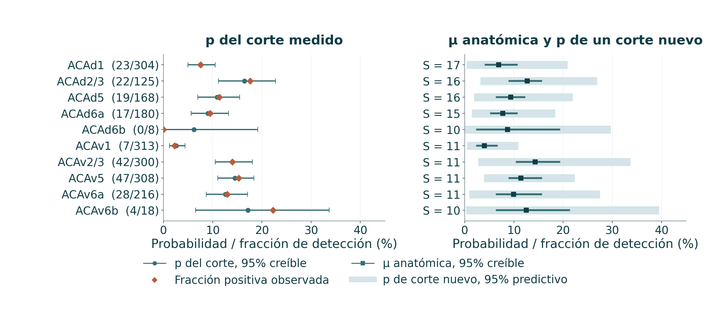{fig-alt="Fosb: fracciones observadas, probabilidades del corte conocido e incertidumbre anatómica/de un corte nuevo, rotuladas por separado." width=100%}

::: {.figure-caption}
Fosb: fracciones observadas, probabilidades del corte conocido e incertidumbre anatómica/de un corte nuevo, rotuladas por separado.
:::

::: {.source}
Análisis: este proyecto[Zhang et al., Nature 2023](https://doi.org/10.1038/s41586-023-06808-9) · [SciPy, beta-binomial distribution](https://docs.scipy.org/doc/scipy/reference/generated/scipy.stats.betabinom.html)
:::

::: {.notes}
La p del corte conocido se condiciona a sus propios conteos: es un resumen ajustado, sin ser una predicción reservada. μ promedia propensiones de cortes intercambiables, mientras la fracción agrupada pondera células reales. La distribución de p de un corte nuevo modela heterogeneidad y difiere de una predicción de conteos con denominador n. Las capas pequeñas pueden tener incertidumbre amplia o de forma distinta, sin resolver efectos de exposición. El Brier de Fosb, .08745 frente a .08803, indica una ganancia pequeña, con cobertura de 99.2% y ancho/n de .345.
:::

## La anatomía HY ajustada no garantiza predicción reservada {#beta-hy .figure-slide}

::: {.slide-eyebrow}
04  /  Resultados del proyecto
:::

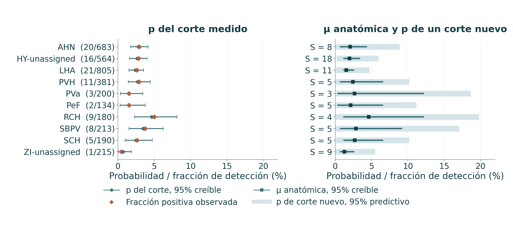{fig-alt="Tll1: probabilidades ajustadas acotadas. Las anatomías reservadas no vistas revelan dependencia del prior." width=100%}

::: {.figure-caption}
Tll1: probabilidades ajustadas acotadas. Las anatomías reservadas no vistas revelan dependencia del prior.
:::

::: {.source}
Análisis: este proyecto[Zhang et al., Nature 2023](https://doi.org/10.1038/s41586-023-06808-9) · [SciPy, beta-binomial distribution](https://docs.scipy.org/doc/scipy/reference/generated/scipy.stats.betabinom.html)
:::

::: {.notes}
El Brier reservado de Tll1, .08329, es peor que el regional, .01772. La cobertura es 98.9%, pero la amplitud media/n es .600 y 79 de 186 grupos quedan solo con prior. La posterior de referencia completa utiliza todos los cortes y puede parecer razonable aunque falle la predicción con separación. Mostrar ambas evita confundir ajuste y generalización. Filtrar por clase oculta las estimaciones de todas las clases, sin simular un reajuste específico de clase. El gráfico de intervalos no agrega resolución ni células respondedoras a PM.
:::

## Estabilidad numérica y utilidad predictiva son distintas {#numerics .layout-result}

::: {.slide-eyebrow}
04  /  Resultados del proyecto
:::

| Cuadrícula 64×48 frente a 96×64 | ACA | HY |
|---|---|---|
| Cambio máximo de media μ | 0.000192 | 0.000537 |
| Cambio máximo de extremo IC de μ | 0.0203 | 0.0181 |
| Cambio máximo de extremo p nuevo | 0.00254 | 0.00358 |
| Cobertura reservada de conteos | 97.89% → 98.05% | 99.35% sin cambio |
Las verificaciones numéricas y de simulación reproducible apoyan la revisión computacional. No reparan una predicción débil ni validan biológicamente los priors.

::: {.source}
Análisis: este proyecto[Zhang et al., Nature 2023](https://doi.org/10.1038/s41586-023-06808-9) · [Murphy, 2007, Gaussian conjugacy](https://www.cs.ubc.ca/~murphyk/Papers/bayesGauss.pdf) · [SciPy, beta-binomial distribution](https://docs.scipy.org/doc/scipy/reference/generated/scipy.stats.betabinom.html)
:::

::: {.notes}
Las diferencias OOF de Brier son como máximo 10⁻⁶. Cambia el estado de cobertura de cuatro grupos ACA y ninguno HY. Los cuantiles discretos de μ pueden moverse más que las medias, por lo que informar solo estabilidad media exageraría la convergencia de la incertidumbre. La inversión determinista de la CDF elimina el ruido Monte Carlo de ese diagnóstico particular; p del corte conocido y conteos reservados mantienen 8192 sorteos. Un chequeo independiente de la posterior gaussiana verifica el transporte analítico de incertidumbre, sin validar la verosimilitud. Las verificaciones de implementación no equivalen a éxito científico general.
:::

## Límites que cambian la interpretación científica {#limits .small .layout-result}

::: {.slide-eyebrow}
05  /  Interpretación
:::

| Nivel | Inferencia respaldada | Límite |
|---|---|---|
| Reproducción | Recuperación numérica con datos fuente | Sin réplicas biológicas nuevas |
| Bulk / miRNA | Asociaciones regionales de cada estudio | Composición, n pequeño y metadatos |
| GO e interacciones | Patrones exploratorios / contrastes definidos | Multiplicidad, correlación y supuestos |
| Atlas medido | Detección en posiciones originales | Un donante, panel dirigido y espacios entre cortes |
| Bayesianos espaciales | Estimaciones condicionales y diagnósticos reservados | Ganancia limitada, prior y modelo inadecuado |
| Escenario PM₂.₅ | Ilustración uniforme de efecto grupal | Sin respuesta celular identificada |

::: {.source}
Referencias científicas[Rajagopalan et al., JCI 2020](https://doi.org/10.1172/JCI137315) · [Zhang et al., Science 2025](https://doi.org/10.1126/science.adu4132) · [Nakamya et al., IJMS 2025](https://doi.org/10.3390/ijms26062407)
:::

::: {.notes}
Estos límites operativos determinan qué afirmaciones pueden respaldar las figuras. Un donante no establece prevalencia espacial poblacional. Una cuadrícula de visualización más fina no eleva la resolución de adquisición. Para estimar la respuesta celular se requieren mediciones espaciales de ARN con exposición o datos single-cell emparejados, sin asumir escalamiento uniforme. Donantes independientes permitirían evaluar la transferencia de priors y calibrar la incertidumbre más allá de una referencia.
:::

## Conclusiones respaldadas por el trabajo completado {#conclusions .layout-statement}

::: {.slide-eyebrow}
05  /  Interpretación
:::

::: {.statement-grid}

::: {.statement-metric}

04

conclusiones respaldadas por evidencia

:::

::: {.statement-copy}
1. La reconstrucción cortical recupera los cuatro conjuntos significativos y conserva una pregunta sobre la calidad de la fuente.
2. Los reanálisis muestran sensibilidad al modelo, a la familia de pruebas y al tamaño muestral. La respuesta de ozono dependiente de edad ofrece la señal conjunta más clara.
3. Los cortes medidos, los productos génicos y los modelos de detección acotada mejoran la interpretación del atlas.
4. La validación espacial informa ganancias limitadas y fallos. El trabajo no establece una reconstrucción celular de cerebro expuesto.
:::

:::

::: {.source}
Referencias científicas[Rajagopalan et al., JCI 2020](https://doi.org/10.1172/JCI137315) · [Zhang et al., Science 2025](https://doi.org/10.1126/science.adu4132) · [Nakamya et al., IJMS 2025](https://doi.org/10.3390/ijms26062407)
:::

::: {.notes}
La defensa conserva las fortalezas y los fallos. El resultado exacto más fuerte es la reproducción cortical a nivel de conteos. La evidencia nueva más directa de diferencias de respuesta es el LRT conjunto de edad, con sensibilidad explícita a la familia de multiplicidad. El aporte espacial es un explorador medido reproducible y modelos condicionales evaluados, sin aumento de resolución. «Nuevo» se refiere al proyecto. La verificación experimental independiente y los metadatos completos siguen pendientes.
:::

## El trabajo futuro requiere información biológica independiente {#future .layout-statement}

::: {.slide-eyebrow}
05  /  Interpretación
:::

::: {.statement-grid}

::: {.statement-metric}

NEXT

validación biológica independiente

:::

::: {.statement-copy}
- Recuperar los metadatos fuente de sexo/identidad y las especificaciones RUVg faltantes.
- Validar candidatos en animales y poblaciones celulares independientes.
- Evaluar modelos de conteos dispersos o hurdle y predicción entre donantes.
- Obtener mediciones espaciales/single-cell con exposición antes de inferir respuestas específicas.
- Explorar UCSC Genome Browser, Ensembl y ENCODE para evidencia epigenómica cerebral compatible.
:::

:::

::: {.notes}
La epigenómica recoge la línea propuesta por el usuario, sin una búsqueda o análisis completado. No se afirman capas epigenéticas, asignaciones de enhancers, resultados de accesibilidad ni un dataset de NO₂. La integración exigiría compatibilidad de especie, ensamblaje, región, tipo celular, edad y ensayo. Una capa de referencia aportaría contexto regulatorio basal, sin demostrar una respuesta medida a la contaminación sin un contraste experimental. Los modelos alternativos deben juzgarse con unidades reservadas y calibración preespecificadas, sin seleccionarlos por crear mapas visualmente detallados.
:::

## Reproducibilidad y discusión {#discussion}

::: {.slide-eyebrow}
05  /  Interpretación
:::

**Evidencia completa:** correspondencias con las fuentes, poblaciones analíticas, código, referencias congeladas, tablas y figuras bilingües.

**Controles:** flechas para navegar, Esc para la vista general, Notas para la explicación detallada y cambio de idioma en la misma diapositiva.

[Informe científico](https://amarusimonaguerojimenez.github.io/Air-Pollution-Brain-Omics-Mouse/es/) · [Repositorio](https://github.com/AmaruSimonAgueroJimenez/Air-Pollution-Brain-Omics-Mouse)

El apéndice contiene protocolos, fórmulas, análisis de sensibilidad, listas de candidatos y referencias.

::: {.notes}
Aquí puede cerrar la presentación principal. El apéndice apoya las preguntas metodológicas sin necesidad de proyectar cada tabla técnica. El HTML incluye figuras, estilos, el motor de presentación y fórmulas nativas para visualizarlo sin conexión. Los enlaces a fuentes y al informe requieren acceso al repositorio o a la página. Las notas están disponibles en el panel de la propia diapositiva, aunque la ventana externa del presentador no pueda cargar sin conexión. Abrir las diapositivas no ejecuta ajustes nuevos.
:::

## Apéndice técnico {#appendix .section-slide data-background-color="#103d49"}

::: {.slide-eyebrow}
06  /  Apéndice técnico
:::

Protocolos, familias de pruebas, definición de priors y reproducibilidad

::: {.notes}
El apéndice apoya el examen detallado. No es necesario proyectarlo completo durante la presentación principal.
:::

## Los protocolos de PM₂.₅ permanecen diferenciados {#a-pm-protocols .appendix .small .layout-study}

::: {.slide-eyebrow}
06  /  Apéndice técnico
:::

| Brazo | Contexto inicial | Protocolo | Precaución temporal |
|---|---|---|---|
| HY / GSE145840 | C57BL/6J macho, 3 semanas | 60–120 µg/m³, media 80; 6 h/día, 5 días/semana, 14 semanas | Edad terminal e intervalo hasta la toma de tejido no informados |
| ACA / GSE297423 | hWT αSyn, 2 meses, sexo no informado | 2 µL de 5 mg/mL intranasal, cada 2 días por 2 meses | Distinto del brazo convencional de mayor edad |
| miRNA / GSE93967 | C57BL/6 macho, aprox. 8 semanas | 1 o 5 mg/kg por aspiración orofaríngea, días alternos por 4 semanas | Toma de tejido 18 h tras la dosis final |

::: {.source}
Referencias científicas[Rajagopalan et al., JCI 2020](https://doi.org/10.1172/JCI137315) · [Zhang et al., Science 2025](https://doi.org/10.1126/science.adu4132) · [Ku et al., Part. Fibre Toxicol. 2017](https://doi.org/10.1186/s12989-017-0215-3)
:::

::: {.notes}
Los protocolos proceden de la revisión guardada de artículos y metadatos, con localizadores por brazo en registro de reproducibilidad. No se transforma concentración atmosférica en dosis instilada por peso. La suma aritmética de edad inicial y duración no reemplaza una edad terminal informada. Las administraciones líquidas cortical y miRNA no se describen como inhalación en cámara. Las plataformas e IDs permanecen en los metadatos de acceso.
:::

## Protocolo de ozono y tamaño muestral secuenciado {#a-ozone-protocol .appendix}

::: {.slide-eyebrow}
06  /  Apéndice técnico
:::

- Ratones machos de reemplazo dirigido APOE3/APOE4 humano.
- Inicio de exposición a los 3 o 17 meses.
- **0.8 ppm O₃, 7 h/día por 5 días**, seguidos de 9 días con aire filtrado.
- Ocho ciclos. RNA-seq del hipocampo izquierdo.
- Los 14–16 animales/grupo del artículo difieren de **tres secuenciados por estrato**.
- Una cadena de cepa SDRF difiere en Sample1 / ERR14708304.

::: {.source}
Referencias científicas[Nakamya et al., IJMS 2025](https://doi.org/10.3390/ijms26062407)
:::

::: {.notes}
Ocho ciclos de 14 días implican 112 días como cálculo de calendario, no como fecha individual de toma de tejido. La fuente revisada no establece independientemente la geometría de la cámara ni el intervalo exacto desde la última exposición a ozono hasta la toma de tejido. Por ello, no se agrega una etiqueta de exposición de cuerpo completo o solo por nariz, ni una edad terminal precisa. La excepción de cepa se conserva como cautela, sin declararla confusión completa por genotipo. El subconjunto secuenciado define el n inferencial.
:::

## Mediana de cocientes y offsets de longitud {#a-normalization .appendix .formula-slide .layout-equation}

::: {.slide-eyebrow}
06  /  Apéndice técnico
:::

::: {.equation-grid}

::: {.equation-core}
$$G_g=\left(\prod_i K_{gi}\right)^{1/m},\qquad
s_i=\operatorname{median}_{g}\left(\frac{K_{gi}}{G_g}\right)$$
:::

::: {.equation-detail}
Para genes con media geométrica utilizable:

Los conteos PM normalizados son $K_{gi}/s_i$. Los factores se estiman con el universo retenido.

Ozono usa normalización gen/muestra por longitud efectiva con tximport. TPM no sustituye la entrada binomial negativa.

VST/PCA y heatmaps estandarizados por fila son transformaciones descriptivas, separadas de la verosimilitud.
:::

:::

::: {.source}
Referencias científicas[Love et al., Genome Biol. 2014](https://doi.org/10.1186/s13059-014-0550-8) · [Soneson et al. 2015](https://doi.org/10.12688/f1000research.7563.2) · [Rajagopalan et al., JCI 2020](https://doi.org/10.1172/JCI137315)
:::

::: {.notes}
Es la definición de cocientes con medias geométricas positivas utilizables, sin afirmar que todos los genes retenidos aportan a cada factor. Se guardan factores y matrices fuente intactas. Los z de heatmap por gen eliminan magnitud y no equivalen a expresión comparable entre genes. Un eje PCA no es un tipo celular ni efecto ajustado. Las transformaciones gráficas no alteran entrada o familia de pruebas.
:::

## Moderación Bayes empírica en limma {#a-limma .appendix .formula-slide .layout-equation}

::: {.slide-eyebrow}
06  /  Apéndice técnico
:::

::: {.equation-grid}

::: {.equation-core}
$$s_{f,\mathrm{post}}^2=
\frac{d_0s_{0f}^2+d_fs_f^2}{d_0+d_f}$$

$$t_{f,\mathrm{mod}}=
\frac{\widehat\Delta_f}{s_{f,\mathrm{post}}\sqrt{v_f}}$$
:::

::: {.equation-detail}
La tendencia de varianza previa depende del nivel de señal. La moderación comparte información entre características.

Los intervalos t puntuales y BH entre características responden preguntas diferentes.

No se inventa pareamiento o lote para los nueve arrays.
:::

:::

::: {.source}
Referencias científicas[Ritchie et al., NAR 2015](https://doi.org/10.1093/nar/gkv007) · [Ku et al., Part. Fibre Toxicol. 2017](https://doi.org/10.1186/s12989-017-0215-3)
:::

::: {.notes}
La fórmula representa la moderación residual limma, con v_f como varianza no escalada del contraste. trend=TRUE permite escala previa dependiente de señal; robust=FALSE. Los grados de libertad moderados entran en t e intervalos bajo convenciones de implementación limma. Es Bayes empírico de arrays, distinto del modelo espacial con priors fijos. No resuelve la incertidumbre de escala depositada.
:::

## Familias de multiplicidad y listas no anidadas {#a-multiplicity .appendix}

::: {.slide-eyebrow}
06  /  Apéndice técnico
:::

| Ejemplo | Familia | Hallazgos BH |
|---|---|---|
| Pruebas O₃ por estrato | Cada estrato separado | 0 / 399 / 2 / 3 |
| Pruebas O₃ por estrato | Cuatro familias válidas juntas | 1 / 43 / 4 / 6 |
| LRT exposición por edad | Familia propia de genes | 8 |
| Tres LRT secundarios | Pruebas válidas agrupadas | 1 hallazgo por edad |
BH conjunta ajusta otra colección de valores p. No se elige la lista que maximiza los hallazgos.

::: {.source}
Referencias científicas[Nakamya et al., IJMS 2025](https://doi.org/10.3390/ijms26062407) · [Love et al., Genome Biol. 2014](https://doi.org/10.1186/s13059-014-0550-8)
:::

::: {.notes}
BH conjunta cambia tanto m como el rango de los p de un estrato; los conjuntos no tienen por qué anidarse en la corrección separada. Se conservan denominadores y criterios de validez. Se identifican la hipótesis principal y la sensibilidad suplementaria. La FDR algorítmica GSEA no entra en estas comparaciones BH. El umbral q es regla de decisión bajo un modelo, no frontera biológica discontinua.
:::

## Sensibilidad a software y omisión de animales {#a-software-loo .appendix}

::: {.slide-eyebrow}
06  /  Apéndice técnico
:::

| Verificación HY | Resultado guardado |
|---|---|
| Hallazgos BH PyDESeq2 frente a R | 11 frente a 12 |
| Correlación Pearson de efectos | 0.9999999996 |
| Acuerdo de estado Cook | Los 19,611 genes retenidos |
| Gen discordante en umbral BH | Tnrc6c: Python 0.05211, R 0.03992 |
| Rango de hallazgos leave-one-out | 0–825 |
| Dirección de 11 hallazgos principales | Conservada en las siete omisiones |

::: {.source}
Referencias científicas[Love et al., Genome Biol. 2014](https://doi.org/10.1186/s13059-014-0550-8) · [Muzellec et al. 2023](https://doi.org/10.1093/bioinformatics/btad547) · [Rajagopalan et al., JCI 2020](https://doi.org/10.1172/JCI137315)
:::

::: {.notes}
Los efectos de Tnrc6c difieren solo aproximadamente −3.3×10⁻⁶ unidades log₂, pero pequeñas diferencias del error estándar cruzan el umbral q. Es sensibilidad de implementación, sin definir qué software es biológicamente correcto. No se eligieron el software o las omisiones para aumentar hallazgos. Ningún hallazgo principal conserva q < .05 en todas las omisiones, aunque la dirección siempre coincida. Estas comprobaciones permiten discutir conjuntamente continuidad del efecto, incertidumbre y decisiones basadas en umbrales.
:::

## Candidatos hipotalámicos medidos {#a-genes-hy .appendix .tiny}

::: {.slide-eyebrow}
06  /  Apéndice técnico
:::

| Gen | q principal | log₂FC MLE | log₂FC regularizado | Evidencia |
|---|---|---|---|---|
| Tll1 | 0.0035 | -1.344 | -1.224 | q<.05 |
| Fosl2 | 0.0574 | -1.343 | -1.149 | q≥.05 |
| Nr4a3 | 0.0574 | -1.451 | -1.246 | q≥.05 |
| Egr2 | 0.0766 | -3.943 | -0.024 | q≥.05 |
| Cpne9 | 0.0793 | +2.253 | +1.915 | q≥.05 |
| Egr3 | 0.0793 | -4.238 | -0.020 | q≥.05 |
| Hgf | 0.106 | -3.455 | -0.027 | q≥.05 |
| Bcl11b | 0.111 | -3.601 | -0.023 | q≥.05 |
| Car12 | 0.111 | -3.652 | -0.023 | q≥.05 |
| Crym | 0.111 | -3.629 | -0.023 | q≥.05 |
Solo Tll1 cumple BH principal en HY; nueve candidatos permanecen exploratorios.

::: {.notes}
Se conservan el orden congelado del panel medido y la inferencia regional original. La tabla fuente aporta además intervalos puntuales del 95%, productos, biotipos, URLs e indicadores de control de calidad. Son efectos regionales bulk, no cambios de células individuales. Los modelos del atlas usan mediciones basales de estos transcritos sin reajustar el contraste regional.
:::

## Candidatos corticales medidos {#a-genes-aca .appendix .tiny}

::: {.slide-eyebrow}
06  /  Apéndice técnico
:::

| Gen | q principal | log₂FC MLE | log₂FC regularizado | Evidencia |
|---|---|---|---|---|
| Fosb | 2.27e-19 | +1.018 | +0.997 | q<.05 |
| Egr3 | 6.33e-14 | +0.629 | +0.611 | q<.05 |
| S1pr1 | 1.95e-07 | +0.539 | +0.512 | q<.05 |
| C730002L08Rik | 1.51e-06 | -0.630 | -0.594 | q<.05 |
| Fosl2 | 3.11e-06 | +0.542 | +0.509 | q<.05 |
| Col19a1 | 5.3e-06 | -0.494 | -0.463 | q<.05 |
| Pcdh8 | 7.43e-06 | +0.474 | +0.444 | q<.05 |
| Iqgap2 | 1.79e-05 | +0.440 | +0.410 | q<.05 |
| Usp43 | 3.09e-05 | -0.867 | -0.800 | q<.05 |
| Rorb | 3.36e-05 | -0.418 | -0.388 | q<.05 |
Los diez candidatos ACA cumplen el umbral BH regional principal.

::: {.notes}
Se conservan el orden congelado del panel medido y la inferencia regional original. La tabla fuente aporta además intervalos puntuales del 95%, productos, biotipos, URLs e indicadores de control de calidad. Son efectos regionales bulk, no cambios de células individuales. Los modelos del atlas usan mediciones basales de estos transcritos sin reajustar el contraste regional.
:::

## Supuestos gaussianos y sensibilidad preespecificada {#a-gaussian-assumptions .appendix}

::: {.slide-eyebrow}
06  /  Apéndice técnico
:::

| Componente | Especificación principal | Sensibilidad / límite |
|---|---|---|
| Residual | Normal, varianza σ² | La respuesta dispersa puede violar el soporte |
| Efecto de corte | Normal, varianza 0.25σ² | Un corte nuevo aporta 0.25σ² |
| Longitudes RBF AP/DV/ML | 0.60 / 0.45 / 0.45 mm | Multiplicar todas por 0.5 o 2 |
| Varianzas espaciales previas | Diagonal fija | Multiplicar por 0.25 o 4 |
| Anatomía desconocida | Media previa 0, varianza extra 1×σ² | Informar anatomía ausente del entrenamiento |
| Validación | 5 bloques con separación | Dentro de un donante |

::: {.source}
Referencias científicas[Zhang et al., Nature 2023](https://doi.org/10.1038/s41586-023-06808-9) · [Murphy, 2007, Gaussian conjugacy](https://www.cs.ubc.ca/~murphyk/Papers/bayesGauss.pdf) · [Rasmussen & Williams, 2006, ch. 2](https://gaussianprocess.org/gpml/chapters/RW2.pdf)
:::

::: {.notes}
La implementación realiza 60 ajustes gaussianos por bloque y dos ajustes con la referencia completa entre las dos regiones. Cada resolución procesa diez columnas de respuesta, conservando coeficientes y escalas residuales específicos por gen. Los ajustes por bloque cubren el modelo espacial principal, la referencia de solo anatomía y cuatro configuraciones espaciales de sensibilidad preespecificadas. kNN se evalúa aparte. Verificar álgebra lineal o transporte de incertidumbre por simulación comprueba el cálculo, sin validar la verosimilitud gaussiana. Los hiperparámetros son fijos, sin ajustar con resultados reservados.
:::

## Verosimilitud beta-binomial y predicción de corte nuevo {#a-beta-marginal .appendix .formula-slide .layout-equation}

::: {.slide-eyebrow}
06  /  Apéndice técnico
:::

::: {.equation-grid}

::: {.equation-core}
$$P(Y=y\mid n,\mu,\kappa)=\binom ny
\frac{B(y+\mu\kappa,n-y+(1-\mu)\kappa)}
{B(\mu\kappa,(1-\mu)\kappa)}$$

$$\rho=\frac1{\kappa+1}$$

$$p_s\mid y,n,\mu,\kappa\sim
\operatorname{Beta}(\mu\kappa+y,(1-\mu)\kappa+n-y).$$
:::

::: {.equation-detail}
Los componentes del corte conocido se actualizan:

Las mezclas ponderadas por hiperpósterior conservan incertidumbre paramétrica.
:::

:::

::: {.source}
Referencias científicas[Zhang et al., Nature 2023](https://doi.org/10.1038/s41586-023-06808-9) · [SciPy, beta-binomial distribution](https://docs.scipy.org/doc/scipy/reference/generated/scipy.stats.betabinom.html)
:::

::: {.notes}
Para un corte nuevo se integra o sortea p de la mezcla Beta no actualizada y después un conteo binomial con n si el objetivo es Y. La posterior conocida condiciona al propio corte, algo válido para estimación ajustada pero no para predicción reservada. Rho resume la sobredispersión bajo el modelo, no una correlación celular medida experimentalmente. El ajuste es independiente por anatomía/gen, sin tratar anatomías vecinas como una misma categoría.
:::

## Cobertura marginal y diagnósticos condicionados por resultado {#a-coverage .appendix .formula-slide .layout-equation .wide-equation}

::: {.slide-eyebrow}
06  /  Apéndice técnico
:::

::: {.equation-core}
$$P\{Y_*\in I_{0.95}(X_*,D)\}\approx0.95.$$

$$P\{Y_*\in I_{0.95}(X_*,D)\mid Y_*>0\}=0.95.$$
:::

::: {.equation-detail}
Un intervalo nominal busca una propiedad marginal:

No exige

La inclusión solo positiva describe recuperación de la cola.

El soporte predictivo negativo imposible es otra limitación de verosimilitud.
:::

::: {.source}
Referencias científicas[Zhang et al., Nature 2023](https://doi.org/10.1038/s41586-023-06808-9) · [Murphy, 2007, Gaussian conjugacy](https://www.cs.ubc.ca/~murphyk/Papers/bayesGauss.pdf) · [SciPy, beta-binomial distribution](https://docs.scipy.org/doc/scipy/reference/generated/scipy.stats.betabinom.html)
:::

::: {.notes}
Esta distinción evita afirmar que la inclusión positiva bajo el 95% por sí sola refuta la calibración marginal. La abundancia de ceros puede producir una cobertura global alta. La mala recuperación de positivos sigue siendo informativa para reconstruir observaciones de ARN. Junto al soporte negativo y al rendimiento basal limitado, restringe la utilidad del modelo. La cobertura beta de conteos tiene otro objetivo discreto y se interpreta junto con sus amplitudes y estratos sostenidos solo por el prior.
:::

## Datos y análisis fuera del alcance completado {#a-outstanding .appendix}

::: {.slide-eyebrow}
06  /  Apéndice técnico
:::

- Los artículos cerebrales NO₂ permanecen en el inventario, sin matriz completa incorporada a estos cuatro modelos.
- No se sintetiza un dataset cerebral espacial/single-cell expuesto como evidencia medida.
- Los genes fuera del panel MERFISH permanecen no medidos.
- La integración epigenómica con UCSC, Ensembl y ENCODE es trabajo futuro.
- Siguen pendientes validación entre donantes y exposición independientes.

::: {.notes}
No se convierte una búsqueda, un artículo descargado o una propuesta en un análisis terminado. El alcance incluye experimentos cerebrales con PM₂.₅/O₃ y una referencia espacial sin exposición. Las listas suplementarias no sustituyen una matriz para modelar muestras. Las diferencias de ruta, edad, genotipo y escala impiden un coeficiente conjunto de contaminantes en este proyecto.
:::

## Estudios originales y referencia espacial {#a-primary-refs .appendix .small}

::: {.slide-eyebrow}
06  /  Apéndice técnico
:::

**Rajagopalan et al. (2020).** Metabolic effects of air pollution exposure and reversibility. J Clin Invest. [doi:10.1172/JCI137315](https://doi.org/10.1172/JCI137315)

**Zhang et al. (2025).** Lewy body dementia promotion by air pollutants. Science. [doi:10.1126/science.adu4132](https://doi.org/10.1126/science.adu4132)

**Ku et al. (2017).** NF-κB-regulated microRNA-574-5p underlies synaptic and cognitive impairment in response to atmospheric PM₂.₅ aspiration. Particle and Fibre Toxicology. [doi:10.1186/s12989-017-0215-3](https://doi.org/10.1186/s12989-017-0215-3)

**Nakamya et al. (2025).** Age- and ApoE Genotype-Dependent Transcriptomic Responses to O₃ in the Hippocampus of Mice. Int J Mol Sci. [doi:10.3390/ijms26062407](https://doi.org/10.3390/ijms26062407)

**Zhang et al. (2023).** Molecularly defined and spatially resolved cell atlas of the whole mouse brain. Nature. [doi:10.1038/s41586-023-06808-9](https://doi.org/10.1038/s41586-023-06808-9)

::: {.notes}
Estas son fuentes originales, no cinco cohortes de exposición emparejadas. Se conservan registros bibliográficos completos, copias de lectura y localizadores. El material público enlaza los artículos originales en vez de redistribuir textos restringidos.
:::

## Referencias de software estadístico {#a-method-refs .appendix .small}

::: {.slide-eyebrow}
06  /  Apéndice técnico
:::

**DESeq2:** Love et al. 2014. [10.1186/s13059-014-0550-8](https://doi.org/10.1186/s13059-014-0550-8)

**PyDESeq2:** Muzellec et al. 2023. [10.1093/bioinformatics/btad547](https://doi.org/10.1093/bioinformatics/btad547)

**limma:** Ritchie et al. 2015. [10.1093/nar/gkv007](https://doi.org/10.1093/nar/gkv007)

**Salmon:** Patro et al. 2017. [10.1038/nmeth.4197](https://doi.org/10.1038/nmeth.4197)

**tximport:** Soneson et al. 2015. [10.12688/f1000research.7563.2](https://doi.org/10.12688/f1000research.7563.2)

**apeglm:** Zhu et al. 2019. [10.1093/bioinformatics/bty895](https://doi.org/10.1093/bioinformatics/bty895)

::: {.notes}
La presentación describe versiones congeladas del repositorio, sin afirmar que toda versión actual se comporte igual. Los análisis incluyen registros de sesiones R y del entorno Python. Citar software no establece validez biológica.
:::

## Fuentes de derivación e implementación bayesiana {#a-bayes-refs .appendix}

::: {.slide-eyebrow}
06  /  Apéndice técnico
:::

- Regresión bayesiana con bases y predicción: [Rasmussen y Williams, capítulo 2](https://gaussianprocess.org/gpml/chapters/RW2.pdf).
- Análisis gaussiano conjugado: [nota técnica de Murphy](https://www.cs.ubc.ca/~murphyk/Papers/bayesGauss.pdf).
- Distribución beta-binomial: [documentación oficial de SciPy](https://docs.scipy.org/doc/scipy/reference/generated/scipy.stats.betabinom.html).
- Fórmulas, priors y validación del proyecto: métodos congelados e implementaciones.

Los modelos de referencia son implementaciones del proyecto con supuestos evaluados.

::: {.source}
Referencias científicas[Rasmussen & Williams, 2006, ch. 2](https://gaussianprocess.org/gpml/chapters/RW2.pdf) · [Murphy, 2007, Gaussian conjugacy](https://www.cs.ubc.ca/~murphyk/Papers/bayesGauss.pdf) · [SciPy, beta-binomial distribution](https://docs.scipy.org/doc/scipy/reference/generated/scipy.stats.betabinom.html)
:::

::: {.notes}
Estas fuentes fundamentan la matemática, sin validar las longitudes, los priors, las categorías anatómicas o la aproximación gaussiana particulares. El código completo define la implementación.
:::

## Reconstruir la presentación sin reajustar los análisis {#a-rebuild .appendix .small}

::: {.slide-eyebrow}
06  /  Apéndice técnico
:::

El constructor lee tablas guardadas y genera figuras para proyectar, fuentes QMD pareadas y HTML.

    .venv-analysis/bin/python scripts/build_defense_slides.py --figures
    .venv-analysis/bin/python scripts/render_docs.py --page defense.qmd
    .venv-analysis/bin/python scripts/build_defense_slides.py --package
    .venv-analysis/bin/python scripts/validate_defense_slides.py

Las presentaciones conservan hashes, IDs EN/ES iguales, procedencia de las figuras y revisión en el navegador.

::: {.notes}
Reconstruir esta presentación no repite modelos RNA-seq/arrays, el procesamiento de lecturas o los ajustes bayesianos. Los comandos científicos separados permanecen en la web y los scripts. La auditoría revisa el alcance, la consistencia, la estructura, los recursos y el diseño dentro de sus límites, sin certificar validez científica universal.
:::
