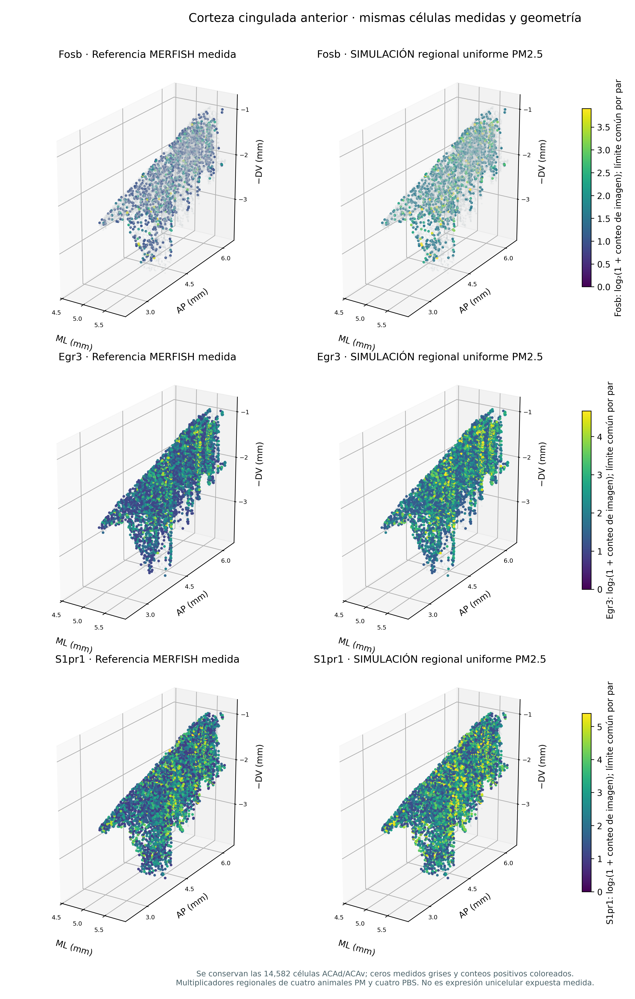
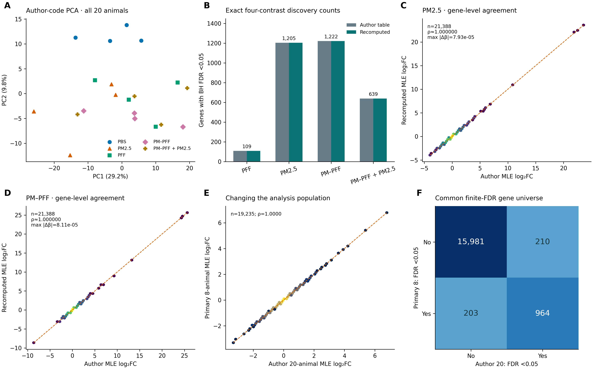
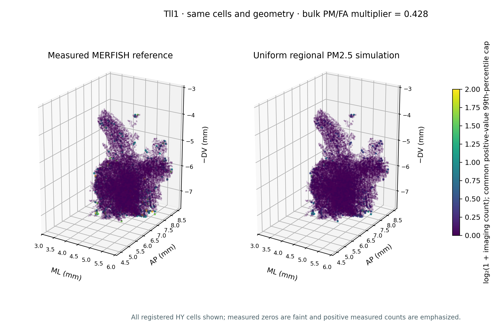

```{python}
from pathlib import Path
import json
import pandas as pd
from IPython.display import display, Markdown, HTML
from _report_utils import ROOT, summary, metric_cards, show_table
h = summary("hypothalamus")
c = summary("cortex")
m = summary("mirna")
v = summary("spatial_viewer")
aca = summary("spatial_cortex")
o = summary("ozone") if (ROOT / "results/ozone/summary.json").exists() else {}
ozone_ready = o.get("complete", False)
```

<p class="research-kicker">ESTUDIO REPRODUCIBLE CON DATOS PÚBLICOS · CUATRO EXPERIMENTOS INDEPENDIENTES</p>

::: {.lead}
¿Cómo difieren los perfiles de expresión de las regiones cerebrales tras la exposición a PM2.5 u ozono y dónde se expresan normalmente los genes afectados? Este informe distingue los contrastes experimentales de una referencia espacial y de un escenario de PM2.5 modelado explícitamente.
:::

```{python}
metric_cards([
    ("Estudios de exposición", "4", "Tres estudios de PM2.5 y uno de ozono"),
    ("Muestras del análisis principal", "48", "Los contrastes se ajustan dentro de cada estudio"),
    ("Genes espaciales medidos", f"{v['measured_genes']:,}", "Panel MERFISH; sin genes imputados"),
    ("Células espaciales registradas", f"{v['hypothalamus_cells']+aca['anterior_cingulate_cells']:,}", "Hipotálamo + cingulada anterior; un donante")
])
if not ozone_ready:
    display(Markdown("> **Análisis en curso:** los tres análisis de PM2.5 y el visor espacial están completos. "
                     "El componente de ozono se está procesando desde sus 24 bibliotecas originales de lecturas pareadas; "
                     "no se infiere ningún resultado diferencial de ozono a partir de la tabla depositada que solo compara genotipos."))
```

## Presentación para defensa

La presentación HTML detalla diseños, reconstrucción de resultados originales, ecuaciones, validación y resultados nuevos del proyecto. Incluye 100 diapositivas por idioma, explicaciones visibles de los modelos y de cómo leer las figuras, notas del presentador y apéndice técnico. Los mapas de hipotálamo y corteza son interactivos dentro de las diapositivas: rote las escenas vinculadas, cambie de gen medido y amplíe el mapa sin salir de la presentación. Se conservan las vistas estáticas.

[Abrir las diapositivas en español](defense.qmd){.btn .btn-primary}
[Open in English](../defense.html){.btn .btn-outline-primary}
[Descargar las dos versiones HTML](../downloads/defense-slides-bilingual.zip){.btn .btn-outline-primary}

## Anatomía espacial y predicción

Explore **cortes físicos, capas de ACA y núcleos hipotalámicos**, junto con mapas de detección medida cuyos denominadores incluyen los ceros. El nuevo capítulo bayesiano evalúa predicciones espaciales en cortes completos reservados y distingue incertidumbre de la media latente y de una nueva célula en un nuevo corte. La referencia sigue siendo un donante sin exposición experimental.

[Cortes, capas y detección →](spatial_explorer.qmd){.btn .btn-primary}
[Validación e incertidumbre bayesianas →](spatial_bayes.qmd){.btn .btn-outline-primary}

## Introducción

Los cuatro estudios miden regiones, exposiciones y ensayos diferentes. Se analizan por separado y no se combinan en un único efecto de la contaminación. El atlas de referencia conserva las ubicaciones celulares y mide 1,122 genes mediante MERFISH, lo que aporta un contexto anatómico para determinadas señales regionales. No proporciona células individuales expuestas. [Leer la introducción](introduction.qmd).

## Metodología

El flujo clásico incluye comprobaciones de fuentes y muestras, distribuciones de conteos o señales, relaciones entre muestras y PCA, expresión diferencial con control de pruebas múltiples, estimación de tamaños de efecto y enriquecimiento funcional cuando las anotaciones génicas lo permiten. El ozono se reprocesa desde las lecturas originales. El modelo 3D utiliza dentro del hipotálamo un multiplicador regional específico para cada gen, derivado del tejido completo, y mantiene fijas las posiciones celulares de referencia. [Leer la metodología](methods.qmd).

## Resultados

```{python}
rows = [
    ["Hipotálamo · PM2.5", "4 FA / 3 PM", f"{h['genes_fdr_below_0_05']:,}", "RNA-seq de tejido completo", "Sensible a animales individuales"],
    ["Corteza cingulada · PM2.5", "4 PBS / 4 PM", f"{c['FDR05_genes']:,}", "RNA-seq de tejido completo", "Modelo y vía de exposición diferentes"],
    ["miRNA hipocampal · PM2.5", "3 control / 3 dosis baja / 3 alta", "1 dosis baja / 0 dosis alta", "Señal normalizada de microarreglo", "Marcado límite inferior de la señal"],
    ["Hipocampo · ozono", "24 bibliotecas; 8 grupos", " / ".join(str(o['contrasts'][k]['fdr_005']) for k in ["M3_E3_O3_vs_FA", "M3_E4_O3_vs_FA", "M17_E3_O3_vs_FA", "M17_E4_O3_vs_FA"]) + " (cuatro estratos)" if ozone_ready else "Procesamiento de lecturas originales en curso", "RNA-seq desde FASTQ", "Diseño edad × genotipo × exposición"],
]
show_table(pd.DataFrame(rows, columns=["Estudio", "Muestras independientes", "FDR < 0.05", "Evidencia", "Límite interpretativo"]), n=10)
if ozone_ready:
    display(Markdown(
        f"Los conteos de ozono siguen el orden de edad inicial/genotipo **M3/APOE3, M3/APOE4, M17/APOE3, M17/APOE4**. "
        f"La prueba global de exposición por razón de verosimilitudes (LRT), separada y con cuatro grados de libertad, identifica **{o['global_LRT']['fdr_005']:,} genes**. "
        "Las diferencias en el número de hallazgos no establecen una interacción con la edad o el genotipo; el estrato sin hallazgos significativos no demuestra ausencia de respuesta."
    ))
```

Estos conteos son hallazgos específicos de cada estudio y no una clasificación de la toxicidad de los contaminantes. Difieren los tamaños muestrales, la composición tisular, los protocolos y la potencia estadística.

::: {.study-grid}
::: {.study-card}
<p class="tag">VÍNCULO PRINCIPAL CON EL VISOR 3D</p>
### Hipotálamo

Siete animales sustentan el contraste de PM2.5. Los once hallazgos principales conservan la dirección de su efecto al omitir una muestra por vez, pero ninguno mantiene significación según FDR en los siete ajustes. No se eliminó selectivamente ningún control.

[Explorar los resultados del hipotálamo →](results.qmd)
:::
::: {.study-card}
<p class="tag">RESPUESTA REGIONAL</p>
### Corteza cingulada

El contraste PM frente a PBS se restringe a ocho ratones humanizados para α-sinucleína. Los brazos de tratamiento con PFF no se combinan con esta comparación de exposición.

[Explorar los resultados de corteza →](cortex.qmd)
:::
::: {.study-card}
<p class="tag">UNA CAPA MOLECULAR DIFERENTE</p>
### miRNA hipocampal

Dos contrastes específicos por dosis conservan la escala de señal normalizada depositada. Los efectos son diferencias de señal media y no conteos de RNA-seq ni cambios de expresión en escala log₂ confirmada.

[Explorar los resultados de miRNA →](mirna.qmd)
:::
::: {.study-card}
<p class="tag">EDAD Y GENOTIPO</p>
### Hipocampo y ozono

Las lecturas pareadas originales se cuantifican frente a una referencia fija de ratón. Un modelo factorial distingue los efectos específicos de edad, genotipo y exposición.

[Explorar los resultados de ozono →](ozone.qmd)
:::
:::

## Genes prioritarios: qué codifican, qué hacen y dónde se miden

[**Explorar productos y funciones génicas →**](gene_profiles.qmd) presenta los 11 hallazgos hipotalámicos, los 20 genes codificantes principales de corteza y listas espaciales seleccionadas, con 46 anotaciones verificadas en fuentes oficiales. Las fichas distinguen genes codificantes, RNA no codificantes y pseudogenes.

[**Corteza 3D: 76 genes significativos medidos →**](cortex_viewer.qmd) incorpora 14,582 células medidas de corteza cingulada anterior y efectos regionales PM/PBS propios. Se pueden explorar Fosb, Egr3, S1pr1 y otros candidatos, además de comparar hasta tres genes en una tabla de evidencia. En hipotálamo hay opciones medidas más allá de Tll1, con etiquetas exploratorias explícitas.

[{.site-overview-image}](cortex_viewer.qmd)

## Reproducir los artículos y examinar la estructura de la respuesta

[**Reproducción de los estudios originales →**](replication.qmd) compara el código depositado y las tablas de genes con ajustes nuevos. El modelo original de corteza con 20 muestras recupera **exactamente los cuatro conjuntos significativos** (109 / 1,205 / 1,222 / 639). En hipotálamo, miRNA y ozono se explicitan los límites de reproducción parcial. Las señales ligadas al cromosoma Y en corteza también plantean una cuestión de calidad que la coincidencia numérica no resuelve.

[**Interacciones y paneles moleculares →**](advanced_results.qmd) agrega pruebas formales de respuesta por edad/genotipo, intervalos que incorporan covarianzas, paneles por animal, una matriz de enriquecimiento GO de seis contrastes y una red de solapamiento de conjuntos. Ocho genes de respuesta por edad superan el umbral de su familia en ozono; **uno** permanece al corregir conjuntamente las tres familias de interacción. Es evidencia secundaria de los mismos animales.

[{.site-overview-image}](replication.qmd)

Cada panel enlaza figuras vectoriales y tablas fuente. Se distingue la reproducción computacional, la interpretación biológica y la simulación espacial.

## Una referencia medida junto a una simulación explícita

```{python}
display(Markdown(
    f"**{v['default_gene']}** es el único hallazgo principal del hipotálamo según FDR medido en este panel MERFISH. "
    f"Su multiplicador regional central es **{v['default_multiplier']:.3f}×**. El visor contiene "
    f"**{v['measured_genes']:,} genes medidos**, con estimaciones fiables del efecto regional para "
    f"**{v['genes_with_estimable_bulk_effect']:,}** de ellos; los genes no significativos se identifican como exploratorios."
))
```

[{.site-overview-image}](viewer.qmd)

::: {.model-note}
**Es un escenario modelado, no datos espaciales de exposición.** El donante del atlas no es un control experimental de los siete animales del análisis de tejido completo. Un multiplicador regional uniforme no identifica qué tipos celulares responden ni modela pérdida celular, desplazamiento o cambios anatómicos.
:::

[Abrir el visor 3D enlazado](viewer.qmd){.btn .btn-primary} [Consultar datos, código y reproducibilidad](reproducibility.qmd){.btn .btn-outline-secondary}

[Consultar la composición celular medida y la detección de Tll1 por clases y subestructuras →](spatial_reference.qmd)
